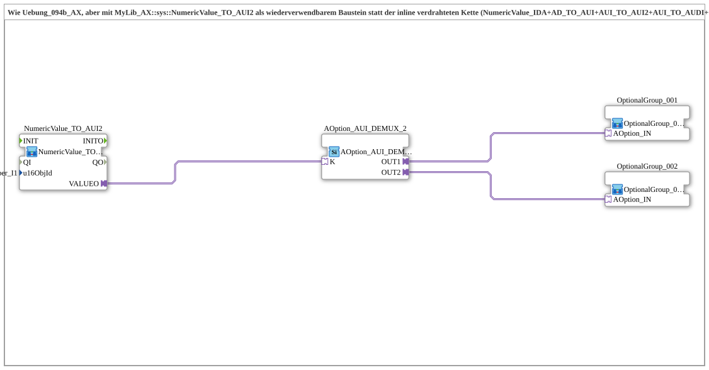

# Exercise_094b4_AX: Option Selection (2 Options) with Reusable Block NumericValue_TO_AUI2

* * * * * * * * * * *

## Introduction

This exercise corresponds to `Uebung_094b_AX` but uses the reusable block [`MyLib::sys::NumericValue_TO_AUI2`](https://meisterschulen-am-ostbahnhof-munchen-docs.readthedocs.io/projects/4diac-library-reference-docs/en/latest/Bibliotheken/ExternalLibraries/MyLib_AX/sys/NumericValue_TO_AUI2/) instead of the inline-wired chain of `NumericValue_IDA`, `AD_TO_AUI`, `AUI_TO_AUI2`, `AUI_TO_AUDI` and `Q_NumericValue_AUDI`. The object ID of the VT field is passed as a SubApp parameter. Selection between two option groups is done by [`AOption_AUI_DEMUX_2`](https://meisterschulen-am-ostbahnhof-munchen-docs.readthedocs.io/projects/4diac-library-reference-docs/en/latest/Bibliotheken/ExternalLibraries/Option/selection/AOption_AUI_DEMUX_2/) (index, single select).

## Function Blocks (FBs) Used

- **NumericValue_TO_AUI2**: reads the VT input field and provides it as a bidirectional AUI2 plug
    - **Type**: [`MyLib::sys::NumericValue_TO_AUI2`](https://meisterschulen-am-ostbahnhof-munchen-docs.readthedocs.io/projects/4diac-library-reference-docs/en/latest/Bibliotheken/ExternalLibraries/MyLib_AX/sys/NumericValue_TO_AUI2/) (SubApp instance)
    - **Parameters**: `u16ObjId = InputNumber_I1`
    - **Explanation**: Reads the VT field and passes the value on via `VALUEO`. The consumer reports the accepted value back via the same plug, and the echo is written back to the VT field.
- **AOption_AUI_DEMUX_2**: option selection with two outputs
    - **Type**: [`Option::selection::AOption_AUI_DEMUX_2`](https://meisterschulen-am-ostbahnhof-munchen-docs.readthedocs.io/projects/4diac-library-reference-docs/en/latest/Bibliotheken/ExternalLibraries/Option/selection/AOption_AUI_DEMUX_2/)
    - **Parameters**: none
    - **Explanation**: Depending on the index `K`, activates exactly one of the outputs `OUT1` or `OUT2`.
- **OptionalGroup_001**, **OptionalGroup_002**: option groups
    - **Type**: [`MyLib_AX_Option::sys::OptionalGroup_001`](https://meisterschulen-am-ostbahnhof-munchen-docs.readthedocs.io/projects/4diac-library-reference-docs/en/latest/Bibliotheken/ExternalLibraries/MyLib_AX_Option/sys/OptionalGroup_001/) and [`MyLib_AX_Option::sys::OptionalGroup_002`](https://meisterschulen-am-ostbahnhof-munchen-docs.readthedocs.io/projects/4diac-library-reference-docs/en/latest/Bibliotheken/ExternalLibraries/MyLib_AX_Option/sys/OptionalGroup_002/) (SubApp instances)
    - **Parameters**: none
    - **Explanation**: Group 1 contains `I1`/`Q1`, group 2 contains `I2`/`Q2`.
- **INI_IN_AND_STORE_AUI2**, **INI_IN_AND_STORE_AUDI2**: persistence blocks
    - **Type**: [`MyLib::sys::INI_IN_AND_STORE_AUI2`](https://meisterschulen-am-ostbahnhof-munchen-docs.readthedocs.io/projects/4diac-library-reference-docs/en/latest/Bibliotheken/ExternalLibraries/MyLib_AX/sys/INI_IN_AND_STORE_AUI2/) and `MyLib::sys::INI_IN_AND_STORE_AUDI2` (SubApp instances)
    - **Parameters**: none
    - **Explanation**: Placed in the network but not attached to any connection; they have no function in this exercise.

## Program Flow and Connections

1. `NumericValue_TO_AUI2.VALUEO` → `AOption_AUI_DEMUX_2.K`: The input field value selects the active output.
2. `AOption_AUI_DEMUX_2.OUT1` → `OptionalGroup_001.OPTION`, `OUT2` → `OptionalGroup_002.OPTION`.

**Behavior**: Index 1 activates group 1, index 2 activates group 2; only one group is active at a time.

## Summary

The read/echo chain is encapsulated in [`MyLib::sys::NumericValue_TO_AUI2`](https://meisterschulen-am-ostbahnhof-munchen-docs.readthedocs.io/projects/4diac-library-reference-docs/en/latest/Bibliotheken/ExternalLibraries/MyLib_AX/sys/NumericValue_TO_AUI2/). The exercise behaves like `Uebung_094b_AX` with a much smaller network. The variant with INI persistence is `Uebung_094b4b_AX`.

---

### 🌐 Related topic subpages on ms-muc-docs.de

- [🌐 Eclipse 4diac IDE & Color Reference on ms-muc-docs.de](https://www.ms-muc-docs.de/iec-61499/eclipse-4diac/)
