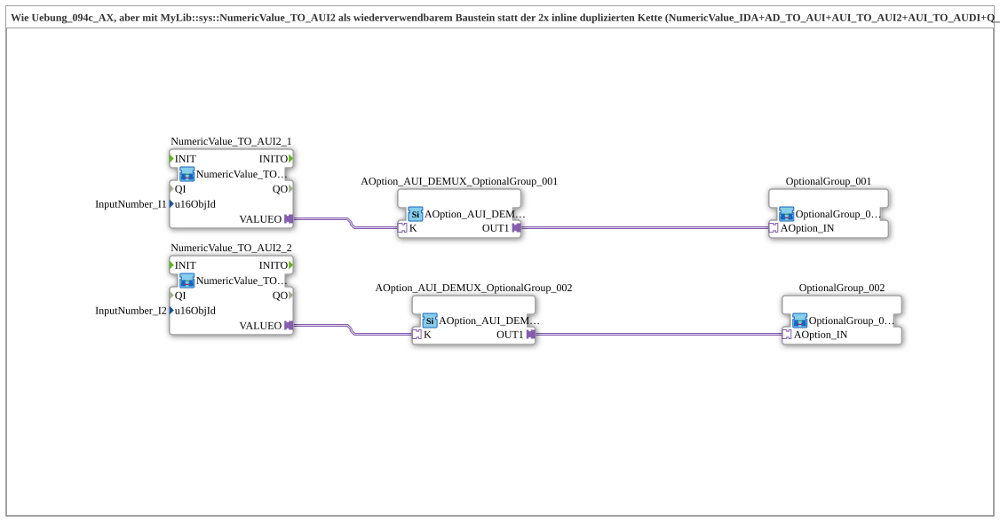

# Uebung_094c2_AX: Dropdown Chain as a Reusable Block

* * * * * * * * * *

## Introduction

Like `Uebung_094c_AX`, but the read/echo chain duplicated per dropdown (`NumericValue_IDA`, `AD_TO_AUI`, `AUI_TO_AUI2`, `AUI_TO_AUDI`, `Q_NumericValue_AUDI`) has been moved into the reusable block [`MyLib::sys::NumericValue_TO_AUI2`](https://meisterschulen-am-ostbahnhof-munchen-docs.readthedocs.io/projects/4diac-library-reference-docs/en/latest/Bibliotheken/ExternalLibraries/MyLib_AX/sys/NumericValue_TO_AUI2/); `u16ObjId` is a sub-app parameter instead of being hard-wired. There is still no mutual exclusion between the two groups.

## Function Blocks (FBs) Used

- **NumericValue_TO_AUI2_1**: Reusable block per dropdown
    - **Type**: [`MyLib::sys::NumericValue_TO_AUI2`](https://meisterschulen-am-ostbahnhof-munchen-docs.readthedocs.io/projects/4diac-library-reference-docs/en/latest/Bibliotheken/ExternalLibraries/MyLib_AX/sys/NumericValue_TO_AUI2/) (sub-app)
    - **Parameters**: `u16ObjId = InputNumber_I1`
    - **Explanation**: Reads the VT input field `InputNumber_I1` and provides the index as bidirectional plug `VALUEO`; the VT write-back is included.
- **NumericValue_TO_AUI2_2**: Reusable block per dropdown
    - **Type**: [`MyLib::sys::NumericValue_TO_AUI2`](https://meisterschulen-am-ostbahnhof-munchen-docs.readthedocs.io/projects/4diac-library-reference-docs/en/latest/Bibliotheken/ExternalLibraries/MyLib_AX/sys/NumericValue_TO_AUI2/) (sub-app)
    - **Parameters**: `u16ObjId = InputNumber_I2`
    - **Explanation**: Reads the VT input field `InputNumber_I2` and provides the index as bidirectional plug `VALUEO`; the VT write-back is included.
- **AOption_AUI_DEMUX_OptionalGroup_001**: Enable for option group 1
    - **Type**: [`Option::selection::AOption_AUI_DEMUX_1`](https://meisterschulen-am-ostbahnhof-munchen-docs.readthedocs.io/projects/4diac-library-reference-docs/en/latest/Bibliotheken/ExternalLibraries/Option/selection/AOption_AUI_DEMUX_1/)
    - **Parameters**: none
    - **Explanation**: Enables option group 1 via `OUT1` (socket `K`).
- **AOption_AUI_DEMUX_OptionalGroup_002**: Enable for option group 2
    - **Type**: [`Option::selection::AOption_AUI_DEMUX_1`](https://meisterschulen-am-ostbahnhof-munchen-docs.readthedocs.io/projects/4diac-library-reference-docs/en/latest/Bibliotheken/ExternalLibraries/Option/selection/AOption_AUI_DEMUX_1/)
    - **Parameters**: none
    - **Explanation**: Enables option group 2 via `OUT1` (socket `K`).
- **OptionalGroup_001**: Option group 1
    - **Type**: [`MyLib_AX_Option::sys::OptionalGroup_001`](https://meisterschulen-am-ostbahnhof-munchen-docs.readthedocs.io/projects/4diac-library-reference-docs/en/latest/Bibliotheken/ExternalLibraries/MyLib_AX_Option/sys/OptionalGroup_001/) (sub-app)
    - **Parameters**: none
    - **Explanation**: Enabled via the `AOption_IN` adapter (QI instead of Permit).
- **OptionalGroup_002**: Option group 2
    - **Type**: [`MyLib_AX_Option::sys::OptionalGroup_002`](https://meisterschulen-am-ostbahnhof-munchen-docs.readthedocs.io/projects/4diac-library-reference-docs/en/latest/Bibliotheken/ExternalLibraries/MyLib_AX_Option/sys/OptionalGroup_002/) (sub-app)
    - **Parameters**: none
    - **Explanation**: Enabled via the `AOption_IN` adapter (QI instead of Permit).

## Program Flow and Connections

1. `NumericValue_TO_AUI2_1.VALUEO` → `AOption_AUI_DEMUX_OptionalGroup_001.K`, then `AOption_AUI_DEMUX_OptionalGroup_001.OUT1` → `OptionalGroup_001.AOption_IN` (dropdown 1).
2. `NumericValue_TO_AUI2_2.VALUEO` → `AOption_AUI_DEMUX_OptionalGroup_002.K`, then `AOption_AUI_DEMUX_OptionalGroup_002.OUT1` → `OptionalGroup_002.AOption_IN` (dropdown 2).

## Summary

The exercise is functionally identical to `Uebung_094c_AX`, but much more compact with only six instead of fourteen instances.

---

### 🌐 Related topic subpages on ms-muc-docs.de

- [🌐 Eclipse 4diac IDE & Color Reference on ms-muc-docs.de](https://www.ms-muc-docs.de/iec-61499/eclipse-4diac/)
