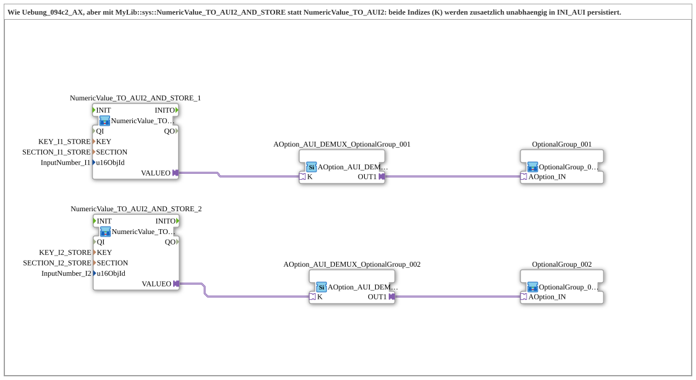

# Uebung_094c2b_AX: Dropdown Chain with INI Persistence

* * * * * * * * * *

## Introduction

Like `Uebung_094c2_AX`, but with [`MyLib::sys::NumericValue_TO_AUI2_AND_STORE`](https://meisterschulen-am-ostbahnhof-munchen-docs.readthedocs.io/projects/4diac-library-reference-docs/en/latest/Bibliotheken/ExternalLibraries/MyLib_AX/sys/NumericValue_TO_AUI2_AND_STORE/) instead of [`NumericValue_TO_AUI2`](https://meisterschulen-am-ostbahnhof-munchen-docs.readthedocs.io/projects/4diac-library-reference-docs/en/latest/Bibliotheken/ExternalLibraries/MyLib_AX/sys/NumericValue_TO_AUI2/): same bidirectional `VALUEO` plug, both indices (K) are additionally persisted independently in `INI_AUI` (`KEY_I1_STORE`/`SECTION_I1_STORE` and `KEY_I2_STORE`/`SECTION_I2_STORE`), analogous to `Uebung_094b3b_AX`/`Uebung_094b4b_AX`.

## Function Blocks (FBs) Used

- **NumericValue_TO_AUI2_AND_STORE_1**: Reusable block per dropdown
    - **Type**: [`MyLib::sys::NumericValue_TO_AUI2_AND_STORE`](https://meisterschulen-am-ostbahnhof-munchen-docs.readthedocs.io/projects/4diac-library-reference-docs/en/latest/Bibliotheken/ExternalLibraries/MyLib_AX/sys/NumericValue_TO_AUI2_AND_STORE/) (sub-app)
    - **Parameters**: `KEY = KEY_I1_STORE`, `SECTION = SECTION_I1_STORE`, `u16ObjId = InputNumber_I1`
    - **Explanation**: Reads the VT input field `InputNumber_I1` and provides the index as bidirectional plug `VALUEO`; the VT write-back is included. In addition the index is persisted independently in `INI_AUI` (key `KEY_I1_STORE`, section `SECTION_I1_STORE`).
- **NumericValue_TO_AUI2_AND_STORE_2**: Reusable block per dropdown
    - **Type**: [`MyLib::sys::NumericValue_TO_AUI2_AND_STORE`](https://meisterschulen-am-ostbahnhof-munchen-docs.readthedocs.io/projects/4diac-library-reference-docs/en/latest/Bibliotheken/ExternalLibraries/MyLib_AX/sys/NumericValue_TO_AUI2_AND_STORE/) (sub-app)
    - **Parameters**: `KEY = KEY_I2_STORE`, `SECTION = SECTION_I2_STORE`, `u16ObjId = InputNumber_I2`
    - **Explanation**: Reads the VT input field `InputNumber_I2` and provides the index as bidirectional plug `VALUEO`; the VT write-back is included. In addition the index is persisted independently in `INI_AUI` (key `KEY_I2_STORE`, section `SECTION_I2_STORE`).
- **AOption_AUI_DEMUX_OptionalGroup_001**: Enable for option group 1
    - **Type**: [`Option::selection::AOption_AUI_DEMUX_1`](https://meisterschulen-am-ostbahnhof-munchen-docs.readthedocs.io/projects/4diac-library-reference-docs/en/latest/Bibliotheken/ExternalLibraries/Option/selection/AOption_AUI_DEMUX_1/)
    - **Parameters**: none
    - **Explanation**: Enables option group 1 via `OUT1` (socket `K`).
- **AOption_AUI_DEMUX_OptionalGroup_002**: Enable for option group 2
    - **Type**: [`Option::selection::AOption_AUI_DEMUX_1`](https://meisterschulen-am-ostbahnhof-munchen-docs.readthedocs.io/projects/4diac-library-reference-docs/en/latest/Bibliotheken/ExternalLibraries/Option/selection/AOption_AUI_DEMUX_1/)
    - **Parameters**: none
    - **Explanation**: Enables option group 2 via `OUT1` (socket `K`).
- **OptionalGroup_001**: Option group 1
    - **Type**: [`MyLib_AX_Option::sys::OptionalGroup_001`](https://meisterschulen-am-ostbahnhof-munchen-docs.readthedocs.io/projects/4diac-library-reference-docs/en/latest/Bibliotheken/ExternalLibraries/MyLib_AX_Option/sys/OptionalGroup_001/) (sub-app)
    - **Parameters**: none
    - **Explanation**: Enabled via the `OPTION` adapter (QI instead of Permit).
- **OptionalGroup_002**: Option group 2
    - **Type**: [`MyLib_AX_Option::sys::OptionalGroup_002`](https://meisterschulen-am-ostbahnhof-munchen-docs.readthedocs.io/projects/4diac-library-reference-docs/en/latest/Bibliotheken/ExternalLibraries/MyLib_AX_Option/sys/OptionalGroup_002/) (sub-app)
    - **Parameters**: none
    - **Explanation**: Enabled via the `OPTION` adapter (QI instead of Permit).

## Program Flow and Connections

1. `NumericValue_TO_AUI2_AND_STORE_1.VALUEO` → `AOption_AUI_DEMUX_OptionalGroup_001.K`, then `AOption_AUI_DEMUX_OptionalGroup_001.OUT1` → `OptionalGroup_001.OPTION` (dropdown 1).
2. `NumericValue_TO_AUI2_AND_STORE_2.VALUEO` → `AOption_AUI_DEMUX_OptionalGroup_002.K`, then `AOption_AUI_DEMUX_OptionalGroup_002.OUT1` → `OptionalGroup_002.OPTION` (dropdown 2).

## Summary

Compared to `Uebung_094c2_AX`, only the block type and the additional parameters `KEY` and `SECTION` change; the wiring stays identical.

---

### 🌐 Related topic subpages on ms-muc-docs.de

- [🌐 Eclipse 4diac IDE & Color Reference on ms-muc-docs.de](https://www.ms-muc-docs.de/iec-61499/eclipse-4diac/)
