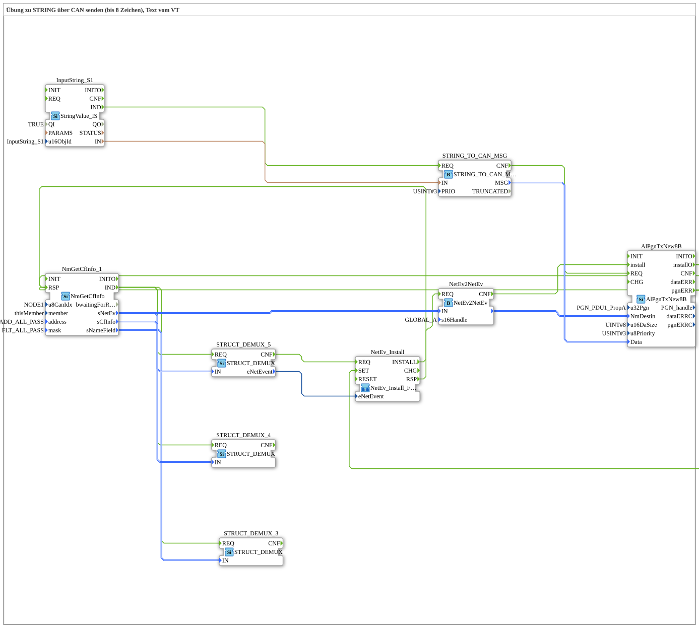

# Uebung_136b_AX: Übung zu STRING über CAN senden (bis 8 Zeichen), Text vom VT

This article describes the 4diac IDE sub-application Uebung_136b_AX (Übung zu STRING über CAN senden (bis 8 Zeichen), Text vom VT).

----

## Objective of the Exercise

The main objective of this exercise is to implement the following requirement: **Übung zu STRING über CAN senden (bis 8 Zeichen), Text vom VT**

-----

## Description and Components

The exercise consists of the sub-application Uebung_136b_AX.SUB, which uses the following function block structure:

### Instantiated Function Blocks (FBs)

- **STRUCT_DEMUX_3**: Instance of type eclipse4diac::convert::STRUCT_DEMUX.
- **NmGetCfInfo_1**: Instance of type isobus::pgn::NmGetCfInfo.
  - Parameter u8CanIdx = NODE1
  - Parameter member = thisMember
  - Parameter address = ADD_ALL_PASS
  - Parameter mask = FLT_ALL_PASS
- **STRUCT_DEMUX_4**: Instance of type eclipse4diac::convert::STRUCT_DEMUX.
- **STRUCT_DEMUX_5**: Instance of type eclipse4diac::convert::STRUCT_DEMUX.
- **NetEv2NetEv**: Instance of type isobus::pgn::NetEv2NetEv.
  - Parameter s16Handle = GLOBAL_A
- **STRING_TO_CAN_MSG**: Instance of type isobus::pgn::STRING_TO_CAN_MSG.
  - Parameter PRIO = 3
- **AlPgnTxNew8B**: Instance of type isobus::pgn::tx::AlPgnTxNew8B.
  - Parameter u32Pgn = PGN_PDU1_PropA
  - Parameter u16DaSize = 8
  - Parameter u8Priority = 3
- **InputString_S1**: Instance of type isobus::UT::io::StringValue::StringValue_IS.
  - Parameter QI = TRUE
  - Parameter u16ObjId = InputString_S1
- **NetEv_Install**: Nested sub-application (SubApp) MyLib::sys::NetEv_Install_Filter.

The exercise uses the common pattern with `NmGetCfInfo` (IND/RSP): `IND` triggers `STRUCT_DEMUX`, `NetEv_Install` handles the event and acknowledges with `RSP`.

-----

## Summary

Exercise Uebung_136b_AX demonstrates the modular IEC 61499 architecture in 4diac IDE.
