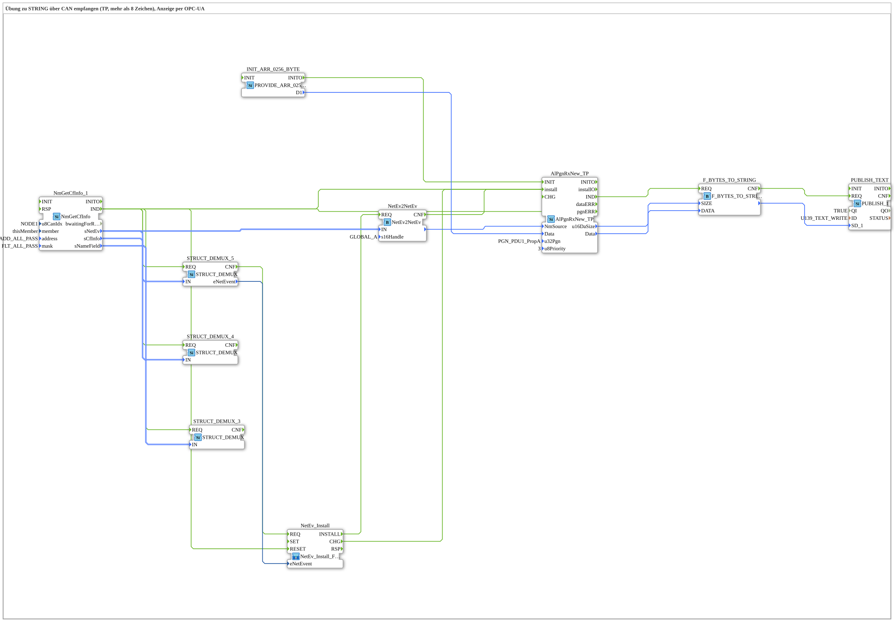

# Uebung_139c_AX: Übung zu STRING über CAN empfangen (TP, mehr als 8 Zeichen), Anzeige per OPC-UA

This article describes the 4diac IDE sub-application Uebung_139c_AX (Übung zu STRING über CAN empfangen (TP, mehr als 8 Zeichen), Anzeige per OPC-UA).

----

## Objective of the Exercise

The main objective of this exercise is to implement the following requirement: **Übung zu STRING über CAN empfangen (TP, mehr als 8 Zeichen), Anzeige per OPC-UA**

-----

## Description and Components

The exercise consists of the sub-application Uebung_139c_AX.SUB, which uses the following function block structure:

### Instantiated Function Blocks (FBs)

- **STRUCT_DEMUX_3**: Instance of type eclipse4diac::convert::STRUCT_DEMUX.
- **NmGetCfInfo_1**: Instance of type isobus::pgn::NmGetCfInfo.
  - Parameter u8CanIdx = NODE1
  - Parameter member = thisMember
  - Parameter address = ADD_ALL_PASS
  - Parameter mask = FLT_ALL_PASS
- **STRUCT_DEMUX_4**: Instance of type eclipse4diac::convert::STRUCT_DEMUX.
- **STRUCT_DEMUX_5**: Instance of type eclipse4diac::convert::STRUCT_DEMUX.
- **NetEv2NetEv**: Instance of type isobus::pgn::NetEv2NetEv.
  - Parameter s16Handle = GLOBAL_A
- **INIT_ARR_0256_BYTE**: Instance of type eclipse4diac::convert::providers::PROVIDE_ARR_0256_BYTE.
- **AlPgnRxNew_TP**: Instance of type isobus::pgn::rx::AlPgnRxNew_TP.
  - Parameter u32Pgn = PGN_PDU1_PropA
  - Parameter u8Priority = 3
- **F_BYTES_TO_STRING**: Instance of type logiBUS::utils::dyn_arr::F_BYTES_TO_STRING.
- **PUBLISH_TEXT**: Instance of type iec61499::net::PUBLISH_1.
  - Parameter QI = TRUE
  - Parameter ID = U139_TEXT_WRITE
- **NetEv_Install**: Nested sub-application (SubApp) MyLib::sys::NetEv_Install_Filter.

The exercise uses the common pattern with `NmGetCfInfo` (IND/RSP): `IND` triggers `STRUCT_DEMUX`, `NetEv_Install` handles the event and acknowledges with `RSP`.

-----

## Summary

Exercise Uebung_139c_AX demonstrates the modular IEC 61499 architecture in 4diac IDE.
