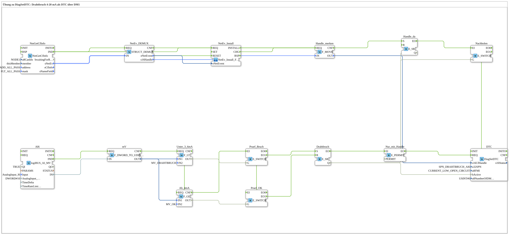

# Uebung_141_AX: Exercise on DiagSetDTC (wire break 4–20 mA as DTC via DM1)

This article describes the logiBUS® exercise `Uebung_141_AX`.

----

## Objective of the Exercise

A wire break on a 4–20 mA input is reported as a diagnostic trouble code (DTC) via the diagnostic message DM1. The block `DiagSetDTC` is used.

-----

## Description and Components

### Function Blocks (FBs)

- `AI6`: `logiBUS::io::AI::logiBUS_AI_MV`, delivers the voltage at the pin in mV (input `AnalogInput_I6`, 4–20 mA through a 500 Ω burden, effectively 491.2 Ω).
- `mV`, `Unter_3_6mA`, `Ab_4mA`: `F_DWORD_TO_UDINT` and the comparators `F_LT` / `F_GE` against the constants `MV_DRAHTBRUCH` and `MV_OK`.
- `Pruef_Bruch`, `Pruef_OK`, `Drahtbruch`: `E_SWITCH` and `E_SR`. The output of `Drahtbruch` fires only on a state change.
- `NmGetCfInfo` (`member = thisMember`) and `Handle_merken` (`F_MOVE`): deliver and store the own CF handle (`s16Handle`).
- `Handle_da` (`E_SR`), `Nur_mit_Handle` (`E_PERMIT`), `Nachholen` (`E_SWITCH`): the DTC is only sent once the handle is known. If the wire break was already present before, it is caught up.
- `DTC`: `isobus::pgn::diag::DiagSetDTC` with `u32SPN = SPN_DRAHTBRUCH_AI6` (520192), `u8FMI = CURRENT_LOW_OPEN_CIRCUIT` (5) and `u8NumberOfDM1Messages = 0`.

The exercise uses the common pattern with `NmGetCfInfo` (IND/RSP): `IND` triggers `STRUCT_DEMUX`, `NetEv_Install` (`MyLib::sys::NetEv_Install_Filter`) handles the event and always acknowledges with `RSP` (the RSP connections are hidden in the IDE). `INIT` is left unconnected as `EInit`.

-----

## Sequence and Operation

1. The thresholds are in `Diag.gcf`: below 564 mV (3.6 mA) the input counts as broken, from 626 mV (4 mA) as OK, in between the last state is kept (hysteresis). The values are calculated (4 mA = 626.4 mV, 3.6 mA = 563.8 mV), not measured.
2. Every new mV value from `AI6` passes through the two comparators. `Drahtbruch` (`E_SR`) is set on a break and reset when OK.
3. On every state change `DTC.REQ` triggers, `bActive` is the state of `Drahtbruch.Q`.
4. The own CF handle comes from `NmGetCfInfo` (`thisMember`, on `Active` and `NewAddress`) and goes to `DTC.s16CfHandle`.
5. The output `s16Status` of `DiagSetDTC` shows 0 on success. `E_CONFIG` means the firmware was built without `ISO_DIAG_ENABLE_DM1`.

-----

## Expected Behavior

- Cable off: DM1 with SPN 520192 and FMI 5 (`CURRENT_LOW_OPEN_CIRCUIT`), every second.
- Cable back on: the DTC is inactive, afterwards it is listed in DM2 and can be cleared with DM3 (expected).
- The occurrence count rises on every activation.

No hardware results are documented: the exercise has not been tested on hardware yet. Statements about the behavior come from the comment in the exercise network and are to be read as expected.

-----

## Application Example

Monitoring of 4–20 mA sensors (pressure, level): if the current drops below 3.6 mA, the controller reports a wire break to the terminal or diagnostic tool instead of continuing with a wrong measured value.

