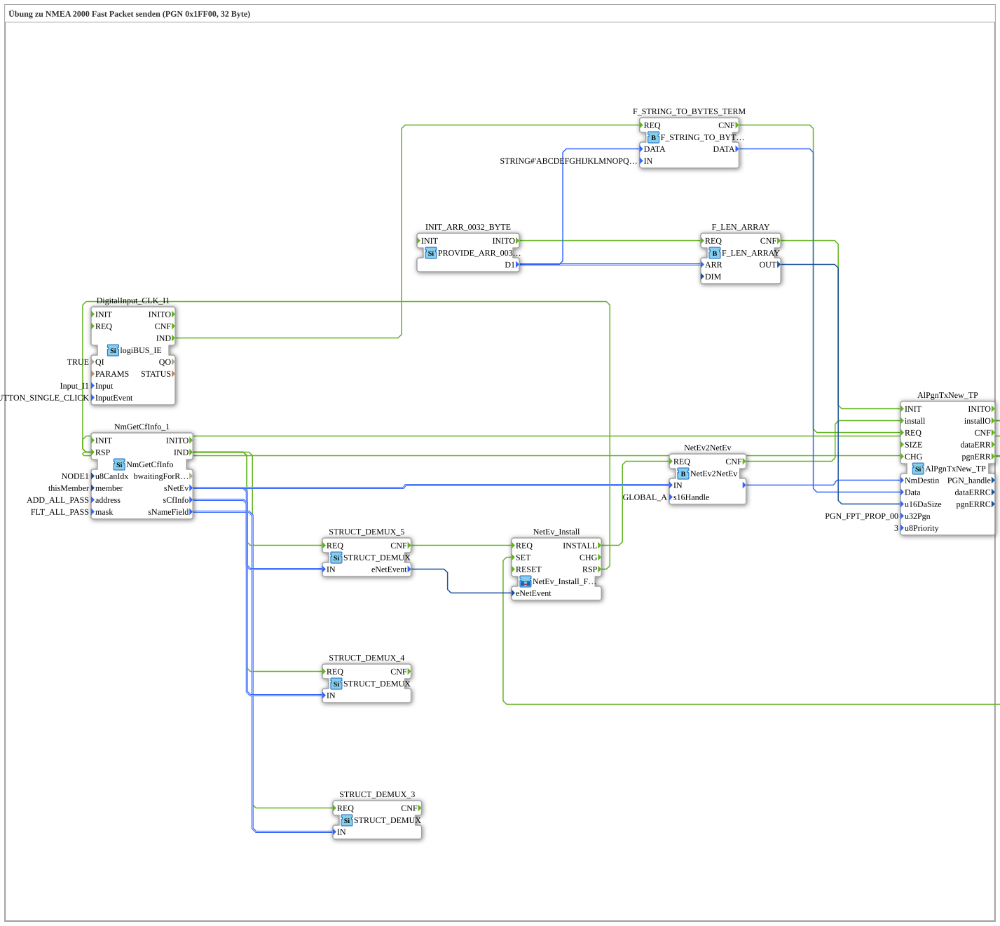

# Uebung_142_AX: Exercise on sending NMEA 2000 Fast Packet (PGN 0x1FF00, 32 bytes)

This article describes the logiBUS® exercise `Uebung_142_AX`.

----

## Objective of the Exercise

A PGN in the proprietary range `0x1FF00` with 32 bytes is sent as Fast Packet, not via ISO-TP, so without RTS/CTS.

-----

## Description and Components

### Function Blocks (FBs)

- `DigitalInput_CLK_I1`: `logiBUS_IE` on `I1`, event `BUTTON_SINGLE_CLICK`, triggers sending.
- `F_STRING_TO_BYTES_TERM`: converts the text `ABCDEFGHIJKLMNOPQRSTUVWXYZ01234` to bytes. `INIT_ARR_0032_BYTE` provides the 32-byte buffer, `F_LEN_ARRAY` the length.
- `AlPgnTxNew_TP`: `isobus::pgn::tx::AlPgnTxNew_TP` with `u32Pgn = PGN_FPT_PROP_00` (0x1FF00) and `u8Priority = 3`. The destination is global (`NetEv2NetEv` with `s16Handle = GLOBAL_A`).
- `NmGetCfInfo_1`, `STRUCT_DEMUX_*`, `NetEv_Install`: pattern with `thisMember`.

The exercise uses the common pattern with `NmGetCfInfo` (IND/RSP): `IND` triggers `STRUCT_DEMUX`, `NetEv_Install` (`MyLib::sys::NetEv_Install_Filter`) handles the event and always acknowledges with `RSP` (the RSP connections are hidden in the IDE). `INIT` is left unconnected as `EInit`.

-----

## Sequence and Operation

1. A click on `I1` sends the text including the terminating byte `16#00` (32 bytes) as Fast Packet.
2. On the bus, frames with the CAN ID of PGN `0x1FF00` are expected: frame 0 contains the sequence and frame counter in byte 0, the length 32 (`0x20`) in byte 1 and then `ABCDEF`. Frames 1 to 4 each have the counter and 7 data bytes: `GHIJKLM`, `NOPQRST`, `UVWXYZ0`, `1234 00 FF FF`.
3. PGNs in the range `0x1F000` to `0x1FFFF` with more than 8 bytes go as Fast Packet, always as broadcast. Proprietary A (`0xEF00`) stays ISO-TP.
4. The counterpart is exercise 143.

-----

## Expected Behavior

- After the click a bus trace shows five frames with the structure described above (expected).
- More on the protocol: [NMEA 2000 Fast Packet](https://meisterschulen-am-ostbahnhof-munchen-docs.readthedocs.io/projects/isobus-other-docs/en/latest/NMEA2000-Fast-Packet/).

No hardware results are documented: the exercise has not been tested on hardware yet. Statements about the behavior come from the comment in the exercise network and are to be read as expected.

-----

## Application Example

Manufacturer-specific data of more than 8 bytes that a device sends to all without a connection setup, for example status values.

