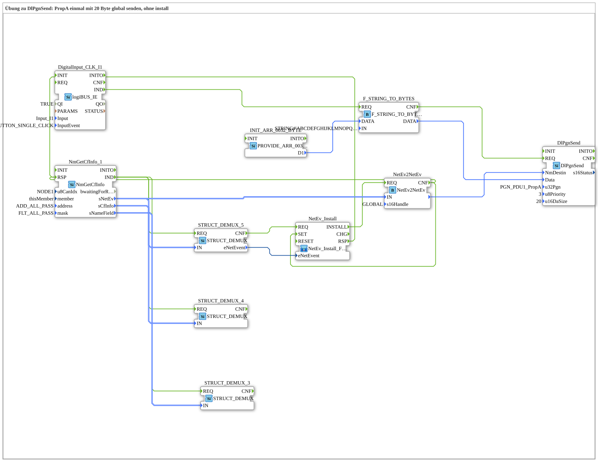

# Uebung_147_AX: Exercise on DlPgnSend (send a PGN once, without install)

This article describes the logiBUS® exercise `Uebung_147_AX`.

----

## Objective of the Exercise

A PGN is sent once without installing it first. Here: Proprietary A with 20 bytes, global.

-----

## Description and Components

### Function Blocks (FBs)

- `DlPgnSend`: `isobus::pgn::tx::DlPgnSend` with `u32Pgn = PGN_PDU1_PropA`, `u8Priority = 3`, `u16DaSize = 20`.
- `DigitalInput_CLK_I1`: a click on `I1` sends.
- `F_STRING_TO_BYTES_TERM` and `INIT_ARR_0032_BYTE`: text `ABCDEFGHIJKLMNOPQRS` plus `16#00` (20 bytes).
- `NmGetCfInfo_1` (`thisMember`) and `NetEv2NetEv` (`s16Handle = GLOBAL`): produce the `NmDestin`. `s16OwnCfHnd` is the sender, `s16Handle = HANDLE::GLOBAL` the destination.

The exercise uses the common pattern with `NmGetCfInfo` (IND/RSP): `IND` triggers `STRUCT_DEMUX`, `NetEv_Install` (`MyLib::sys::NetEv_Install_Filter`) handles the event and always acknowledges with `RSP` (the RSP connections are hidden in the IDE). `INIT` is left unconnected as `EInit`.

-----

## Sequence and Operation

1. The own handle comes from `NmGetCfInfo` (`thisMember`, on `Active`).
2. A click on `I1` sends Proprietary A (`0xEF00`) with 20 bytes globally. More than 8 bytes go via TP BAM.
3. `s16Status = 0` means OK. Up to 1785 bytes are possible, more gives `E_RANGE`.

-----

## Expected Behavior

- Exercise 139 serves as receiver and shows the text (expected).

No hardware results are documented: the exercise has not been tested on hardware yet. Statements about the behavior come from the comment in the exercise network and are to be read as expected.

-----

## Application Example

Rare single messages for which a permanent registration is not worthwhile.

