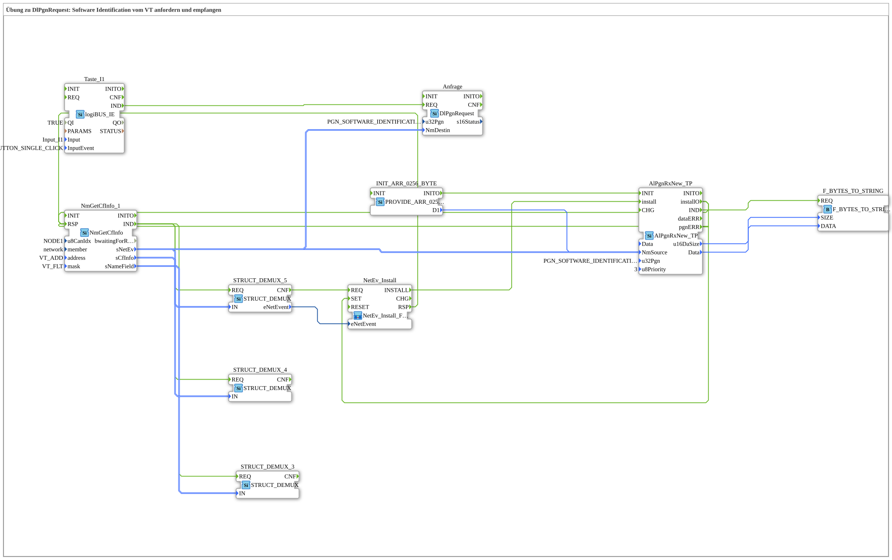

# Uebung_148_AX: Exercise on DlPgnRequest (request Software Identification from the VT)

This article describes the logiBUS® exercise `Uebung_148_AX`.

----

## Objective of the Exercise

The Software Identification (PGN `0xFEDA`) is requested from the Virtual Terminal. The response is received and shown as text.

-----

## Description and Components

### Function Blocks (FBs)

- `Taste_I1`: a click on `I1` triggers the request.
- `Anfrage`: `isobus::pgn::tx::DlPgnRequest` with `u32Pgn = PGN_SOFTWARE_IDENTIFICATION`. It sends a request (PGN `0xEA00`) to the VT.
- `NmGetCfInfo_1`: `member = network`, `address = VT_ADD`, `mask = VT_FLT`, reports the VT (`NmDestin` from `sNetEv`).
- `AlPgnRxNew_TP`: receives `PGN_SOFTWARE_IDENTIFICATION` from the VT. `INIT_ARR_0256_BYTE` provides the receive buffer.
- `F_BYTES_TO_STRING`: turns the received bytes into a text for the watch window.

The exercise uses the common pattern with `NmGetCfInfo` (IND/RSP): `IND` triggers `STRUCT_DEMUX`, `NetEv_Install` (`MyLib::sys::NetEv_Install_Filter`) handles the event and always acknowledges with `RSP` (the RSP connections are hidden in the IDE). `INIT` is left unconnected as `EInit`.

-----

## Sequence and Operation

1. `NmGetCfInfo` reports the VT, `AlPgnRxNew_TP` is installed on `0xFEDA` from it.
2. A click on `I1` triggers `Anfrage.REQ`, the request goes to the VT. `s16Status = 0` means OK.
3. The response usually comes via TP. The watch shows `u16DaSize` and the text from `F_BYTES_TO_STRING`, the fields are separated by `*`.

-----

## Expected Behavior

- Which fields the VT delivers depends on the terminal and is not documented here.

No hardware results are documented: the exercise has not been tested on hardware yet. Statements about the behavior come from the comment in the exercise network and are to be read as expected.

-----

## Application Example

Reading manufacturer and version information of other participants, for example for diagnostics or compatibility checks.

