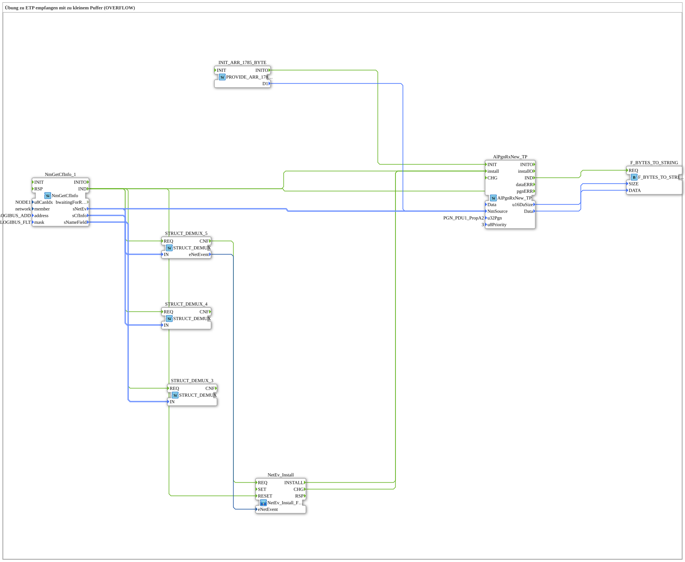

# Uebung_149c_AX: Übung zu ETP empfangen mit zu kleinem Puffer (OVERFLOW)

This article describes the 4diac IDE sub-application Uebung_149c_AX (Übung zu ETP empfangen mit zu kleinem Puffer (OVERFLOW)).

----

## Objective of the Exercise

The main objective of this exercise is to implement the following requirement: **Übung zu ETP empfangen mit zu kleinem Puffer (OVERFLOW)**

-----

## Description and Components

The exercise consists of the sub-application Uebung_149c_AX.SUB, which uses the following function block structure:

### Instantiated Function Blocks (FBs)

- **STRUCT_DEMUX_3**: Instance of type eclipse4diac::convert::STRUCT_DEMUX.
- **NmGetCfInfo_1**: Instance of type isobus::pgn::NmGetCfInfo.
  - Parameter u8CanIdx = NODE1
  - Parameter member = network
  - Parameter address = LOGIBUS_ADD
  - Parameter mask = LOGIBUS_FLT
- **STRUCT_DEMUX_4**: Instance of type eclipse4diac::convert::STRUCT_DEMUX.
- **STRUCT_DEMUX_5**: Instance of type eclipse4diac::convert::STRUCT_DEMUX.
- **INIT_ARR_1785_BYTE**: Instance of type eclipse4diac::convert::providers::PROVIDE_ARR_1785_BYTE.
- **AlPgnRxNew_TP**: Instance of type isobus::pgn::rx::AlPgnRxNew_TP.
  - Parameter u32Pgn = PGN_PDU1_PropA2
  - Parameter u8Priority = 3
- **F_BYTES_TO_STRING**: Instance of type logiBUS::utils::dyn_arr::F_BYTES_TO_STRING.
- **NetEv_Install**: Nested sub-application (SubApp) MyLib::sys::NetEv_Install_Filter.

The exercise uses the common pattern with `NmGetCfInfo` (IND/RSP): `IND` triggers `STRUCT_DEMUX`, `NetEv_Install` handles the event and acknowledges with `RSP`.

-----

## Sequence and expected behavior (from the comment in the network)

- ETP empfangen mit zu kleinem Puffer: PGN PropA2 0x1EF00 (Sender: Übung 149)
- Der Partner sendet 4000 Byte, der Puffer hat nur 1785 Byte.
- Watch: u16DaSize = 4000 (echte Länge), OVERFLOW = TRUE, Data ist nach 1785 Byte abgeschnitten.
- Firmware ab LOGIBUS 24534469 auf BEIDEN Geräten.

Note: The exercise has not been tested on hardware yet. The description comes from the sub-application and its comment, the behavior is to be read as expected.

-----

## Summary

Exercise Uebung_149c_AX demonstrates the modular IEC 61499 architecture in 4diac IDE.
