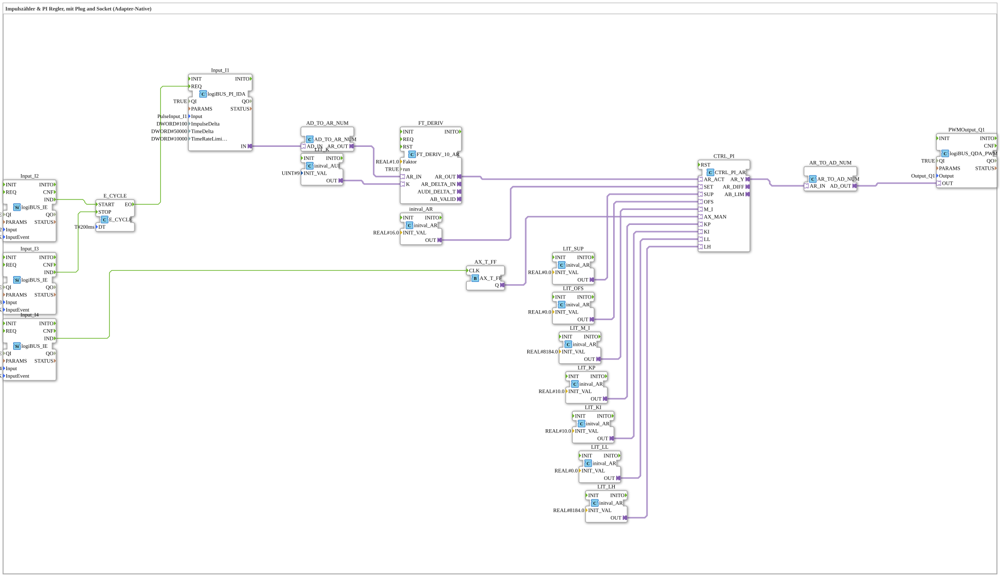

# Exercise_152_AX: Pulse Counter and PI Controller with Plug and Socket (Adapter Native)

* * * * * * * * * *

## Introduction

This exercise measures pulses on `I8`, derives the derivative from them (`FT_DERIV_10_AR`), controls it with a PI controller (`CTRL_PI_AR`) to a setpoint and outputs the manipulated variable as a PWM signal at `Q1`. The entire signal chain is adapter native: actual value, setpoint, manual switch and all controller parameters are supplied via adapter sockets, and the fixed values come from `initval_AR`/`initval_AUI` constant blocks.

## Function Blocks (FBs) Used

- **DigitalInput_I2**: Click input: start measurement
    - **Type**: [`logiBUS::io::DI::logiBUS_IE`](https://meisterschulen-am-ostbahnhof-munchen-docs.readthedocs.io/projects/4diac-library-reference-docs/en/latest/Bibliotheken/ExternalLibraries/logiBUS/io/DI/logiBUS_IE/)
    - **Parameters**: `QI = TRUE`, `Input = Input_I2`, `InputEvent = BUTTON_SINGLE_CLICK`
    - **Explanation**: Reports a single click on `I2` as event `IND`.
- **DigitalInput_I3**: Click input: stop measurement
    - **Type**: [`logiBUS::io::DI::logiBUS_IE`](https://meisterschulen-am-ostbahnhof-munchen-docs.readthedocs.io/projects/4diac-library-reference-docs/en/latest/Bibliotheken/ExternalLibraries/logiBUS/io/DI/logiBUS_IE/)
    - **Parameters**: `QI = TRUE`, `Input = Input_I3`, `InputEvent = BUTTON_SINGLE_CLICK`
    - **Explanation**: Reports a single click on `I3` as event `IND`.
- **E_CYCLE**: Sampling clock
    - **Type**: `iec61499::events::E_CYCLE`
    - **Parameters**: `DT = T#200ms`
    - **Explanation**: After `START`, generates an event `EO` every 200 ms until `STOP` arrives.
- **logiBUS_PI_IDA**: Pulse input
    - **Type**: [`logiBUS::io::PI::logiBUS_PI_IDA`](https://meisterschulen-am-ostbahnhof-munchen-docs.readthedocs.io/projects/4diac-library-reference-docs/en/latest/Bibliotheken/ExternalLibraries/logiBUS/io/PI/logiBUS_PI_IDA/)
    - **Parameters**: `QI = TRUE`, `Input = PulseInput_I8`, `ImpulseDelta = 100`, `TimeDelta = 50000`, `TimeRateLimit = 10000`
    - **Explanation**: Counts the pulses on `I8` and outputs them via the adapter `IN` on every request (`REQ`).
- **AD_TO_AR_NUM**: Adapter conversion
    - **Type**: [`adapter::conversion::unidirectional::AD_TO_AR_NUM`](https://meisterschulen-am-ostbahnhof-munchen-docs.readthedocs.io/projects/4diac-library-reference-docs/en/latest/Bibliotheken/ExternalLibraries/adapter/conversion/unidirectional/AD_AR/AD_TO_AR_NUM/)
    - **Parameters**: none
    - **Explanation**: Converts the `AD` adapter value into an `AR` adapter value (REAL).
- **LIT_K**: Constant for the derivative window
    - **Type**: [`adapter::types::unidirectional::AUI::initval::initval_AUI`](https://meisterschulen-am-ostbahnhof-munchen-docs.readthedocs.io/projects/4diac-library-reference-docs/en/latest/Bibliotheken/ExternalLibraries/adapter/types/unidirectional/UINT/initval/initval_AUI/)
    - **Parameters**: `INIT_VAL = 9`
    - **Explanation**: Provides the constant `9` as `AUI` adapter value to `FT_DERIV.K`.
- **FT_DERIV**: Derivative (speed from pulses)
    - **Type**: `OSCAT_adapter::Control::FT_DERIV_10_AR`
    - **Parameters**: `Faktor = 1.0`, `run = TRUE`
    - **Explanation**: AR adapter wrapper around OSCAT `FT_DERIV_10`: forms the derivative of the input signal (`AR_IN`). The window is selected via the adapter `K` (`0` = 1 period, `9` = 10 periods).
- **DigitalInput_I1**: Click input: manual/automatic
    - **Type**: [`logiBUS::io::DI::logiBUS_IE`](https://meisterschulen-am-ostbahnhof-munchen-docs.readthedocs.io/projects/4diac-library-reference-docs/en/latest/Bibliotheken/ExternalLibraries/logiBUS/io/DI/logiBUS_IE/)
    - **Parameters**: `QI = TRUE`, `Input = Input_I1`, `InputEvent = BUTTON_SINGLE_CLICK`
    - **Explanation**: Reports a single click on `I1` as event `IND`.
- **AX_T_FF**: Toggle flip-flop
    - **Type**: [`adapter::events::unidirectional::AX_T_FF`](https://meisterschulen-am-ostbahnhof-munchen-docs.readthedocs.io/projects/4diac-library-reference-docs/en/latest/Bibliotheken/ExternalLibraries/adapter/events/unidirectional/BOOL/AX_T_FF/)
    - **Parameters**: none
    - **Explanation**: Toggles the state of `Q` on every `CLK` event.
- **initval_AR**: Setpoint
    - **Type**: [`adapter::types::unidirectional::AR::initval::initval_AR`](https://meisterschulen-am-ostbahnhof-munchen-docs.readthedocs.io/projects/4diac-library-reference-docs/en/latest/Bibliotheken/ExternalLibraries/adapter/types/unidirectional/REAL/initval/initval_AR/)
    - **Parameters**: `INIT_VAL = 16.0`
    - **Explanation**: Provides the setpoint `16.0` to `CTRL_PI.SET`.
- **LIT_SUP, LIT_OFS, LIT_M_I, LIT_KP, LIT_KI, LIT_LL, LIT_LH**: Constants for the controller parameters
    - **Type**: [`adapter::types::unidirectional::AR::initval::initval_AR`](https://meisterschulen-am-ostbahnhof-munchen-docs.readthedocs.io/projects/4diac-library-reference-docs/en/latest/Bibliotheken/ExternalLibraries/adapter/types/unidirectional/REAL/initval/initval_AR/)
    - **Parameters**: `INIT_VAL` = `0.0` (`LIT_SUP`), `0.0` (`LIT_OFS`), `8184.0` (`LIT_M_I`), `10.0` (`LIT_KP`), `10.0` (`LIT_KI`), `0.0` (`LIT_LL`), `8184.0` (`LIT_LH`)
    - **Explanation**: Provide as `AR` adapter values: noise suppression `SUP`, offset `OFS`, manual value `M_I`, proportional gain `KP`, integral gain `KI`, lower limit `LL` and upper limit `LH` to `CTRL_PI`.
- **CTRL_PI**: PI controller
    - **Type**: `OSCAT_adapter::Control::CTRL_PI_AR`
    - **Parameters**: none
    - **Explanation**: AR adapter wrapper around OSCAT `CTRL_PI`: actual value (`AR_ACT`), setpoint (`SET`), manual switch (`AX_MAN`) and all controller parameters are adapter sockets; the manipulated variable is available at the adapter `AR_Y`.
- **AR_TO_AD_NUM**: Adapter conversion
    - **Type**: [`adapter::conversion::unidirectional::AR_TO_AD_NUM`](https://meisterschulen-am-ostbahnhof-munchen-docs.readthedocs.io/projects/4diac-library-reference-docs/en/latest/Bibliotheken/ExternalLibraries/adapter/conversion/unidirectional/AD_AR/AR_TO_AD_NUM/)
    - **Parameters**: none
    - **Explanation**: Converts the `AR` manipulated variable into an `AD` adapter value.
- **PWMOutput_Q1**: PWM output
    - **Type**: [`logiBUS::io::DQ::logiBUS_QDA_PWM`](https://meisterschulen-am-ostbahnhof-munchen-docs.readthedocs.io/projects/4diac-library-reference-docs/en/latest/Bibliotheken/ExternalLibraries/logiBUS/io/DO/logiBUS_QDA_PWM/)
    - **Parameters**: `QI = TRUE`, `Output = Output_Q1`
    - **Explanation**: Outputs the manipulated variable as a PWM signal at the physical output `Q1`.

## Program Flow and Connections

1. `DigitalInput_I2.IND` → `E_CYCLE.START` and `DigitalInput_I3.IND` → `E_CYCLE.STOP` (EventConnections): `I2` starts, `I3` stops the 200 ms clock.
2. `E_CYCLE.EO` → `logiBUS_PI_IDA.REQ` (EventConnection): With every clock, the pulse input is queried.
3. `logiBUS_PI_IDA.IN` → `AD_TO_AR_NUM.AD_IN` and `AD_TO_AR_NUM.AR_OUT` → `FT_DERIV.AR_IN` (AdapterConnections): The pulse value is converted into an `AR` value and fed to the derivative. `LIT_K.OUT` → `FT_DERIV.K` defines the window.
4. `FT_DERIV.AR_OUT` → `CTRL_PI.AR_ACT` (AdapterConnection): The derivative is the actual value of the controller; `initval_AR.OUT` → `CTRL_PI.SET` provides the setpoint `16.0`.
5. `LIT_SUP.OUT`, `LIT_OFS.OUT`, `LIT_M_I.OUT`, `LIT_KP.OUT`, `LIT_KI.OUT`, `LIT_LL.OUT`, `LIT_LH.OUT` → `CTRL_PI.SUP`/`OFS`/`M_I`/`KP`/`KI`/`LL`/`LH` (AdapterConnections): The controller parameters come as constant adapters.
6. `DigitalInput_I1.IND` → `AX_T_FF.CLK` (EventConnection) and `AX_T_FF.Q` → `CTRL_PI.AX_MAN` (AdapterConnection): Each click on `I1` toggles the manual switch of the controller.
7. `CTRL_PI.AR_Y` → `AR_TO_AD_NUM.AR_IN` and `AR_TO_AD_NUM.AD_OUT` → `PWMOutput_Q1.OUT` (AdapterConnections): The manipulated variable is converted and output as PWM at `Q1`.

**Behavior**: After a click on `I2`, the pulse input is queried every 200 ms until `I3` stops the clock. The controller works towards the setpoint `16.0`; `I1` toggles the manual switch of the controller (`AX_MAN`). The manipulated variable is limited to `LL = 0.0` through `LH = 8184.0`.

## Summary

The exercise shows a control loop that is wired entirely with plug and socket (adapters). Since version 1.3, the former parameters on `CTRL_PI` and `FT_DERIV` have been replaced by constant blocks (`initval_AR`/`initval_AUI`) and adapter connections, because `CTRL_PI_AR` and `FT_DERIV_10_AR` only provide these inputs as adapter sockets.

---

### 🌐 Related topic subpages on ms-muc-docs.de

- [🌐 Eclipse 4diac IDE & Color Reference on ms-muc-docs.de](https://www.ms-muc-docs.de/iec-61499/eclipse-4diac/)
