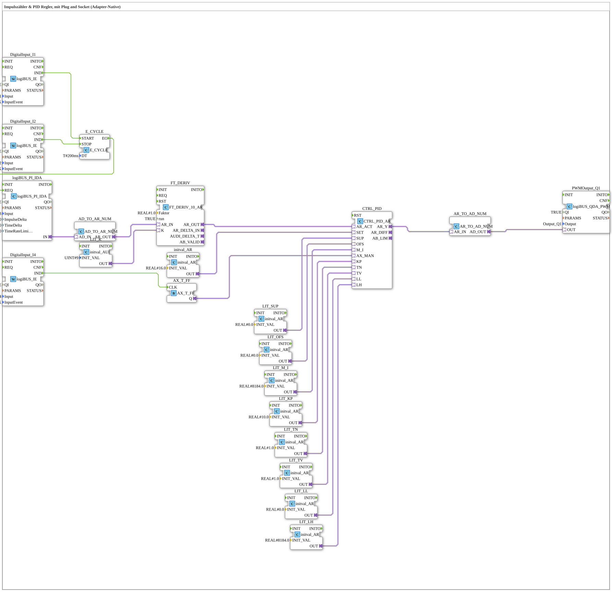

# Uebung_153_AX: Pulse Counter & PID Controller, with Plug and Socket (Adapter-Native)

* * * * * * * * * *

## Introduction

This exercise combines a pulse counter (`logiBUS_PI_IDA`, input `I8`) with a PID controller and outputs the manipulated variable as PWM at `Q1`. The data flow runs entirely via adapters (plug and socket): `FT_DERIV_10_AR` and `CTRL_PID_AR` come from `OSCAT_adapter`, `AD_TO_AR_NUM` and `AR_TO_AD_NUM` convert between the adapter types. The controller parameters (`SET`, `SUP`, `OFS`, `M_I`, `KP`, `TN`, `TV`, `LL`, `LH`) and the factor `K` of the differentiator are no longer supplied as parameters but via literal blocks (`initval_AR`/`initval_AUI`) over adapters. `I2` and `I3` start and stop the cyclic polling, `I1` toggles the manual mode of the controller.

## Function Blocks (FBs) Used

- **DigitalInput_I1**, **DigitalInput_I2**, **DigitalInput_I3**: Buttons with click detection
    - **Type**: [`logiBUS::io::DI::logiBUS_IE`](https://meisterschulen-am-ostbahnhof-munchen-docs.readthedocs.io/projects/4diac-library-reference-docs/en/latest/Bibliotheken/ExternalLibraries/logiBUS/io/DI/logiBUS_IE/)
    - **Parameters**: `QI = TRUE`, `Input = Input_I1` / `Input_I2` / `Input_I3`, each with `InputEvent = BUTTON_SINGLE_CLICK`
    - **Explanation**: Report a single click as event `IND`.
- **E_CYCLE**: Sampling clock
    - **Type**: [`iec61499::events::E_CYCLE`](https://meisterschulen-am-ostbahnhof-munchen-docs.readthedocs.io/projects/4diac-library-reference-docs/en/latest/Bibliotheken/StandardLibraries/events/E_CYCLE/)
    - **Parameters**: `DT = T#200ms`
    - **Explanation**: Started by `I2` (`START`), stopped by `I3` (`STOP`) and requests a new pulse value every 200 ms.
- **logiBUS_PI_IDA**: Pulse input
    - **Type**: [`logiBUS::io::PI::logiBUS_PI_IDA`](https://meisterschulen-am-ostbahnhof-munchen-docs.readthedocs.io/projects/4diac-library-reference-docs/en/latest/Bibliotheken/ExternalLibraries/logiBUS/io/PI/logiBUS_PI_IDA/)
    - **Parameters**: `QI = TRUE`, `Input = PulseInput_I8`, `ImpulseDelta = 100`, `TimeDelta = 50000`, `TimeRateLimit = 10000`
    - **Explanation**: Provides the pulse value via the adapter `IN` on every `REQ`.
- **AD_TO_AR_NUM**: Conversion `AD` to `AR`
    - **Type**: [`adapter::conversion::unidirectional::AD_TO_AR_NUM`](https://meisterschulen-am-ostbahnhof-munchen-docs.readthedocs.io/projects/4diac-library-reference-docs/en/latest/Bibliotheken/ExternalLibraries/adapter/conversion/unidirectional/AD_AR/AD_TO_AR_NUM/)
    - **Parameters**: none
    - **Explanation**: Numerically converts the pulse value (`AD_IN`) to a `REAL` adapter value (`AR_OUT`).
- **LIT_K**: Factor `K` of the differentiator
    - **Type**: [`adapter::types::unidirectional::AUI::initval::initval_AUI`](https://meisterschulen-am-ostbahnhof-munchen-docs.readthedocs.io/projects/4diac-library-reference-docs/en/latest/Bibliotheken/ExternalLibraries/adapter/types/unidirectional/UINT/initval/initval_AUI/)
    - **Parameters**: `INIT_VAL = 9`
    - **Explanation**: Provides `K = 9` to `FT_DERIV.K`.
- **FT_DERIV**: Differentiator with delay
    - **Type**: `OSCAT_adapter::Control::FT_DERIV_10_AR`
    - **Parameters**: `Faktor = 1.0`, `run = TRUE`
    - **Explanation**: Forms the rate of change (`AR_OUT`) from the `REAL` value (`AR_IN`), which goes to the controller as actual value.
- **AX_T_FF**: Toggle flip-flop
    - **Type**: [`adapter::events::unidirectional::AX_T_FF`](https://meisterschulen-am-ostbahnhof-munchen-docs.readthedocs.io/projects/4diac-library-reference-docs/en/latest/Bibliotheken/ExternalLibraries/adapter/events/unidirectional/BOOL/AX_T_FF/)
    - **Parameters**: none
    - **Explanation**: Each click on `I1` (`CLK`) inverts `Q`; `Q` goes to the input `AX_MAN` of the controller.
- **initval_AR**: Set value
    - **Type**: [`adapter::types::unidirectional::AR::initval::initval_AR`](https://meisterschulen-am-ostbahnhof-munchen-docs.readthedocs.io/projects/4diac-library-reference-docs/en/latest/Bibliotheken/ExternalLibraries/adapter/types/unidirectional/REAL/initval/initval_AR/)
    - **Parameters**: `INIT_VAL = 16.0`
    - **Explanation**: Provides the set value to `CTRL_PID.SET`.
- **CTRL_PID**: PID controller
    - **Type**: [`OSCAT_adapter::Control::CTRL_PID_AR`](https://meisterschulen-am-ostbahnhof-munchen-docs.readthedocs.io/projects/4diac-library-reference-docs/en/latest/Bibliotheken/ExternalLibraries/OSCAT/Basic/POUs/Engineering/Control/CTRL_PID_AR/)
    - **Parameters**: none (all inputs are adapters)
    - **Explanation**: Receives actual value (`AR_ACT`), set value (`SET`), manual mode (`AX_MAN`) and the controller parameters via adapters; provides the manipulated variable `AR_Y`.
- **LIT_SUP**, **LIT_OFS**, **LIT_M_I**, **LIT_KP**, **LIT_TN**, **LIT_TV**, **LIT_LL**, **LIT_LH**: Literal blocks for the controller parameters
    - **Type**: [`adapter::types::unidirectional::AR::initval::initval_AR`](https://meisterschulen-am-ostbahnhof-munchen-docs.readthedocs.io/projects/4diac-library-reference-docs/en/latest/Bibliotheken/ExternalLibraries/adapter/types/unidirectional/REAL/initval/initval_AR/)
    - **Parameters**: `INIT_VAL` = `0.0` (`LIT_SUP`), `0.0` (`LIT_OFS`), `8184.0` (`LIT_M_I`), `10.0` (`LIT_KP`), `1.0` (`LIT_TN`), `1.0` (`LIT_TV`), `0.0` (`LIT_LL`), `8184.0` (`LIT_LH`)
    - **Explanation**: Each block feeds the input of the same name (`SUP`, `OFS`, `M_I`, `KP`, `TN`, `TV`, `LL`, `LH`) of `CTRL_PID`.
- **AR_TO_AD_NUM**: Conversion `AR` to `AD`
    - **Type**: [`adapter::conversion::unidirectional::AR_TO_AD_NUM`](https://meisterschulen-am-ostbahnhof-munchen-docs.readthedocs.io/projects/4diac-library-reference-docs/en/latest/Bibliotheken/ExternalLibraries/adapter/conversion/unidirectional/AD_AR/AR_TO_AD_NUM/)
    - **Parameters**: none
    - **Explanation**: Converts the manipulated variable (`AR_IN`) to an `AD` adapter value (`AD_OUT`).
- **PWMOutput_Q1**: PWM output
    - **Type**: [`logiBUS::io::DQ::logiBUS_QDA_PWM`](https://meisterschulen-am-ostbahnhof-munchen-docs.readthedocs.io/projects/4diac-library-reference-docs/en/latest/Bibliotheken/ExternalLibraries/logiBUS/io/DO/logiBUS_QDA_PWM/)
    - **Parameters**: `QI = TRUE`, `Output = Output_Q1`
    - **Explanation**: Outputs the value of `AR_TO_AD_NUM.AD_OUT` as PWM at `Q1`.

## Program Flow and Connections

1. `DigitalInput_I2.IND` → `E_CYCLE.START` and `DigitalInput_I3.IND` → `E_CYCLE.STOP` (EventConnections): `I2` starts, `I3` stops the 200 ms clock.
2. `E_CYCLE.EO` → `logiBUS_PI_IDA.REQ` (EventConnection): On every clock tick the pulse value is requested.
3. `logiBUS_PI_IDA.IN` → `AD_TO_AR_NUM.AD_IN`, `AD_TO_AR_NUM.AR_OUT` → `FT_DERIV.AR_IN` and `LIT_K.OUT` → `FT_DERIV.K` (AdapterConnections): The pulse value is converted and differentiated.
4. `FT_DERIV.AR_OUT` → `CTRL_PID.AR_ACT` (AdapterConnection): The result is the actual value of the controller.
5. `initval_AR.OUT` → `CTRL_PID.SET` (AdapterConnection): Set value 16.0.
6. `DigitalInput_I1.IND` → `AX_T_FF.CLK` and `AX_T_FF.Q` → `CTRL_PID.AX_MAN` (Event and AdapterConnection): Each click on `I1` toggles the manual mode of the controller.
7. `LIT_SUP.OUT` → `CTRL_PID.SUP`, `LIT_OFS.OUT` → `CTRL_PID.OFS`, `LIT_M_I.OUT` → `CTRL_PID.M_I`, `LIT_KP.OUT` → `CTRL_PID.KP`, `LIT_TN.OUT` → `CTRL_PID.TN`, `LIT_TV.OUT` → `CTRL_PID.TV`, `LIT_LL.OUT` → `CTRL_PID.LL`, `LIT_LH.OUT` → `CTRL_PID.LH` (AdapterConnections): The controller parameters.
8. `CTRL_PID.AR_Y` → `AR_TO_AD_NUM.AR_IN` and `AR_TO_AD_NUM.AD_OUT` → `PWMOutput_Q1.OUT` (AdapterConnections): The manipulated variable is output as PWM at `Q1`.

## Summary

Exercise 153_AX shows a control loop in which pulse acquisition, differentiation and PID controller are connected entirely via adapters. The controller parameters and the differentiation factor are no longer set as parameters but supplied via `initval_AR`/`initval_AUI` literals with the same values as before.

---

### 🌐 Related topic subpages on ms-muc-docs.de

- [🌐 Eclipse 4diac IDE & Color Reference on ms-muc-docs.de](https://www.ms-muc-docs.de/iec-61499/eclipse-4diac/)
