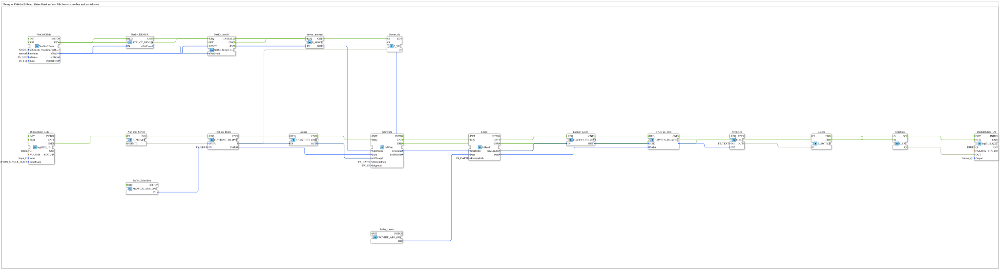

# Uebung_156_AX: Übung zu FsWrite/FsRead: kleine Datei auf den File Server schreiben und zurücklesen

This article describes the 4diac IDE sub-application Uebung_156_AX (Übung zu FsWrite/FsRead: kleine Datei auf den File Server schreiben und zurücklesen).

----

## Objective of the Exercise

The main objective of this exercise is to implement the following requirement: **Übung zu FsWrite/FsRead: kleine Datei auf den File Server schreiben und zurücklesen**

-----

## Description and Components

The exercise consists of the sub-application Uebung_156_AX.SUB, which uses the following function block structure:

### Instantiated Function Blocks (FBs)

- **NmGetCfInfo**: Instance of type isobus::pgn::NmGetCfInfo.
  - Parameter u8CanIdx = NODE1
  - Parameter member = network
  - Parameter address = FS_ADD
  - Parameter mask = FS_FLT
- **NetEv_DEMUX**: Instance of type eclipse4diac::convert::STRUCT_DEMUX.
- **NetEv_Install**: Nested sub-application (SubApp) MyLib::sys::NetEv_Install_Filter.
- **Server_merken**: Instance of type iec61131::selection::F_MOVE.
- **Server_da**: Instance of type iec61499::events::E_SR.
- **DigitalInput_CLK_I1**: Instance of type logiBUS::io::DI::logiBUS_IE.
  - Parameter QI = TRUE
  - Parameter Input = Input_I1
  - Parameter InputEvent = BUTTON_SINGLE_CLICK
- **Nur_mit_Server**: Instance of type iec61499::events::E_PERMIT.
- **Puffer_Schreiben**: Instance of type eclipse4diac::convert::providers::PROVIDE_ARR_0064_BYTE.
- **Text_zu_Bytes**: Instance of type logiBUS::utils::dyn_arr::F_STRING_TO_BYTES.
  - Parameter IN = FS_TEXT
- **Laenge**: Instance of type iec61131::conversion::F_UINT_TO_UDINT.
- **Schreiben**: Instance of type isobus::fs::FsWrite.
  - Parameter sRemotePath = FS_DATEI
  - Parameter bAppend = FALSE
- **Puffer_Lesen**: Instance of type eclipse4diac::convert::providers::PROVIDE_ARR_0064_BYTE.
- **Lesen**: Instance of type isobus::fs::FsRead.
  - Parameter sRemotePath = FS_DATEI
- **Laenge_Lesen**: Instance of type iec61131::conversion::F_UDINT_TO_UINT.
- **Bytes_zu_Text**: Instance of type logiBUS::utils::dyn_arr::F_BYTES_TO_STRING.
- **Vergleich**: Instance of type iec61131::comparison::F_EQ.
  - Parameter IN1 = FS_TEXT
- **Gleich**: Instance of type iec61499::events::E_SWITCH.
- **Ergebnis**: Instance of type iec61499::events::E_SR.
- **DigitalOutput_Q1**: Instance of type logiBUS::io::DQ::logiBUS_QX.
  - Parameter QI = TRUE
  - Parameter Output = Output_Q1

The exercise uses the common pattern with `NmGetCfInfo` (IND/RSP): `IND` triggers `STRUCT_DEMUX`, `NetEv_Install` handles the event and acknowledges with `RSP`.

-----

## Sequence and expected behavior (from the comment in the network)

- File Server: Datei schreiben und zurücklesen (FsWrite, FsRead)
- NmGetCfInfo (network, Filter FS_ADD/FS_FLT = NAME-Funktion 61) meldet den File Server, z. B. CCI 1200 mit USB-Stick.
- I1 Klick (nur mit Server): FS_TEXT nach FS_DATEI schreiben, danach zurücklesen und vergleichen. Q1 an = gleich, Q1 aus = Fehler.
- Watch on ERR: Schreiben/Lesen.s16Status and .u16FsError (ISO 11783-13 B.9, from 6400 client). FS_DATEI without a volume ends up in the current directory of the file server (CCI 1200: USB stick).
- Paths: The CCI 1200 has no fixed volume `\\USB\`, a stick is named after its FAT serial number. So FS_DATEI holds a path without a volume (`logibus_test.txt`).
- Weiter: Übung 156b (FsGet/FsPut über eine lokale Datei).

Note: Tested on hardware on the CCI 1200 with a USB stick (2026-11-26): FsWrite and FsRead passed. Q1 turns on when the text read back is equal.

-----

## Summary

Exercise Uebung_156_AX demonstrates the modular IEC 61499 architecture in 4diac IDE.
