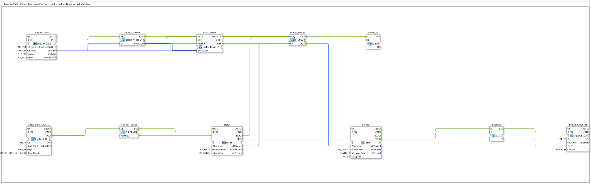

# Uebung_156b_AX: Übung zu FsGet/FsPut: Datei vom File Server holen und als Kopie zurückschreiben

This article describes the 4diac IDE sub-application Uebung_156b_AX (Übung zu FsGet/FsPut: Datei vom File Server holen und als Kopie zurückschreiben).

----

## Objective of the Exercise

The main objective of this exercise is to implement the following requirement: **Übung zu FsGet/FsPut: Datei vom File Server holen und als Kopie zurückschreiben**

-----

## Description and Components

The exercise consists of the sub-application Uebung_156b_AX.SUB, which uses the following function block structure:

### Instantiated Function Blocks (FBs)

- **NmGetCfInfo**: Instance of type isobus::pgn::NmGetCfInfo.
  - Parameter u8CanIdx = NODE1
  - Parameter member = network
  - Parameter address = FS_ADD
  - Parameter mask = FS_FLT
- **NetEv_DEMUX**: Instance of type eclipse4diac::convert::STRUCT_DEMUX.
- **NetEv_Install**: Nested sub-application (SubApp) MyLib::sys::NetEv_Install_Filter.
- **Server_merken**: Instance of type iec61131::selection::F_MOVE.
- **Server_da**: Instance of type iec61499::events::E_SR.
- **DigitalInput_CLK_I1**: Instance of type logiBUS::io::DI::logiBUS_IE.
  - Parameter QI = TRUE
  - Parameter Input = Input_I1
  - Parameter InputEvent = BUTTON_SINGLE_CLICK
- **Nur_mit_Server**: Instance of type iec61499::events::E_PERMIT.
- **Holen**: Instance of type isobus::fs::FsGet.
  - Parameter sRemotePath = FS_DATEI
  - Parameter sLocalPath = FS_LOKAL
- **Zurueck**: Instance of type isobus::fs::FsPut.
  - Parameter sLocalPath = FS_LOKAL
  - Parameter sRemotePath = FS_DATEI_2
  - Parameter bAppend = FALSE
- **Ergebnis**: Instance of type iec61499::events::E_SR.
- **DigitalOutput_Q1**: Instance of type logiBUS::io::DQ::logiBUS_QX.
  - Parameter QI = TRUE
  - Parameter Output = Output_Q1

The exercise uses the common pattern with `NmGetCfInfo` (IND/RSP): `IND` triggers `STRUCT_DEMUX`, `NetEv_Install` handles the event and acknowledges with `RSP`.

-----

## Sequence and expected behavior (from the comment in the network)

- File Server: Datei holen und als Kopie zurückschreiben (FsGet, FsPut)
- NmGetCfInfo (network, Filter FS_ADD/FS_FLT = NAME-Funktion 61) meldet den File Server, z. B. CCI 1200 mit USB-Stick.
- I1 Klick (nur mit Server): FS_DATEI nach FS_LOKAL (/data/fs/) holen, dann als FS_DATEI_2 zurückschreiben. Q1 an = fertig, Q1 aus = Fehler.
- Watch: u32Bytes (PROG beim Holen), bei ERR s16Status und u16FsError. FS_DATEI muss es geben, z. B. aus Übung 156.
- Paths: FS_DATEI has no volume (`logibus_test.txt`, current directory of the file server). Missing directories under `/data/` are created by FsGet itself.

Note: On hardware only FsGet has been tested so far (CCI 1200 with USB stick, 2026-11-26, 24 bytes). FsPut and the complete sequence of this exercise are not tested yet, the behavior is to be read as expected.

-----

## Summary

Exercise Uebung_156b_AX demonstrates the modular IEC 61499 architecture in 4diac IDE.
