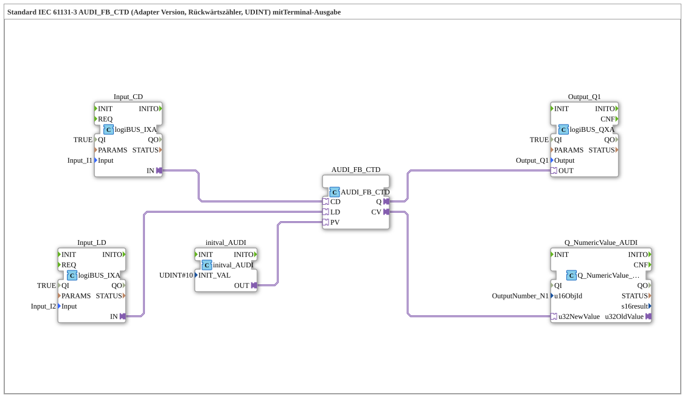

# Exercise_218_AUDI: Standard IEC 61131-3 AUDI_FB_CTD (Adapter Version, Down Counter, UDINT) with Terminal Output

* * * * * * * * * *

## Introduction

This exercise implements an IEC 61131-3 compliant down counter (`AUDI_FB_CTD`) with a UDINT data type in the adapter version. The counter value is output via a terminal block. The preset value (`PV`) is set to 10 by a separate block (`initval_AUDI`). The exercise demonstrates the use of adapter-based function blocks and their interaction with input/output modules as well as a numeric terminal display.

## Function Blocks (FBs) Used

- **Input_CD**: Digital input for "Count Down"
    - **Type**: `logiBUS::io::DI::logiBUS_IXA`
    - **Parameters**: `QI = TRUE`, `Input = Input_I1`
    - **Explanation**: Provides the state of `I1` as AX adapter `IN` to `AUDI_FB_CTD.CD`.
- **Input_LD**: Digital input for "Load"
    - **Type**: `logiBUS::io::DI::logiBUS_IXA`
    - **Parameters**: `QI = TRUE`, `Input = Input_I2`
    - **Explanation**: Provides the state of `I2` as AX adapter `IN` to `AUDI_FB_CTD.LD`.
- **initval_AUDI**: Preset value
    - **Type**: `adapter::types::unidirectional::AUDI::initval::initval_AUDI`
    - **Parameters**: `INIT_VAL = 10`
    - **Explanation**: Provides the UDINT value 10 as adapter `OUT` to `AUDI_FB_CTD.PV` on initialization.
- **AUDI_FB_CTD**: Down counter
    - **Type**: `adapter::iec61131::counters::AUDI_FB_CTD`
    - **Parameters**: none
    - **Explanation**: Adapter version of the IEC 61131-3 down counter (CTD, UDINT). Inputs as adapters: `CD` (count down, AX), `LD` (load, AX) and `PV` (preset value, AUDI). Outputs as adapters: `Q` (AX, TRUE at counter value 0) and `CV` (current counter value, AUDI). The outputs are reported only on change.
- **Output_Q1**: Digital output
    - **Type**: `logiBUS::io::DQ::logiBUS_QXA`
    - **Parameters**: `QI = TRUE`, `Output = Output_Q1`
    - **Explanation**: Outputs `AUDI_FB_CTD.Q` as a binary signal on `Q1`.
- **Q_NumericValue_AUDI**: Terminal output
    - **Type**: `isobus::UT::Q::Q_NumericValue_AUDI`
    - **Parameters**: `u16ObjId = OutputNumber_N1`
    - **Explanation**: Receives the counter value (`CV`) via an `AUDI` adapter (`u32NewValue`) and displays it in the object `OutputNumber_N1`.

## Program Flow and Connections

The network contains only adapter connections (no EventConnections):

1. `Input_CD.IN` → `AUDI_FB_CTD.CD`: `I1` counts the counter down.
2. `Input_LD.IN` → `AUDI_FB_CTD.LD`: `I2` loads the counter with the preset value.
3. `initval_AUDI.OUT` → `AUDI_FB_CTD.PV`: the preset value is 10.
4. `AUDI_FB_CTD.Q` → `Output_Q1.OUT`: `Q1` lights up as soon as the counter value has reached 0.
5. `AUDI_FB_CTD.CV` → `Q_NumericValue_AUDI.u32NewValue`: the current counter value is displayed on the terminal.

**Learning Objectives:**

- Understanding the IEC 61131-3 down counter (CTD) as an adapter block.
- Working with adapter connections in 4diac.
- Specifying counter values via an `initval` block.
- Visualizing values on a terminal.

**Difficulty Level:** Medium

**Required Prior Knowledge:** Basic PLC programming knowledge, familiarity with the 4diac IDE, understanding of event and data flows.

**Procedure:**

- Import the exercise into the 4diac IDE.
- Assign the inputs/outputs to the corresponding real or simulated hardware pins.
- Start the application and observe its behavior: pressing `I2` loads the counter with 10. Each press of `I1` counts down by 1 until 0 is reached - then `Q1` lights up. The current counter value is displayed in the terminal.

## Summary

Exercise 218 demonstrates a complete IEC 61131-3 down counter with a UDINT data type, which communicates with digital inputs and outputs, as well as a terminal output, via adapter connections. The preset value is provided by a separate `initval` block.

---

### 🌐 Related topic subpages on ms-muc-docs.de

- [🌐 Eclipse 4diac IDE & Color Reference on ms-muc-docs.de](https://www.ms-muc-docs.de/iec-61499/eclipse-4diac/)
