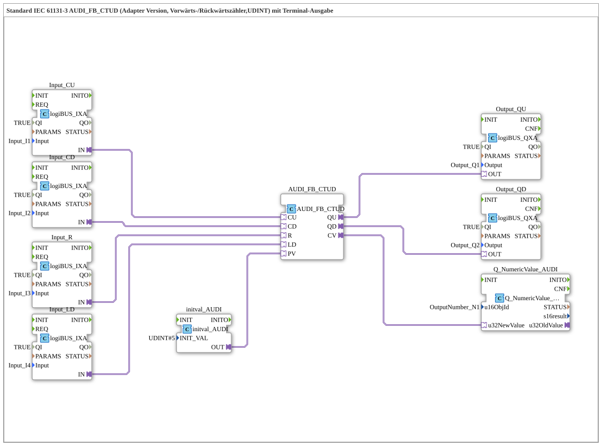

# Exercise_223_AUDI: Standard IEC 61131-3 AUDI_FB_CTUD (Adapter Version, Up/Down Counter, UDINT) with Terminal Output

* * * * * * * * * *

## Introduction

This exercise shows an up/down counter (CTUD) according to IEC 61131-3 as an adapter version for the data type UDINT. Four digital inputs control counting up, counting down, reset and load; the fixed preset value `5` comes from an `initval_AUDI` constant block. The count value is shown on the ISOBUS terminal, and the counter outputs `QU` and `QD` are applied to `Q1` and `Q2`.

## Function Blocks (FBs) Used

- **Input_CU**: Count-up input
    - **Type**: [`logiBUS::io::DI::logiBUS_IXA`](https://meisterschulen-am-ostbahnhof-munchen-docs.readthedocs.io/projects/4diac-library-reference-docs/en/latest/Bibliotheken/ExternalLibraries/logiBUS/io/DI/logiBUS_IXA/)
    - **Parameters**: `QI = TRUE`, `Input = Input_I1`
    - **Explanation**: Provides the state of `I1` as adapter output `IN`.
- **Input_CD**: Count-down input
    - **Type**: [`logiBUS::io::DI::logiBUS_IXA`](https://meisterschulen-am-ostbahnhof-munchen-docs.readthedocs.io/projects/4diac-library-reference-docs/en/latest/Bibliotheken/ExternalLibraries/logiBUS/io/DI/logiBUS_IXA/)
    - **Parameters**: `QI = TRUE`, `Input = Input_I2`
    - **Explanation**: Provides the state of `I2` as adapter output `IN`.
- **Input_R**: Reset input
    - **Type**: [`logiBUS::io::DI::logiBUS_IXA`](https://meisterschulen-am-ostbahnhof-munchen-docs.readthedocs.io/projects/4diac-library-reference-docs/en/latest/Bibliotheken/ExternalLibraries/logiBUS/io/DI/logiBUS_IXA/)
    - **Parameters**: `QI = TRUE`, `Input = Input_I3`
    - **Explanation**: Provides the state of `I3` as adapter output `IN`.
- **Input_LD**: Load input
    - **Type**: [`logiBUS::io::DI::logiBUS_IXA`](https://meisterschulen-am-ostbahnhof-munchen-docs.readthedocs.io/projects/4diac-library-reference-docs/en/latest/Bibliotheken/ExternalLibraries/logiBUS/io/DI/logiBUS_IXA/)
    - **Parameters**: `QI = TRUE`, `Input = Input_I4`
    - **Explanation**: Provides the state of `I4` as adapter output `IN`.
- **initval_AUDI**: Constant for the preset value
    - **Type**: [`adapter::types::unidirectional::AUDI::initval::initval_AUDI`](https://meisterschulen-am-ostbahnhof-munchen-docs.readthedocs.io/projects/4diac-library-reference-docs/en/latest/Bibliotheken/ExternalLibraries/adapter/types/unidirectional/UDINT/initval/initval_AUDI/)
    - **Parameters**: `INIT_VAL = 5`
    - **Explanation**: Provides the preset value `5` as `AUDI` adapter value to `AUDI_FB_CTUD.PV`.
- **AUDI_FB_CTUD**: Up/down counter (UDINT, adapter version)
    - **Type**: [`adapter::iec61131::counters::AUDI_FB_CTUD`](https://meisterschulen-am-ostbahnhof-munchen-docs.readthedocs.io/projects/4diac-library-reference-docs/en/latest/Bibliotheken/ExternalLibraries/adapter/iec61131-3/counters/AUDI_FB_CTUD/)
    - **Parameters**: none
    - **Explanation**: Counts up via `CU` and down via `CD`, `R` resets, `LD` loads the preset value `PV`. `QU` and `QD` are the counter outputs according to IEC 61131-3 (CTUD), `CV` provides the current count value.
- **Output_QU**: Digital output for `QU`
    - **Type**: [`logiBUS::io::DQ::logiBUS_QXA`](https://meisterschulen-am-ostbahnhof-munchen-docs.readthedocs.io/projects/4diac-library-reference-docs/en/latest/Bibliotheken/ExternalLibraries/logiBUS/io/DO/logiBUS_QXA/)
    - **Parameters**: `QI = TRUE`, `Output = Output_Q1`
    - **Explanation**: Outputs `AUDI_FB_CTUD.QU` at the physical output `Q1`.
- **Output_QD**: Digital output for `QD`
    - **Type**: [`logiBUS::io::DQ::logiBUS_QXA`](https://meisterschulen-am-ostbahnhof-munchen-docs.readthedocs.io/projects/4diac-library-reference-docs/en/latest/Bibliotheken/ExternalLibraries/logiBUS/io/DO/logiBUS_QXA/)
    - **Parameters**: `QI = TRUE`, `Output = Output_Q2`
    - **Explanation**: Outputs `AUDI_FB_CTUD.QD` at the physical output `Q2`.
- **Q_NumericValue_AUDI**: Display on the ISOBUS terminal
    - **Type**: [`isobus::UT::Q::Q_NumericValue_AUDI`](https://meisterschulen-am-ostbahnhof-munchen-docs.readthedocs.io/projects/4diac-library-reference-docs/en/latest/Bibliotheken/ExternalLibraries/isobus/UT/Q/Q_NumericValue_AUDI/)
    - **Parameters**: `u16ObjId = OutputNumber_N1`
    - **Explanation**: Receives the count value via the `AUDI` adapter `u32NewValue` and shows it in the object `OutputNumber_N1`.

## Program Flow and Connections

1. `Input_CU.IN` → `AUDI_FB_CTUD.CU`, `Input_CD.IN` → `AUDI_FB_CTUD.CD`, `Input_R.IN` → `AUDI_FB_CTUD.R` and `Input_LD.IN` → `AUDI_FB_CTUD.LD` (AdapterConnections): The states of `I1` to `I4` control counting up, counting down, reset and load.
2. `initval_AUDI.OUT` → `AUDI_FB_CTUD.PV` (AdapterConnection): The preset value `5` is passed as preset.
3. `AUDI_FB_CTUD.QU` → `Output_QU.OUT` and `AUDI_FB_CTUD.QD` → `Output_QD.OUT` (AdapterConnections): The counter outputs are applied to `Q1` and `Q2`.
4. `AUDI_FB_CTUD.CV` → `Q_NumericValue_AUDI.u32NewValue` (AdapterConnection): The count value is shown on the terminal.

**Behavior**: `I1` counts up, `I2` counts down, `I3` resets the counter and `I4` loads the preset value `5`. The count value appears in `OutputNumber_N1`. According to the network comment, an `AX_D_FF` can optionally be inserted for each input to reduce the number of events.

## Summary

The exercise shows the adapter-based connection of an IEC 61131-3 up/down counter: inputs, preset value, counter outputs and display are wired purely via adapter connections.

---

### 🌐 Related topic subpages on ms-muc-docs.de

- [🌐 Eclipse 4diac IDE & Color Reference on ms-muc-docs.de](https://www.ms-muc-docs.de/iec-61499/eclipse-4diac/)
