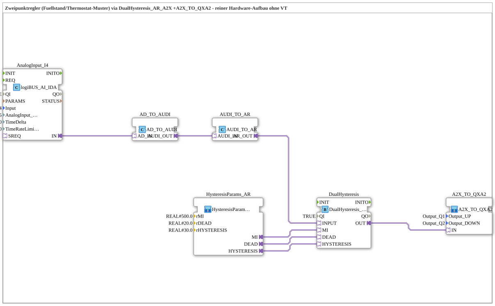

# Uebung_234_AX: Two-Point Controller with Hysteresis (Pure Hardware Exercise, without VT)

* * * * * * * * * *

## Introduction

This exercise implements a classic thermostat/level switch pattern: an analog measured value (e.g. level or temperature) is checked against a mean value `MI` with dead zone (`DEAD`) and hysteresis (`HYSTERESIS`) and thereby controls two opposing actuators (e.g. filling/emptying or heating/cooling) – never both at the same time. The exercise works exclusively with physical hardware, without a VT display.

## Function Blocks (FBs) Used

- **AnalogInput_I4**: Analog input
    - **Type**: [`logiBUS::io::AI::logiBUS_AI_IDA`](https://meisterschulen-am-ostbahnhof-munchen-docs.readthedocs.io/projects/4diac-library-reference-docs/en/latest/Bibliotheken/ExternalLibraries/logiBUS/io/AI/logiBUS_AI_IDA/)
    - **Parameters**: `QI = TRUE`, `Input = AnalogInput_I4`, `AnalogInput_hysteresis = 5`, `TimeDelta = 250`, `TimeRateLimit = 100`
    - **Explanation**: Reads the raw analog measured value (adapter `IN`, type AD) and filters small signal fluctuations via the input-side hysteresis of 5.
- **AD_TO_AUDI**: Conversion from AD to AUDI
    - **Type**: [`adapter::conversion::unidirectional::AD_TO_AUDI`](https://meisterschulen-am-ostbahnhof-munchen-docs.readthedocs.io/projects/4diac-library-reference-docs/en/latest/Bibliotheken/ExternalLibraries/adapter/conversion/unidirectional/AD_AUDI/AD_TO_AUDI/)
    - **Parameters**: none
    - **Explanation**: First step of the numerically correct conversion of the raw measured value into a numeric value.
- **AUDI_TO_AR**: Conversion from AUDI to AR
    - **Type**: [`adapter::conversion::unidirectional::AUDI_TO_AR`](https://meisterschulen-am-ostbahnhof-munchen-docs.readthedocs.io/projects/4diac-library-reference-docs/en/latest/Bibliotheken/ExternalLibraries/adapter/conversion/unidirectional/AR_AUDI/AUDI_TO_AR/)
    - **Parameters**: none
    - **Explanation**: Second step of the conversion (AUDI to `REAL` adapter). Together with `AD_TO_AUDI` this forms the same two-stage conversion chain as in `Uebung_028a_AR` ("an AD_TO_AR would be like a reinterpret_cast").
- **HysteresisParams_AR**: Parameter block for the hysteresis thresholds (sub-app)
    - **Type**: [`MyLib::sys::HysteresisParams_AR`](https://meisterschulen-am-ostbahnhof-munchen-docs.readthedocs.io/projects/4diac-library-reference-docs/en/latest/Bibliotheken/ExternalLibraries/MyLib_AX/sys/HysteresisParams_AR/)
    - **Parameters**: `rMI = 500.0`, `rDEAD = 20.0`, `rHYSTERESIS = 30.0`
    - **Explanation**: Bundles `MI`, `DEAD` and `HYSTERESIS` as three fixed AR constants (one `initval_AR` each); the values can be set at the instance. Here they are fixed example values; in real plants they would typically be configurable via INI/OPC-UA.
- **DualHysteresis**: Two-point controller with dead zone and hysteresis
    - **Type**: [`logiBUS::signalprocessing::hysteresis::DualHysteresis_AR_A2X`](https://meisterschulen-am-ostbahnhof-munchen-docs.readthedocs.io/projects/4diac-library-reference-docs/en/latest/Bibliotheken/ExternalLibraries/adapter/signalprocessing/hysteresis/DualHysteresis_AR_A2X/)
    - **Parameters**: `QI = TRUE`
    - **Explanation**: Compares the measured value (`INPUT`) against `MI`: if the value rises above `MI + DEAD + HYSTERESIS` (here 550), `UP` switches on; if it falls below `MI - DEAD - HYSTERESIS` (here 450), `DOWN` switches on. It only switches off again when the value returns to the pure dead zone `MI ± DEAD` (480–520) – the difference between switch-on and switch-off point prevents chattering near the switching threshold.
- **A2X_TO_QXA2**: Unbundling to two outputs (sub-app)
    - **Type**: [`MyLib::sys::A2X_TO_QXA2`](https://meisterschulen-am-ostbahnhof-munchen-docs.readthedocs.io/projects/4diac-library-reference-docs/en/latest/Bibliotheken/ExternalLibraries/MyLib_AX/sys/A2X_TO_QXA2/)
    - **Parameters**: `Output_UP = Output_Q1`, `Output_DOWN = Output_Q2`
    - **Explanation**: Unbundles the single `A2X` output signal (`UP`/`DOWN`) of `DualHysteresis` to two physical logiBUS outputs (`Q1` for UP, `Q2` for DOWN).

## Program Flow and Connections

1. `AnalogInput_I4.IN` → `AD_TO_AUDI.AD_IN`: The raw value is first converted into an `AUDI` value.
2. `AD_TO_AUDI.AUDI_OUT` → `AUDI_TO_AR.AUDI_IN`: It is then converted into an `AR` value (REAL adapter) – the two-stage conversion.
3. `AUDI_TO_AR.AR_OUT` → `DualHysteresis.INPUT`: The conditioned measured value reaches the two-point controller.
4. `HysteresisParams_AR.MI` / `.DEAD` / `.HYSTERESIS` → `DualHysteresis.MI` / `.DEAD` / `.HYSTERESIS`: The thresholds (500.0 / 20.0 / 30.0) are fixed.
5. `DualHysteresis.OUT` → `A2X_TO_QXA2.IN`: The combined UP/DOWN result is passed to the output block.
6. `A2X_TO_QXA2` writes UP to `Output_Q1` and DOWN to `Output_Q2` – the two actuators are never activated at the same time.

All connections are adapter connections.

## Summary

Exercise 234_AX shows the classic structure of a two-point controller with hysteresis purely at hardware level: an analog input is conditioned via a two-stage adapter chain (`AD_TO_AUDI` → `AUDI_TO_AR`), checked by `DualHysteresis_AR_A2X` against a mean value with dead zone and hysteresis, and switched via `A2X_TO_QXA2` to two mutually exclusive digital outputs. For the same function with a VT display (measured value as number field, UP/DOWN as background colour instead of physical outputs) see `Uebung_235_AX`.

---

### 🌐 Related topic subpages on ms-muc-docs.de

- [🌐 Eclipse 4diac IDE & Color Reference on ms-muc-docs.de](https://www.ms-muc-docs.de/iec-61499/eclipse-4diac/)
