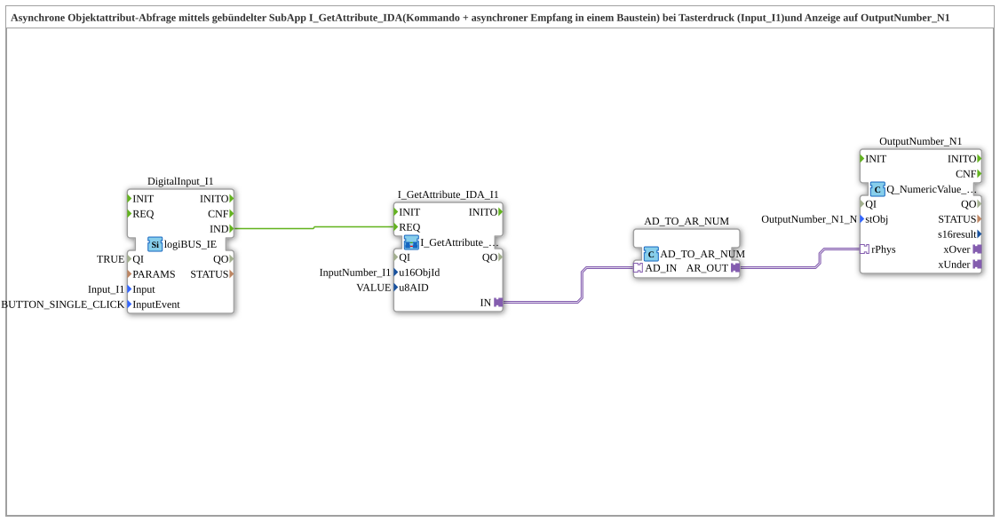

# Exercise_249b_AX: Asynchronous Object Attribute Query with the Bundled SubApp I_GetAttribute_IDA

* * * * * * * * * *

## Introduction

On a button press (`Input_I1`), this exercise asynchronously queries an object attribute of a VT object and displays the result on `OutputNumber_N1`. The command (`GetAttribute`) and the asynchronous reception of the response (`Attribute_IDA`) are bundled in the SubApp `MyLib::sys::I_GetAttribute_IDA`; they share the parameters `u16ObjId` and `u8AID`.

## Function Blocks (FBs) Used

- **DigitalInput_I1**: logiBUS input with click detection
    - **Type**: `logiBUS::io::DI::logiBUS_IE`
    - **Parameters**: `QI = TRUE`, `Input = Input_I1`, `InputEvent = BUTTON_SINGLE_CLICK`
    - **Explanation**: Reports a single click on `I1` as event `IND`.
- **I_GetAttribute_IDA_I1**: bundled attribute query (SubApp instance)
    - **Type**: `MyLib::sys::I_GetAttribute_IDA`
    - **Parameters**: `u16ObjId = InputNumber_I1`, `u8AID = VALUE`
    - **Explanation**: On `REQ`, the internal block `I_GetAttribute` sends the GetAttribute command (F.58) for the attribute `u8AID` of the object `u16ObjId`; the internal block `Attribute_IDA` receives the response asynchronously and provides it as an `AD` adapter (DWORD) at the output `IN`. Here, the value (`VALUE`) of the input field `InputNumber_I1` is queried.
- **AD_TO_AR_NUM**: Adapter converter DWORD → REAL
    - **Type**: `adapter::conversion::unidirectional::AD_TO_AR_NUM`
    - **Parameters**: none
    - **Explanation**: Converts the `AD` adapter numerically (via UDINT, no bit reinterpretation) into an `AR` adapter (REAL).
- **OutputNumber_N1**: Output to the VT number field
    - **Type**: `isobus::UT::Q::Q_NumericValue_PHYSA`
    - **Parameters**: `stObj = OutputNumber_N1_N`
    - **Explanation**: Writes the physical REAL value (`rPhys`) into the VT object from `stObj` (output field `OutputNumber_N1`).

## Program Flow and Connections

1. `DigitalInput_I1.IND` → `I_GetAttribute_IDA_I1.REQ`: the button click triggers the attribute query.
2. `I_GetAttribute_IDA_I1.IN` → `AD_TO_AR_NUM.AD_IN`: the asynchronously arriving response is passed on as a DWORD adapter and converted numerically to REAL.
3. `AD_TO_AR_NUM.AR_OUT` → `OutputNumber_N1.rPhys`: the value is displayed on `OutputNumber_N1`.

**Behavior**: Each click on `I1` queries the current value of the input field `InputNumber_I1` from the terminal; as soon as the response arrives, it appears on `OutputNumber_N1`.

## Summary

The exercise shows how command and asynchronous reception of an attribute query can be bundled in a single SubApp, so that only one block with a common object and attribute ID is needed in the network, and how the result is output on a VT number field via an adapter converter.

---

### 🌐 Related topic subpages on ms-muc-docs.de

- [🌐 Eclipse 4diac IDE & Color Reference on ms-muc-docs.de](https://www.ms-muc-docs.de/iec-61499/eclipse-4diac/)
