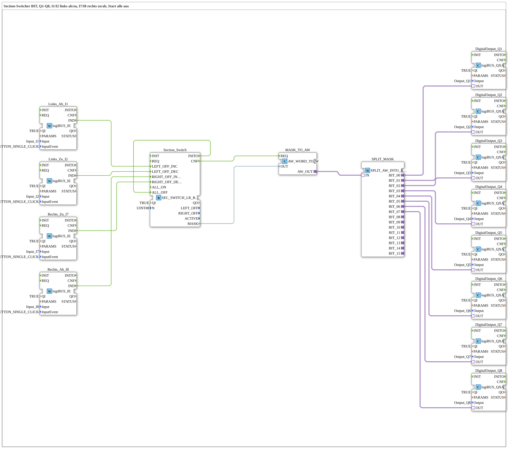

# Uebung_251_AX: Section switcher (BIT) with four buttons

* * * * * * * * * *

## Introduction

The section switcher [`SEC_SWITCH_LR_BIT_WORD`](https://meisterschulen-am-ostbahnhof-munchen-docs.readthedocs.io/projects/4diac-library-reference-docs/en/latest/Bibliotheken/ExternalLibraries/logiBUS/sections/SEC_SWITCH_LR_BIT_WORD/) switches 8 sections off and on again from both sides, like the section control of a sprayer. The exercise puts one section on each output `Q1` to `Q8`. `I1`/`I2` operate the left side, `I7`/`I8` the right side. All sections are off at start.

## Function Blocks Used (FBs)

- **Links_Ab_I1**, **Links_Zu_I2**, **Rechts_Zu_I7**, **Rechts_Ab_I8**: button events (type: [`logiBUS_IE`](https://meisterschulen-am-ostbahnhof-munchen-docs.readthedocs.io/projects/4diac-library-reference-docs/en/latest/Bibliotheken/ExternalLibraries/logiBUS/io/DI/logiBUS_IE/), `InputEvent = BUTTON_SINGLE_CLICK`)
    - **Explanation**: A short click on `I1` calls `LEFT_OFF_INC` (one more section off on the left), `I2` calls `LEFT_OFF_DEC` (one section less off on the left). `I8` calls `RIGHT_OFF_INC`, `I7` calls `RIGHT_OFF_DEC`.
- **Section_Switch**: section switcher (type: [`SEC_SWITCH_LR_BIT_WORD`](https://meisterschulen-am-ostbahnhof-munchen-docs.readthedocs.io/projects/4diac-library-reference-docs/en/latest/Bibliotheken/ExternalLibraries/logiBUS/sections/SEC_SWITCH_LR_BIT_WORD/))
    - **Parameters**: `QI = TRUE`, `N = 8`
    - **Explanation**: Manages the mask of the 8 sections. `INITO` is connected to `ALL_OFF` so that all sections are safely off at start.
- **MASK_TO_AW** (`AW_WORD_TO_W`): takes the mask (`MASK`, WORD) into the adapter.
- **SPLIT_MASK** (`SPLIT_AW_INTO_AX`): splits the word into 8 BOOL values (`BIT_00` to `BIT_07`).
- **DigitalOutput_Q1** to **DigitalOutput_Q8**: digital outputs (type: [`logiBUS_QXA`](https://meisterschulen-am-ostbahnhof-munchen-docs.readthedocs.io/projects/4diac-library-reference-docs/en/latest/Bibliotheken/ExternalLibraries/logiBUS/io/DO/logiBUS_QXA/), `QI = TRUE`, `Output = Output_Q1` to `Output_Q8`)

### Sub-blocks: none

## Program Flow and Connections

1. The four buttons trigger the commands `LEFT_OFF_INC`, `LEFT_OFF_DEC`, `RIGHT_OFF_DEC` and `RIGHT_OFF_INC` in `Section_Switch`.
2. `Section_Switch.INITO` triggers `ALL_OFF`: all sections are off at start.
3. After each change `Section_Switch.CNF` reports to `MASK_TO_AW.REQ`, and the mask goes into `SPLIT_MASK` as an adapter signal.
4. `SPLIT_MASK` distributes the mask to eight bits (`BIT_00` → `Q1` to `BIT_07` → `Q8`).

## Operation

1. In the `Control` of `test_AX.sys`, use *Change Type* to switch to `Uebungen::Uebung_251_AX`.
2. After the start, `Q1` to `Q8` are off.
3. Tap `I1`/`I2` for the left side and `I8`/`I7` for the right side briefly and watch which of the outputs `Q1` to `Q8` switch.

**Note:** The exact behavior of a click (which section switches first, limits of the mask) is described on the library page [`SEC_SWITCH_LR_BIT_WORD`](https://meisterschulen-am-ostbahnhof-munchen-docs.readthedocs.io/projects/4diac-library-reference-docs/en/latest/Bibliotheken/ExternalLibraries/logiBUS/sections/SEC_SWITCH_LR_BIT_WORD/).

## Summary

The exercise shows how a section switcher is operated with four buttons and how its BIT mask is distributed to eight outputs.

---

### 🌐 Related Topic Subpages on ms-muc-docs.de

- [🌐 Eclipse 4diac IDE & Color Reference auf ms-muc-docs.de](https://www.ms-muc-docs.de/iec-61499/eclipse-4diac/)
