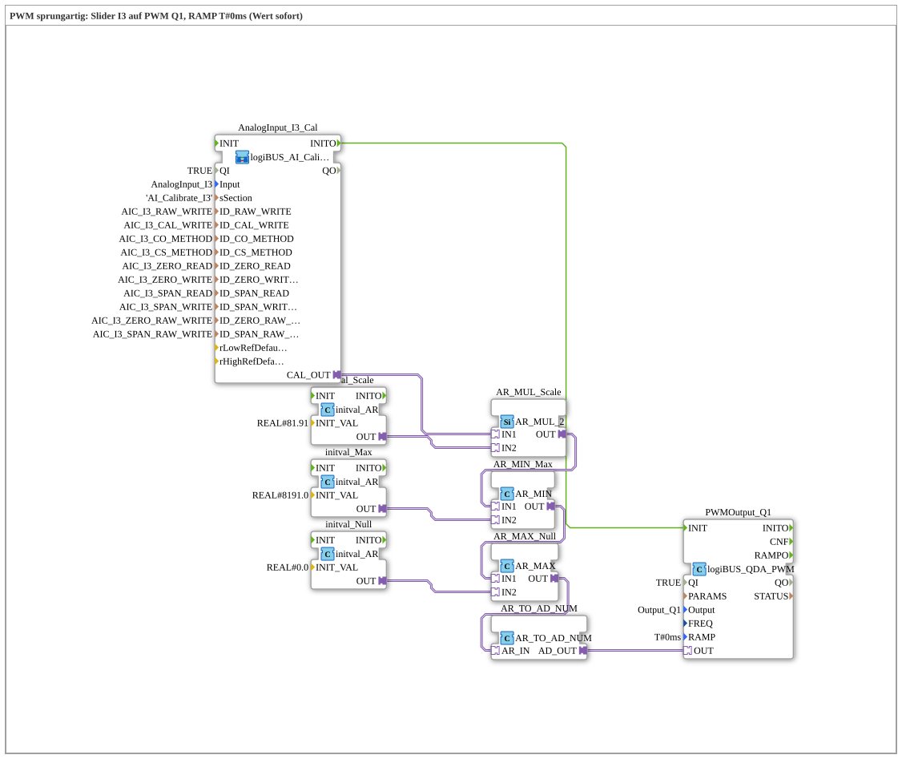

# Uebung_254_AX: PWM with a jump

* * * * * * * * * *

## Introduction

A slider at the analog input `I3` sets the duty cycle of the PWM output `Q1`. The ramp time is `T#0ms`: every new value applies immediately (jump). This is the basic exercise for the block [`logiBUS_QDA_PWM`](https://meisterschulen-am-ostbahnhof-munchen-docs.readthedocs.io/projects/4diac-library-reference-docs/en/latest/Bibliotheken/ExternalLibraries/logiBUS/io/DO/logiBUS_QDA_PWM/).

**Prerequisite (once):** The exercise uses `logiBUS_AI_Calibrate_2P_OPC`. Insert `Button_AI_Calibrate_2P_OPC_UA` as `Control` in `test_AX.sys`, export the boot file and calibrate with the web client `apixon-ai-calibrate-2p.html` (0 %: `CO`, 100 %: `CS`). The INI file (section `AI_Calibrate_I3`) stays on the board. After that the exercise runs without a VT and without a dashboard.

## Function Blocks Used (FBs)

- **AnalogInput_I3_Cal**: analog input I3 with two-point calibration via OPC UA (type: `logiBUS_AI_Calibrate_2P_OPC`, section `AI_Calibrate_I3`)
    - **Explanation**: `CAL_OUT` delivers the calibrated value 0 to 100 %. `INITO` starts the PWM blocks.
- **AR_MUL_Scale** (`AR_MUL_2`) with **initval_Scale** (`initval_AR`, factor `81.91`): converts the value 0 to 100 % into the target range.
- **AR_MIN_Max** (`AR_MIN`) with **initval_Max** (`8191.0`): limits upwards.
- **AR_MAX_Null** (`AR_MAX`) with **initval_Null** (`0`): limits downwards. Together with `AR_MIN_Max` the value stays in the range 0 to 8191.0.
- **AR_TO_AD_NUM** (`AR_TO_AD_NUM`): converts REAL **numerically** to DWORD and passes the value on through the adapter.
- **PWMOutput_Q1** (type: `logiBUS_QDA_PWM`, `QI = TRUE`, `Output = Output_Q1`, `RAMP = T#0ms`)
    - **Explanation**: PWM output `Q1` with the initial frequency value 400 Hz; the duty cycle is 0 to 8191 (13 bit). The block is documented at [`logiBUS_QDA_PWM`](https://meisterschulen-am-ostbahnhof-munchen-docs.readthedocs.io/projects/4diac-library-reference-docs/en/latest/Bibliotheken/ExternalLibraries/logiBUS/io/DO/logiBUS_QDA_PWM/).

### Sub-blocks: none

## Program Flow and Connections

1. The potentiometer value runs from `AnalogInput_I3_Cal.CAL_OUT` through `AR_MUL_Scale`, `AR_MIN_Max` and `AR_MAX_Null` to `AR_TO_AD_NUM` (0 to 8191). From there the value goes directly to `PWMOutput_Q1.OUT`.
2. `AnalogInput_I3_Cal.INITO` initializes `PWMOutput_Q1`.

## Operation

1. Set the exercise `Uebungen::Uebung_254_AX` in the `Control`.
2. Move the slider at `I3`: the brightness or the power at `Q1` follows the slider without delay.

## Summary

The exercise shows the shortest chain from the calibrated analog value to the PWM output. With `RAMP = T#0ms` the output jumps to every new value.

---

### 🌐 Related Topic Subpages on ms-muc-docs.de

- [🌐 Eclipse 4diac IDE & Color Reference auf ms-muc-docs.de](https://www.ms-muc-docs.de/iec-61499/eclipse-4diac/)
