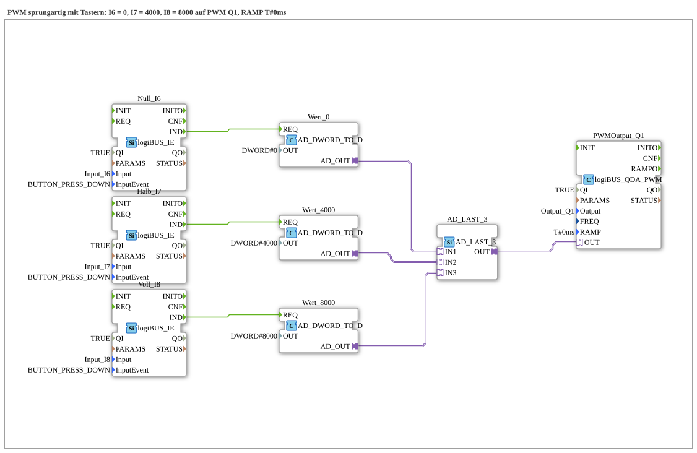

# Uebung_254b_AX: PWM with a jump and buttons

* * * * * * * * * *

## Introduction

Like exercise 254, but without a potentiometer: three buttons set the duty cycle at `Q1` to fixed values: `I6` = 0, `I7` = 4000, `I8` = 8000 (of 8191). The ramp time is `T#0ms` (jump). The three values run via [`AD_LAST_3`](https://meisterschulen-am-ostbahnhof-munchen-docs.readthedocs.io/projects/4diac-library-reference-docs/en/latest/Bibliotheken/ExternalLibraries/adapter/events/unidirectional/DWORD/AD_LAST_3/) to one PWM block: the button pressed last wins.

## Function Blocks Used (FBs)

- **Null_I6**: button event `I6` (type: [`logiBUS_IE`](https://meisterschulen-am-ostbahnhof-munchen-docs.readthedocs.io/projects/4diac-library-reference-docs/en/latest/Bibliotheken/ExternalLibraries/logiBUS/io/DI/logiBUS_IE/), `InputEvent = BUTTON_PRESS_DOWN`) → **Wert_0** (`AD_DWORD_TO_D`, `OUT = DWORD#0`): delivers the fixed value 0 as an adapter signal.
- **Halb_I7**: button event `I7` (type: [`logiBUS_IE`](https://meisterschulen-am-ostbahnhof-munchen-docs.readthedocs.io/projects/4diac-library-reference-docs/en/latest/Bibliotheken/ExternalLibraries/logiBUS/io/DI/logiBUS_IE/), `InputEvent = BUTTON_PRESS_DOWN`) → **Wert_4000** (`AD_DWORD_TO_D`, `OUT = DWORD#4000`): delivers the fixed value 4000 as an adapter signal.
- **Voll_I8**: button event `I8` (type: [`logiBUS_IE`](https://meisterschulen-am-ostbahnhof-munchen-docs.readthedocs.io/projects/4diac-library-reference-docs/en/latest/Bibliotheken/ExternalLibraries/logiBUS/io/DI/logiBUS_IE/), `InputEvent = BUTTON_PRESS_DOWN`) → **Wert_8000** (`AD_DWORD_TO_D`, `OUT = DWORD#8000`): delivers the fixed value 8000 as an adapter signal.
- **AD_LAST_3**: merges the 3 value adapters (type: [`AD_LAST_3`](https://meisterschulen-am-ostbahnhof-munchen-docs.readthedocs.io/projects/4diac-library-reference-docs/en/latest/Bibliotheken/ExternalLibraries/adapter/events/unidirectional/DWORD/AD_LAST_3/))
    - **Explanation**: last writer wins: the value of the button pressed last goes to `OUT`.
- **PWMOutput_Q1** (type: `logiBUS_QDA_PWM`, `QI = TRUE`, `Output = Output_Q1`, `RAMP = T#0ms`)
    - **Explanation**: PWM output `Q1` (jump).

### Sub-blocks: none

## Program Flow and Connections

1. A button press triggers `Wert_0.REQ`, `Wert_4000.REQ` or `Wert_8000.REQ`.
2. The matching value goes to input `IN1`, `IN2` or `IN3` of `AD_LAST_3`.
3. `AD_LAST_3.OUT` goes to `PWMOutput_Q1.OUT`. This output jumps to the value.

## Operation

1. Set the exercise `Uebungen::Uebung_254b_AX` in the `Control`.
2. Press `I6`: duty cycle 0. Press `I7`: duty cycle 4000 (about half). Press `I8`: duty cycle 8000 (almost full).

**Note:** The exercise needs no calibration and no web client.

## Summary

The exercise replaces the potentiometer with three buttons and merges their values into one signal with `AD_LAST_3`.

---

### 🌐 Related Topic Subpages on ms-muc-docs.de

- [🌐 Eclipse 4diac IDE & Color Reference auf ms-muc-docs.de](https://www.ms-muc-docs.de/iec-61499/eclipse-4diac/)
