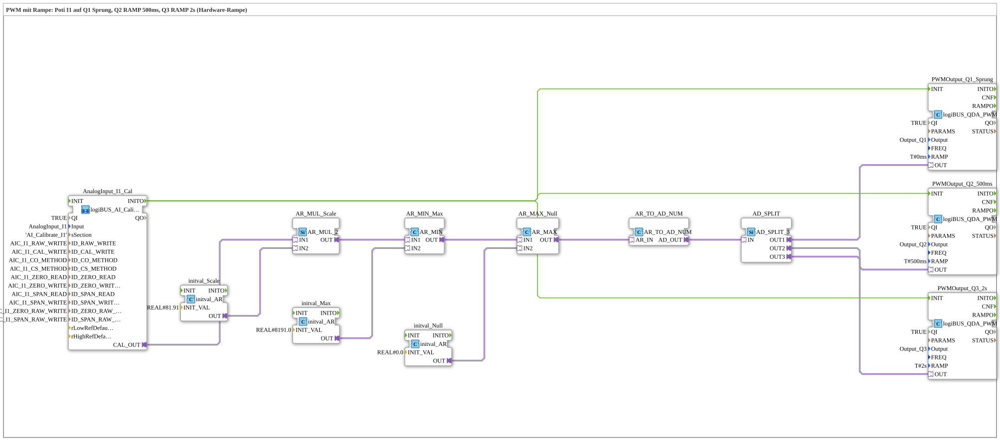

# Uebung_255_AX: PWM with hardware ramp

* * * * * * * * * *

## Introduction

The same potentiometer signal goes to three PWM outputs in parallel with different ramp times: `Q1` jumps (`T#0ms`), `Q2` moves to the new value in 500 ms, `Q3` in 2 s. The ramp runs in hardware and does not block the program (see [`logiBUS_QDA_PWM`](https://meisterschulen-am-ostbahnhof-munchen-docs.readthedocs.io/projects/4diac-library-reference-docs/en/latest/Bibliotheken/ExternalLibraries/logiBUS/io/DO/logiBUS_QDA_PWM/)).

**Prerequisite (once):** The exercise uses `logiBUS_AI_Calibrate_2P_OPC`. Insert `Button_AI_Calibrate_2P_OPC_UA` as `Control` in `test_AX.sys`, export the boot file and calibrate with the web client `apixon-ai-calibrate-2p.html` (0 %: `CO`, 100 %: `CS`). The INI file (section `AI_Calibrate_I1`) stays on the board. After that the exercise runs without a VT and without a dashboard.

## Function Blocks Used (FBs)

- **AnalogInput_I1_Cal**: analog input I1 with two-point calibration via OPC UA (type: `logiBUS_AI_Calibrate_2P_OPC`, section `AI_Calibrate_I1`)
    - **Explanation**: `CAL_OUT` delivers the calibrated value 0 to 100 %. `INITO` starts the PWM blocks.
- **AR_MUL_Scale** (`AR_MUL_2`) with **initval_Scale** (`initval_AR`, factor `81.91`): converts the value 0 to 100 % into the target range.
- **AR_MIN_Max** (`AR_MIN`) with **initval_Max** (`8191.0`): limits upwards.
- **AR_MAX_Null** (`AR_MAX`) with **initval_Null** (`0`): limits downwards. Together with `AR_MIN_Max` the value stays in the range 0 to 8191.0.
- **AR_TO_AD_NUM** (`AR_TO_AD_NUM`): converts REAL **numerically** to DWORD and passes the value on through the adapter.
- **AD_SPLIT** (`AD_SPLIT_3`): distributes the value to 3 PWM outputs.
- **PWMOutput_Q1_Sprung** (type: `logiBUS_QDA_PWM`, `QI = TRUE`, `Output = Output_Q1`, `RAMP = T#0ms`)
    - **Explanation**: PWM output `Q1` with the ramp time `T#0ms`.
- **PWMOutput_Q2_500ms** (type: `logiBUS_QDA_PWM`, `QI = TRUE`, `Output = Output_Q2`, `RAMP = T#500ms`)
    - **Explanation**: PWM output `Q2` with the ramp time `T#500ms`.
- **PWMOutput_Q3_2s** (type: `logiBUS_QDA_PWM`, `QI = TRUE`, `Output = Output_Q3`, `RAMP = T#2s`)
    - **Explanation**: PWM output `Q3` with the ramp time `T#2s`.

### Sub-blocks: none

## Program Flow and Connections

1. The potentiometer value runs from `AnalogInput_I1_Cal.CAL_OUT` through `AR_MUL_Scale`, `AR_MIN_Max` and `AR_MAX_Null` to `AR_TO_AD_NUM` (0 to 8191). `AD_SPLIT` distributes the value to `PWMOutput_Q1_Sprung`, `PWMOutput_Q2_500ms` and `PWMOutput_Q3_2s`.
2. `AnalogInput_I1_Cal.INITO` initializes all three PWM blocks. The ramp time (`RAMP`) is read at that moment.

## Operation

1. Set the exercise `Uebungen::Uebung_255_AX` in the `Control`.
2. Turn the potentiometer at `I1` quickly and compare the three outputs `Q1`, `Q2`, `Q3`: `Q1` follows at once, `Q2` in about half a second, `Q3` in about two seconds.

## Summary

The exercise shows the hardware ramp of [`logiBUS_QDA_PWM`](https://meisterschulen-am-ostbahnhof-munchen-docs.readthedocs.io/projects/4diac-library-reference-docs/en/latest/Bibliotheken/ExternalLibraries/logiBUS/io/DO/logiBUS_QDA_PWM/): the ramp time is set per block at `INIT` and applies to every new value. The program does not wait for the end of the ramp.

---

### 🌐 Related Topic Subpages on ms-muc-docs.de

- [🌐 Eclipse 4diac IDE & Color Reference auf ms-muc-docs.de](https://www.ms-muc-docs.de/iec-61499/eclipse-4diac/)
