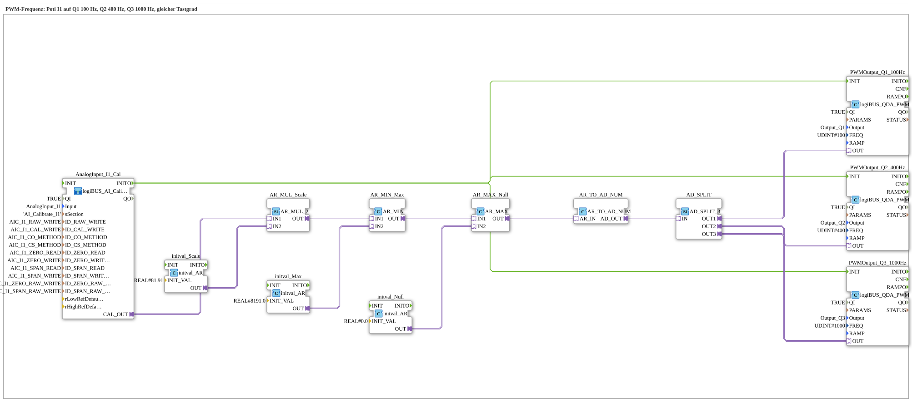

# Uebung_256_AX: Setting the PWM frequency

* * * * * * * * * *

## Introduction

The same potentiometer signal goes to three PWM outputs with different frequencies: `Q1` 100 Hz, `Q2` 400 Hz, `Q3` 1000 Hz. The duty cycle is the same for all three. The frequency is set via `FREQ` at `INIT` (see [`logiBUS_QDA_PWM`](https://meisterschulen-am-ostbahnhof-munchen-docs.readthedocs.io/projects/4diac-library-reference-docs/en/latest/Bibliotheken/ExternalLibraries/logiBUS/io/DO/logiBUS_QDA_PWM/)).

**Prerequisite (once):** The exercise uses `logiBUS_AI_Calibrate_2P_OPC`. Insert `Button_AI_Calibrate_2P_OPC_UA` as `Control` in `test_AX.sys`, export the boot file and calibrate with the web client `apixon-ai-calibrate-2p.html` (0 %: `CO`, 100 %: `CS`). The INI file (section `AI_Calibrate_I1`) stays on the board. After that the exercise runs without a VT and without a dashboard.

## Function Blocks Used (FBs)

- **AnalogInput_I1_Cal**: analog input I1 with two-point calibration via OPC UA (type: `logiBUS_AI_Calibrate_2P_OPC`, section `AI_Calibrate_I1`)
    - **Explanation**: `CAL_OUT` delivers the calibrated value 0 to 100 %. `INITO` starts the PWM blocks.
- **AR_MUL_Scale** (`AR_MUL_2`) with **initval_Scale** (`initval_AR`, factor `81.91`): converts the value 0 to 100 % into the target range.
- **AR_MIN_Max** (`AR_MIN`) with **initval_Max** (`8191.0`): limits upwards.
- **AR_MAX_Null** (`AR_MAX`) with **initval_Null** (`0`): limits downwards. Together with `AR_MIN_Max` the value stays in the range 0 to 8191.0.
- **AR_TO_AD_NUM** (`AR_TO_AD_NUM`): converts REAL **numerically** to DWORD and passes the value on through the adapter.
- **AD_SPLIT** (`AD_SPLIT_3`): distributes the value to 3 PWM outputs.
- **PWMOutput_Q1_100Hz** (type: `logiBUS_QDA_PWM`, `QI = TRUE`, `Output = Output_Q1`, `FREQ = 100`)
    - **Explanation**: PWM output `Q1` at 100 Hz.
- **PWMOutput_Q2_400Hz** (type: `logiBUS_QDA_PWM`, `QI = TRUE`, `Output = Output_Q2`, `FREQ = 400`)
    - **Explanation**: PWM output `Q2` at 400 Hz.
- **PWMOutput_Q3_1000Hz** (type: `logiBUS_QDA_PWM`, `QI = TRUE`, `Output = Output_Q3`, `FREQ = 1000`)
    - **Explanation**: PWM output `Q3` at 1000 Hz.

### Sub-blocks: none

## Program Flow and Connections

1. The potentiometer value runs from `AnalogInput_I1_Cal.CAL_OUT` through `AR_MUL_Scale`, `AR_MIN_Max` and `AR_MAX_Null` to `AR_TO_AD_NUM` (0 to 8191). `AD_SPLIT` distributes the value to the three PWM blocks.
2. `AnalogInput_I1_Cal.INITO` initializes the three PWM blocks. `FREQ` is read at that moment; a different frequency needs a new `INIT`.

## Operation

1. Set the exercise `Uebungen::Uebung_256_AX` in the `Control`.
2. Turn the potentiometer at `I1`. The duty cycle is the same at `Q1`, `Q2` and `Q3`; only the frequency differs. The three frequencies are easy to tell apart with an oscilloscope.

## Summary

The exercise shows that each PWM block gets its frequency via `FREQ` and that the duty cycle stays independent of it.

---

### 🌐 Related Topic Subpages on ms-muc-docs.de

- [🌐 Eclipse 4diac IDE & Color Reference auf ms-muc-docs.de](https://www.ms-muc-docs.de/iec-61499/eclipse-4diac/)
