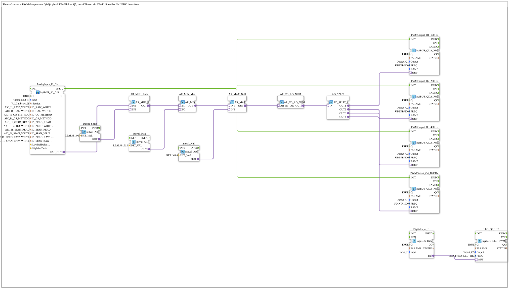

# Uebung_257_AX: Timer limit of the PWM outputs

* * * * * * * * * *

## Introduction

The ESP32 has 4 LEDC timers for PWM outputs. Outputs with the same frequency share one timer (see [`logiBUS_QDA_PWM`](https://meisterschulen-am-ostbahnhof-munchen-docs.readthedocs.io/projects/4diac-library-reference-docs/en/latest/Bibliotheken/ExternalLibraries/logiBUS/io/DO/logiBUS_QDA_PWM/)). With four different frequencies (`Q1` 100 Hz, `Q2` 200 Hz, `Q3` 400 Hz, `Q4` 1000 Hz) the exercise uses all timers and additionally starts an LED blink at `Q5`, which also needs a timer. According to the comment in the model, one block therefore reports **"No LEDC timer free"** in `STATUS`.

**Prerequisite (once):** The exercise uses `logiBUS_AI_Calibrate_2P_OPC`. Insert `Button_AI_Calibrate_2P_OPC_UA` as `Control` in `test_AX.sys`, export the boot file and calibrate with the web client `apixon-ai-calibrate-2p.html` (0 %: `CO`, 100 %: `CS`). The INI file (section `AI_Calibrate_I1`) stays on the board. After that the exercise runs without a VT and without a dashboard.

## Function Blocks Used (FBs)

- **AnalogInput_I1_Cal**: analog input I1 with two-point calibration via OPC UA (type: `logiBUS_AI_Calibrate_2P_OPC`, section `AI_Calibrate_I1`)
    - **Explanation**: `CAL_OUT` delivers the calibrated value 0 to 100 %. `INITO` starts the PWM blocks.
- **AR_MUL_Scale** (`AR_MUL_2`) with **initval_Scale** (`initval_AR`, factor `81.91`): converts the value 0 to 100 % into the target range.
- **AR_MIN_Max** (`AR_MIN`) with **initval_Max** (`8191.0`): limits upwards.
- **AR_MAX_Null** (`AR_MAX`) with **initval_Null** (`0`): limits downwards. Together with `AR_MIN_Max` the value stays in the range 0 to 8191.0.
- **AR_TO_AD_NUM** (`AR_TO_AD_NUM`): converts REAL **numerically** to DWORD and passes the value on through the adapter.
- **AD_SPLIT** (`AD_SPLIT_4`): distributes the value to 4 PWM outputs.
- **PWMOutput_Q1_100Hz** (type: `logiBUS_QDA_PWM`, `QI = TRUE`, `Output = Output_Q1`, `FREQ = 100`)
    - **Explanation**: PWM output `Q1` at 100 Hz.
- **PWMOutput_Q2_200Hz** (type: `logiBUS_QDA_PWM`, `QI = TRUE`, `Output = Output_Q2`, `FREQ = 200`)
    - **Explanation**: PWM output `Q2` at 200 Hz.
- **PWMOutput_Q3_400Hz** (type: `logiBUS_QDA_PWM`, `QI = TRUE`, `Output = Output_Q3`, `FREQ = 400`)
    - **Explanation**: PWM output `Q3` at 400 Hz.
- **PWMOutput_Q4_1000Hz** (type: `logiBUS_QDA_PWM`, `QI = TRUE`, `Output = Output_Q4`, `FREQ = 1000`)
    - **Explanation**: PWM output `Q4` at 1000 Hz.
- **DigitalInput_I1**: digital input `I1` (type: [`logiBUS_IXA`](https://meisterschulen-am-ostbahnhof-munchen-docs.readthedocs.io/projects/4diac-library-reference-docs/en/latest/Bibliotheken/ExternalLibraries/logiBUS/io/DI/logiBUS_IXA/), `QI = TRUE`, `Input = Input_I1`)
- **LED_Q5_1HZ**: LED blinking at `Q5` (type: [`logiBUS_LED_PWM_QXA`](https://meisterschulen-am-ostbahnhof-munchen-docs.readthedocs.io/projects/4diac-library-reference-docs/en/latest/Bibliotheken/ExternalLibraries/logiBUS/io/DO-LED/logiBUS_LED_PWM_QXA/), `QI = TRUE`, `Output = Output_Q5`, `FREQ = LED_FREQ::LED_1HZ`)
    - **Explanation**: The state of `I1` switches the blinking on and off. The blinking uses one of the 4 timers.

### Sub-blocks: none

## Program Flow and Connections

1. The potentiometer value runs from `AnalogInput_I1_Cal.CAL_OUT` through `AR_MUL_Scale`, `AR_MIN_Max` and `AR_MAX_Null` to `AR_TO_AD_NUM` (0 to 8191). `AD_SPLIT` distributes the value to the four PWM blocks.
2. `AnalogInput_I1_Cal.INITO` initializes the four PWM blocks, each requests an LEDC timer for its frequency.
3. `DigitalInput_I1.IN` is connected directly to `LED_Q5_1HZ.OUT`.

## Operation

1. Set the exercise `Uebungen::Uebung_257_AX` in the `Control`.
2. Watch `STATUS` of all five blocks (`PWMOutput_Q1_100Hz` to `PWMOutput_Q4_1000Hz`, `LED_Q5_1HZ`): one block reports that no LEDC timer is free.
3. For comparison, set the frequency of `PWMOutput_Q4_1000Hz` to one already used (for example 400 Hz): two outputs then share one timer, and the message disappears.

**Note:** Which block reports the message depends on the order of initialization. The statement that the message disappears is derived from the timer principle and not checked on the machine.

## Summary

The exercise shows that PWM frequencies are a limited resource: four timers suffice for four different frequencies, but not additionally for an LED blink.

---

### 🌐 Related Topic Subpages on ms-muc-docs.de

- [🌐 Eclipse 4diac IDE & Color Reference auf ms-muc-docs.de](https://www.ms-muc-docs.de/iec-61499/eclipse-4diac/)
