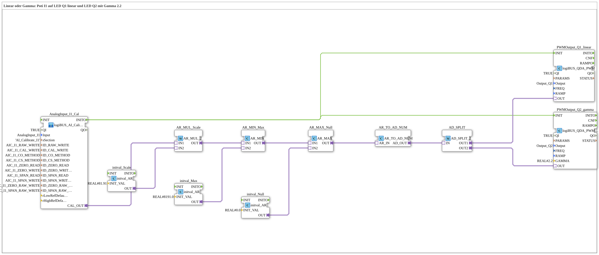

# Uebung_258_AX: Linear or gamma

* * * * * * * * * *

## Introduction

The same potentiometer signal goes to two LEDs: `Q1` via [`logiBUS_QDA_PWM`](https://meisterschulen-am-ostbahnhof-munchen-docs.readthedocs.io/projects/4diac-library-reference-docs/en/latest/Bibliotheken/ExternalLibraries/logiBUS/io/DO/logiBUS_QDA_PWM/) (linear), `Q2` via [`logiBUS_QDA_PWM_G`](https://meisterschulen-am-ostbahnhof-munchen-docs.readthedocs.io/projects/4diac-library-reference-docs/en/latest/Bibliotheken/ExternalLibraries/logiBUS/io/DO/logiBUS_QDA_PWM_G/) with `GAMMA = 2.2`. The eye does not perceive brightness linearly. The gamma curve (approximation of sRGB) compensates for this, so the LED at `Q2` gets brighter more evenly.

**Prerequisite (once):** The exercise uses `logiBUS_AI_Calibrate_2P_OPC`. Insert `Button_AI_Calibrate_2P_OPC_UA` as `Control` in `test_AX.sys`, export the boot file and calibrate with the web client `apixon-ai-calibrate-2p.html` (0 %: `CO`, 100 %: `CS`). The INI file (section `AI_Calibrate_I1`) stays on the board. After that the exercise runs without a VT and without a dashboard.

## Function Blocks Used (FBs)

- **AnalogInput_I1_Cal**: analog input I1 with two-point calibration via OPC UA (type: `logiBUS_AI_Calibrate_2P_OPC`, section `AI_Calibrate_I1`)
    - **Explanation**: `CAL_OUT` delivers the calibrated value 0 to 100 %. `INITO` starts the PWM blocks.
- **AR_MUL_Scale** (`AR_MUL_2`) with **initval_Scale** (`initval_AR`, factor `81.91`): converts the value 0 to 100 % into the target range.
- **AR_MIN_Max** (`AR_MIN`) with **initval_Max** (`8191.0`): limits upwards.
- **AR_MAX_Null** (`AR_MAX`) with **initval_Null** (`0`): limits downwards. Together with `AR_MIN_Max` the value stays in the range 0 to 8191.0.
- **AR_TO_AD_NUM** (`AR_TO_AD_NUM`): converts REAL **numerically** to DWORD and passes the value on through the adapter.
- **AD_SPLIT** (`AD_SPLIT_2`): distributes the value to 2 PWM outputs.
- **PWMOutput_Q1_linear** (type: `logiBUS_QDA_PWM`, `QI = TRUE`, `Output = Output_Q1`)
    - **Explanation**: linear duty cycle at `Q1`.
- **PWMOutput_Q2_gamma** (type: `logiBUS_QDA_PWM_G`, `QI = TRUE`, `Output = Output_Q2`, `GAMMA = 2.2`)
    - **Explanation**: gamma-corrected duty cycle at `Q2` (see [`logiBUS_QDA_PWM_G`](https://meisterschulen-am-ostbahnhof-munchen-docs.readthedocs.io/projects/4diac-library-reference-docs/en/latest/Bibliotheken/ExternalLibraries/logiBUS/io/DO/logiBUS_QDA_PWM_G/)).

### Sub-blocks: none

## Program Flow and Connections

1. The potentiometer value runs from `AnalogInput_I1_Cal.CAL_OUT` through `AR_MUL_Scale`, `AR_MIN_Max` and `AR_MAX_Null` to `AR_TO_AD_NUM` (0 to 8191). `AD_SPLIT` distributes the value to `PWMOutput_Q1_linear` and `PWMOutput_Q2_gamma`.
2. `AnalogInput_I1_Cal.INITO` initializes both PWM blocks.

## Operation

1. Set the exercise `Uebungen::Uebung_258_AX` in the `Control`.
2. Connect one LED each to `Q1` and `Q2`. Turn the potentiometer at `I1` slowly from 0 to 100 % and compare the two LEDs.
3. The linear LED already looks bright at small values and hardly changes toward the end. The gamma LED gets brighter more evenly.

## Summary

The exercise compares linear and gamma-corrected control. The gamma variant adapts the duty cycle to brightness perception.

---

### 🌐 Related Topic Subpages on ms-muc-docs.de

- [🌐 Eclipse 4diac IDE & Color Reference auf ms-muc-docs.de](https://www.ms-muc-docs.de/iec-61499/eclipse-4diac/)
