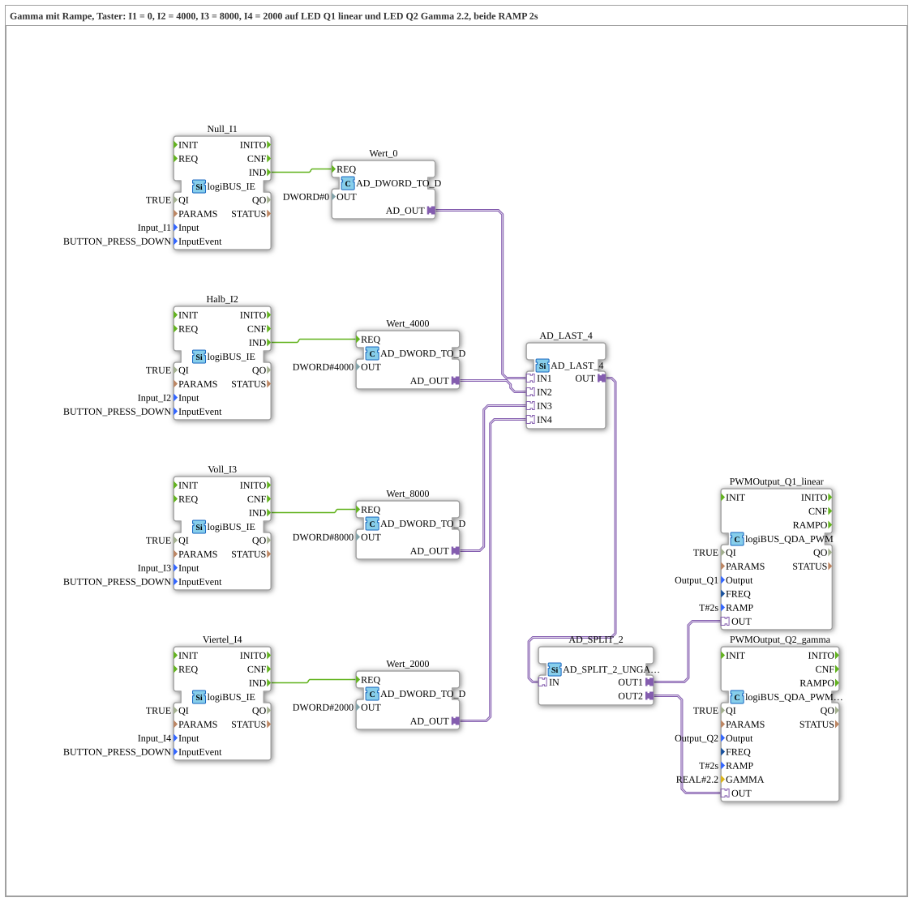

# Uebung_259b_AX: Gamma with ramp and buttons

* * * * * * * * * *

## Introduction

Like exercise 259, but without a potentiometer: four buttons set the duty cycle to fixed values: `I1` = 0, `I2` = 4000, `I3` = 8000, `I4` = 2000 (of 8191). The value goes via [`AD_LAST_4`](https://meisterschulen-am-ostbahnhof-munchen-docs.readthedocs.io/projects/4diac-library-reference-docs/en/latest/Bibliotheken/ExternalLibraries/adapter/events/unidirectional/DWORD/AD_LAST_4/) to `Q1` (linear) and `Q2` (gamma 2.2) at the same time, both with `RAMP = T#2s`. This allows comparing the two curves with identical steps.

## Function Blocks Used (FBs)

- **Null_I1**: button event `I1` (type: [`logiBUS_IE`](https://meisterschulen-am-ostbahnhof-munchen-docs.readthedocs.io/projects/4diac-library-reference-docs/en/latest/Bibliotheken/ExternalLibraries/logiBUS/io/DI/logiBUS_IE/), `InputEvent = BUTTON_PRESS_DOWN`) → **Wert_0** (`AD_DWORD_TO_D`, `OUT = DWORD#0`): delivers the fixed value 0 as an adapter signal.
- **Halb_I2**: button event `I2` (type: [`logiBUS_IE`](https://meisterschulen-am-ostbahnhof-munchen-docs.readthedocs.io/projects/4diac-library-reference-docs/en/latest/Bibliotheken/ExternalLibraries/logiBUS/io/DI/logiBUS_IE/), `InputEvent = BUTTON_PRESS_DOWN`) → **Wert_4000** (`AD_DWORD_TO_D`, `OUT = DWORD#4000`): delivers the fixed value 4000 as an adapter signal.
- **Voll_I3**: button event `I3` (type: [`logiBUS_IE`](https://meisterschulen-am-ostbahnhof-munchen-docs.readthedocs.io/projects/4diac-library-reference-docs/en/latest/Bibliotheken/ExternalLibraries/logiBUS/io/DI/logiBUS_IE/), `InputEvent = BUTTON_PRESS_DOWN`) → **Wert_8000** (`AD_DWORD_TO_D`, `OUT = DWORD#8000`): delivers the fixed value 8000 as an adapter signal.
- **Viertel_I4**: button event `I4` (type: [`logiBUS_IE`](https://meisterschulen-am-ostbahnhof-munchen-docs.readthedocs.io/projects/4diac-library-reference-docs/en/latest/Bibliotheken/ExternalLibraries/logiBUS/io/DI/logiBUS_IE/), `InputEvent = BUTTON_PRESS_DOWN`) → **Wert_2000** (`AD_DWORD_TO_D`, `OUT = DWORD#2000`): delivers the fixed value 2000 as an adapter signal.
- **AD_LAST_4**: merges the 4 value adapters (type: [`AD_LAST_4`](https://meisterschulen-am-ostbahnhof-munchen-docs.readthedocs.io/projects/4diac-library-reference-docs/en/latest/Bibliotheken/ExternalLibraries/adapter/events/unidirectional/DWORD/AD_LAST_4/))
    - **Explanation**: last writer wins: the value of the button pressed last goes to `OUT`.
- **AD_SPLIT_2** (`AD_SPLIT_2_UNGATED`): distributes the value to two outputs, without gating.
- **PWMOutput_Q1_linear** (type: `logiBUS_QDA_PWM`, `QI = TRUE`, `Output = Output_Q1`, `RAMP = T#2s`)
    - **Explanation**: linear duty cycle at `Q1`.
- **PWMOutput_Q2_gamma** (type: `logiBUS_QDA_PWM_G`, `QI = TRUE`, `Output = Output_Q2`, `RAMP = T#2s`, `GAMMA = 2.2`)
    - **Explanation**: gamma-corrected duty cycle at `Q2` (see [`logiBUS_QDA_PWM_G`](https://meisterschulen-am-ostbahnhof-munchen-docs.readthedocs.io/projects/4diac-library-reference-docs/en/latest/Bibliotheken/ExternalLibraries/logiBUS/io/DO/logiBUS_QDA_PWM_G/)).

### Sub-blocks: none

## Program Flow and Connections

1. A button press triggers `Wert_0.REQ`, `Wert_4000.REQ`, `Wert_8000.REQ` or `Wert_2000.REQ`.
2. The matching value goes to `IN1` to `IN4` of `AD_LAST_4`.
3. `AD_LAST_4.OUT` goes via `AD_SPLIT_2` to `PWMOutput_Q1_linear.OUT` and `PWMOutput_Q2_gamma.OUT`.

## Operation

1. Set the exercise `Uebungen::Uebung_259b_AX` in the `Control`.
2. Connect one LED each to `Q1` and `Q2`.
3. Press `I1` (0), `I2` (4000), `I3` (8000) and `I4` (2000) in changing order and watch how the LEDs move to the new value in 2 s. The gamma LED (`Q2`) looks darker at small values than the linear one (`Q1`).

**Note:** The exercise needs no calibration and no web client.

## Summary

The exercise compares linear and gamma control with fixed steps from four buttons, without a potentiometer and without calibration.

---

### 🌐 Related Topic Subpages on ms-muc-docs.de

- [🌐 Eclipse 4diac IDE & Color Reference auf ms-muc-docs.de](https://www.ms-muc-docs.de/iec-61499/eclipse-4diac/)
