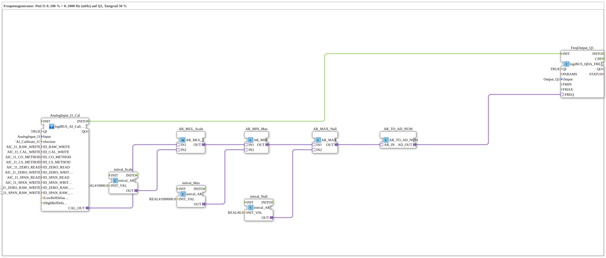

# Uebung_260_AX: Frequency generator

* * * * * * * * * *

## Introduction

The potentiometer at `I1` sets the frequency of a square wave at `Q1`: 0 to 100 % correspond to 0 to 1000 Hz. The duty cycle stays 50 %. The block [`logiBUS_QDA_FREQ`](https://meisterschulen-am-ostbahnhof-munchen-docs.readthedocs.io/projects/4diac-library-reference-docs/en/latest/Bibliotheken/ExternalLibraries/logiBUS/io/DO/logiBUS_QDA_FREQ/) expects the frequency in **millihertz**, therefore the potentiometer value is multiplied by 10000 (100 % × 10000 = 1,000,000 mHz = 1000 Hz) and limited to 1,000,000.

**Prerequisite (once):** The exercise uses `logiBUS_AI_Calibrate_2P_OPC`. Insert `Button_AI_Calibrate_2P_OPC_UA` as `Control` in `test_AX.sys`, export the boot file and calibrate with the web client `apixon-ai-calibrate-2p.html` (0 %: `CO`, 100 %: `CS`). The INI file (section `AI_Calibrate_I1`) stays on the board. After that the exercise runs without a VT and without a dashboard.

## Function Blocks Used (FBs)

- **AnalogInput_I1_Cal**: analog input I1 with two-point calibration via OPC UA (type: `logiBUS_AI_Calibrate_2P_OPC`, section `AI_Calibrate_I1`)
    - **Explanation**: `CAL_OUT` delivers the calibrated value 0 to 100 %. `INITO` starts the PWM blocks.
- **AR_MUL_Scale** (`AR_MUL_2`) with **initval_Scale** (`initval_AR`, factor `10000.0`): converts the value 0 to 100 % into the target range.
- **AR_MIN_Max** (`AR_MIN`) with **initval_Max** (`1000000.0`): limits upwards.
- **AR_MAX_Null** (`AR_MAX`) with **initval_Null** (`0`): limits downwards. Together with `AR_MIN_Max` the value stays in the range 0 to 1000000.0.
- **AR_TO_AD_NUM** (`AR_TO_AD_NUM`): converts REAL **numerically** to DWORD and passes the value on through the adapter.
- **FreqOutput_Q1**: frequency output (type: [`logiBUS_QDA_FREQ`](https://meisterschulen-am-ostbahnhof-munchen-docs.readthedocs.io/projects/4diac-library-reference-docs/en/latest/Bibliotheken/ExternalLibraries/logiBUS/io/DO/logiBUS_QDA_FREQ/), `QI = TRUE`, `Output = Output_Q1`)
    - **Explanation**: The input `FREQ` (UDINT) takes the frequency in mHz.

### Sub-blocks: none

## Program Flow and Connections

1. The potentiometer value runs from `AnalogInput_I1_Cal.CAL_OUT` through `AR_MUL_Scale`, `AR_MIN_Max` and `AR_MAX_Null` to `AR_TO_AD_NUM` (0 to 1,000,000 mHz). From there the value goes to `FreqOutput_Q1.FREQ`.
2. `AnalogInput_I1_Cal.INITO` initializes `FreqOutput_Q1`.

## Operation

1. Set the exercise `Uebungen::Uebung_260_AX` in the `Control`.
2. Connect an oscilloscope or a frequency counter to `Q1` and turn the potentiometer at `I1`: the frequency follows the potentiometer from 0 to 1000 Hz.

**Note:** The behavior at `FREQ = 0` and at very small frequencies is described on the library page [`logiBUS_QDA_FREQ`](https://meisterschulen-am-ostbahnhof-munchen-docs.readthedocs.io/projects/4diac-library-reference-docs/en/latest/Bibliotheken/ExternalLibraries/logiBUS/io/DO/logiBUS_QDA_FREQ/).

## Summary

The exercise shows how an analog value is converted into a frequency in millihertz and passed to a frequency output. The unit factor 10000 is the core of the scaling.

---

### 🌐 Related Topic Subpages on ms-muc-docs.de

- [🌐 Eclipse 4diac IDE & Color Reference auf ms-muc-docs.de](https://www.ms-muc-docs.de/iec-61499/eclipse-4diac/)
