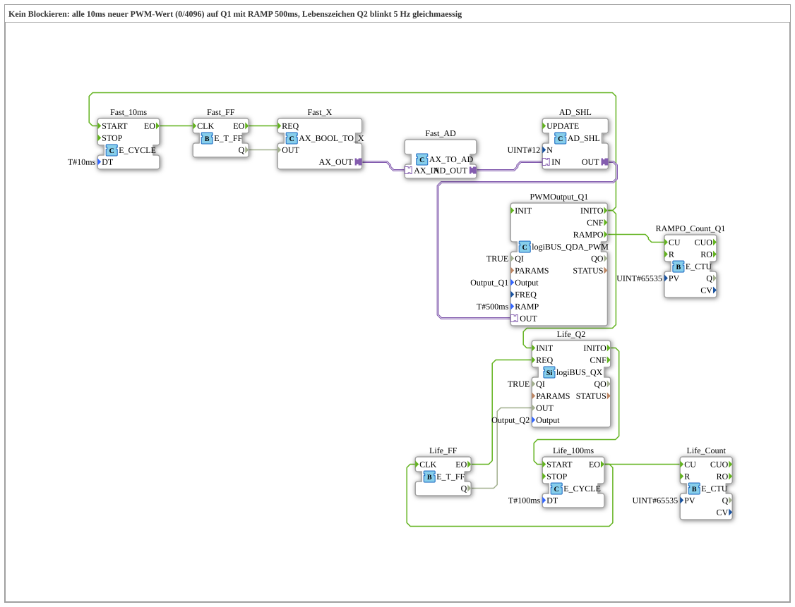

# Uebung_263_AX: No blocking

* * * * * * * * * *

## Introduction

The ramp of [`logiBUS_QDA_PWM`](https://meisterschulen-am-ostbahnhof-munchen-docs.readthedocs.io/projects/4diac-library-reference-docs/en/latest/Bibliotheken/ExternalLibraries/logiBUS/io/DO/logiBUS_QDA_PWM/) runs in hardware. This exercise proves that it **does not block** the program: every 10 ms `Q1` gets a new value (alternating 0 and 4096) with `RAMP = T#500ms`. At the same time `Q2` blinks evenly at 5 Hz as a sign of life. If the ramp stopped the program, the blinking would stutter.

## Function Blocks Used (FBs)

- **PWMOutput_Q1** (type: `logiBUS_QDA_PWM`, `QI = TRUE`, `Output = Output_Q1`, `RAMP = T#500ms`)
    - **Explanation**: PWM output `Q1` with a 500 ms ramp. `INITO` starts the two cycles.
- **Fast_10ms** (`E_CYCLE`, `DT = T#10ms`) → **Fast_FF** (`E_T_FF`): toggles the state every 10 ms.
- **Fast_X** (`AX_BOOL_TO_X`) → **Fast_AD** (`AX_TO_AD`) → **AD_SHL** (`AD_SHL`, `N = UINT#12`): turns TRUE/FALSE into the value 4096 or 0 (1 shifted left by 12 places) and passes it to `PWMOutput_Q1.OUT`.
- **RAMPO_Count_Q1** (`E_CTU`, `PV = 65535`): counts the `RAMPO` events of `Q1`.
- **Life_Q2**: digital output `Q2` (type: `logiBUS_QX`, `QI = TRUE`, `Output = Output_Q2`): sign of life.
- **Life_100ms** (`E_CYCLE`, `DT = T#100ms`) → **Life_FF** (`E_T_FF`): toggles `Q2` every 100 ms, which gives 5 Hz.
- **Life_Count** (`E_CTU`, `PV = 65535`): counts the toggles of the sign of life.

### Sub-blocks: none

## Program Flow and Connections

1. `PWMOutput_Q1.INITO` starts `Fast_10ms` and initializes `Life_Q2`, whose `INITO` starts `Life_100ms`.
2. Every 10 ms `Fast_FF` toggles; the value 4096 or 0 goes to `PWMOutput_Q1.OUT`. Because the ramp takes 500 ms, the next value arrives before it can finish.
3. Every 100 ms `Life_FF` toggles the output `Q2`.
4. `PWMOutput_Q1.RAMPO` counts `RAMPO_Count_Q1`.

## Operation

1. Set the exercise `Uebungen::Uebung_263_AX` in the `Control`.
2. Watch `Q2` (LED or oscilloscope): the blinking stays even at 5 Hz although `Q1` constantly gets new values.
3. Set watches on `RAMPO_Count_Q1.CV` and `Life_Count.CV` and compare them. `Life_Count` counts every 100 ms and stops after 65535 counts (about 109 minutes) even though `Q2` keeps blinking. So compare the counters before this limit is reached.

## Summary

The exercise shows that the hardware ramp does not block the program: the fast change of values at `Q1` does not disturb the even blinking at `Q2`.

---

### 🌐 Related Topic Subpages on ms-muc-docs.de

- [🌐 Eclipse 4diac IDE & Color Reference auf ms-muc-docs.de](https://www.ms-muc-docs.de/iec-61499/eclipse-4diac/)
