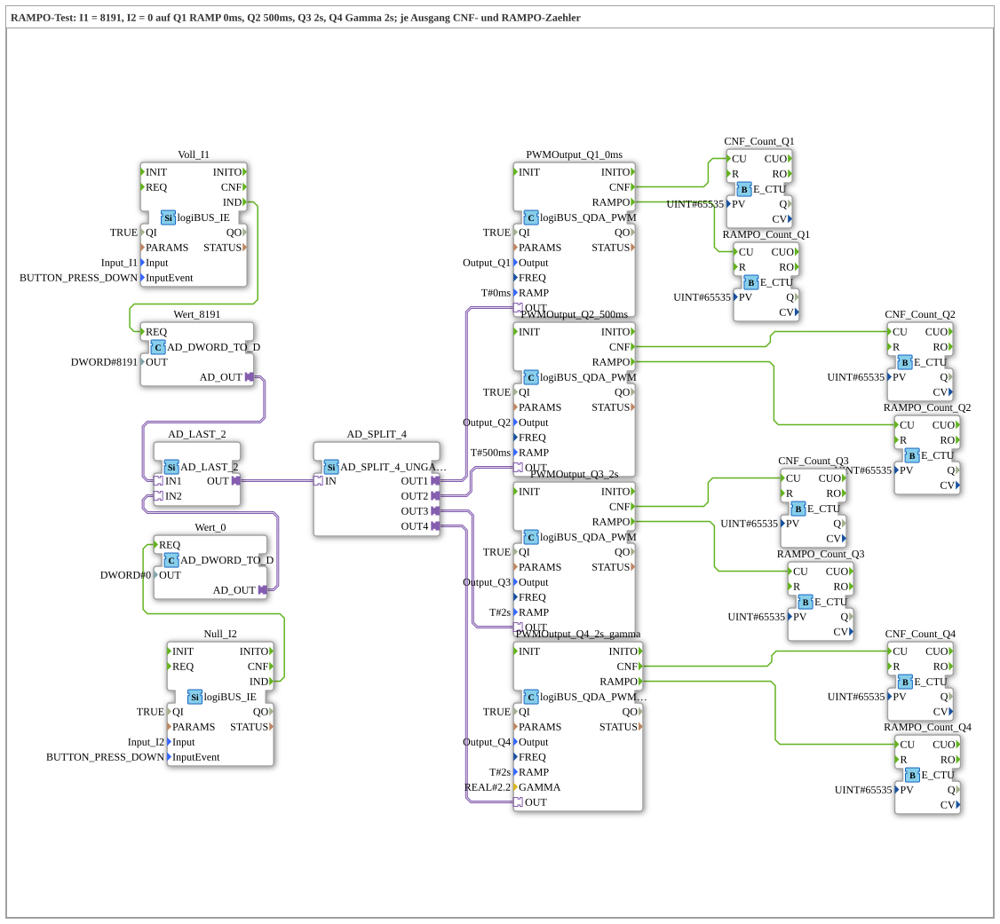

# Uebung_264_AX: RAMPO test with four outputs

* * * * * * * * * *

## Introduction

Two buttons set the same value on four PWM outputs with different ramps: `I1` = 8191 (full), `I2` = 0. `Q1` has `RAMP = T#0ms`, `Q2` 500 ms, `Q3` 2 s, `Q4` 2 s with gamma 2.2. For each output one `E_CTU` counts the confirmations (`CNF`) and another one the ramp ends (`RAMPO`). This allows comparing how `CNF` and `RAMPO` behave depending on the ramp time (see [`logiBUS_QDA_PWM`](https://meisterschulen-am-ostbahnhof-munchen-docs.readthedocs.io/projects/4diac-library-reference-docs/en/latest/Bibliotheken/ExternalLibraries/logiBUS/io/DO/logiBUS_QDA_PWM/)).

## Function Blocks Used (FBs)

- **Voll_I1** ([`logiBUS_IE`](https://meisterschulen-am-ostbahnhof-munchen-docs.readthedocs.io/projects/4diac-library-reference-docs/en/latest/Bibliotheken/ExternalLibraries/logiBUS/io/DI/logiBUS_IE/), `InputEvent = BUTTON_PRESS_DOWN`) → **Wert_8191** (`AD_DWORD_TO_D`, `OUT = DWORD#8191`)
- **Null_I2** ([`logiBUS_IE`](https://meisterschulen-am-ostbahnhof-munchen-docs.readthedocs.io/projects/4diac-library-reference-docs/en/latest/Bibliotheken/ExternalLibraries/logiBUS/io/DI/logiBUS_IE/), `InputEvent = BUTTON_PRESS_DOWN`) → **Wert_0** (`AD_DWORD_TO_D`, `OUT = DWORD#0`)
- **AD_LAST_2** ([`AD_LAST_2`](https://meisterschulen-am-ostbahnhof-munchen-docs.readthedocs.io/projects/4diac-library-reference-docs/en/latest/Bibliotheken/ExternalLibraries/adapter/events/unidirectional/DWORD/AD_LAST_2/)): merges the two values, the button pressed last wins.
- **AD_SPLIT_4** (`AD_SPLIT_4_UNGATED`): distributes the value to four outputs.
- **PWMOutput_Q1_0ms** (type: `logiBUS_QDA_PWM`, `QI = TRUE`, `Output = Output_Q1`, `RAMP = T#0ms`)
    - **Explanation**: PWM output `Q1` with the ramp time `T#0ms`.
- **PWMOutput_Q2_500ms** (type: `logiBUS_QDA_PWM`, `QI = TRUE`, `Output = Output_Q2`, `RAMP = T#500ms`)
    - **Explanation**: PWM output `Q2` with the ramp time `T#500ms`.
- **PWMOutput_Q3_2s** (type: `logiBUS_QDA_PWM`, `QI = TRUE`, `Output = Output_Q3`, `RAMP = T#2s`)
    - **Explanation**: PWM output `Q3` with the ramp time `T#2s`.
- **PWMOutput_Q4_2s_gamma** (type: `logiBUS_QDA_PWM_G`, `QI = TRUE`, `Output = Output_Q4`, `RAMP = T#2s`, `GAMMA = 2.2`)
    - **Explanation**: gamma-corrected PWM output `Q4` (see [`logiBUS_QDA_PWM_G`](https://meisterschulen-am-ostbahnhof-munchen-docs.readthedocs.io/projects/4diac-library-reference-docs/en/latest/Bibliotheken/ExternalLibraries/logiBUS/io/DO/logiBUS_QDA_PWM_G/)).
- **CNF_Count_Q1** to **CNF_Count_Q4**, **RAMPO_Count_Q1** to **RAMPO_Count_Q4** (`E_CTU`, `PV = 65535`): count `CNF` and `RAMPO` of the matching PWM block.

### Sub-blocks: none

## Program Flow and Connections

1. `I1` or `I2` delivers the value 8191 or 0 to `AD_LAST_2`; from there it goes via `AD_SPLIT_4` to all four PWM blocks.
2. Each PWM block confirms with `CNF` (to `CNF_Count_Qn.CU`) and reports the end of the ramp with `RAMPO` (to `RAMPO_Count_Qn.CU`).
3. At `Q1` (`T#0ms`) `RAMPO` comes directly after the jump, at the others only after the ramp has run.

## Operation

1. Set the exercise `Uebungen::Uebung_264_AX` in the `Control`.
2. Set watches on `CNF_Count_Q1.CV` to `CNF_Count_Q4.CV` and `RAMPO_Count_Q1.CV` to `RAMPO_Count_Q4.CV`.
3. Press `I1` and `I2` alternately with pauses and read the counters. Then press `I1` and `I2` quickly one after the other before the ramp is finished and compare how the `RAMPO` counters behave compared to the `CNF` counters.

## Summary

The exercise is a test for `CNF` and `RAMPO` at different ramp times, with linear and gamma output, each with counters to read.

---

### 🌐 Related Topic Subpages on ms-muc-docs.de

- [🌐 Eclipse 4diac IDE & Color Reference auf ms-muc-docs.de](https://www.ms-muc-docs.de/iec-61499/eclipse-4diac/)
