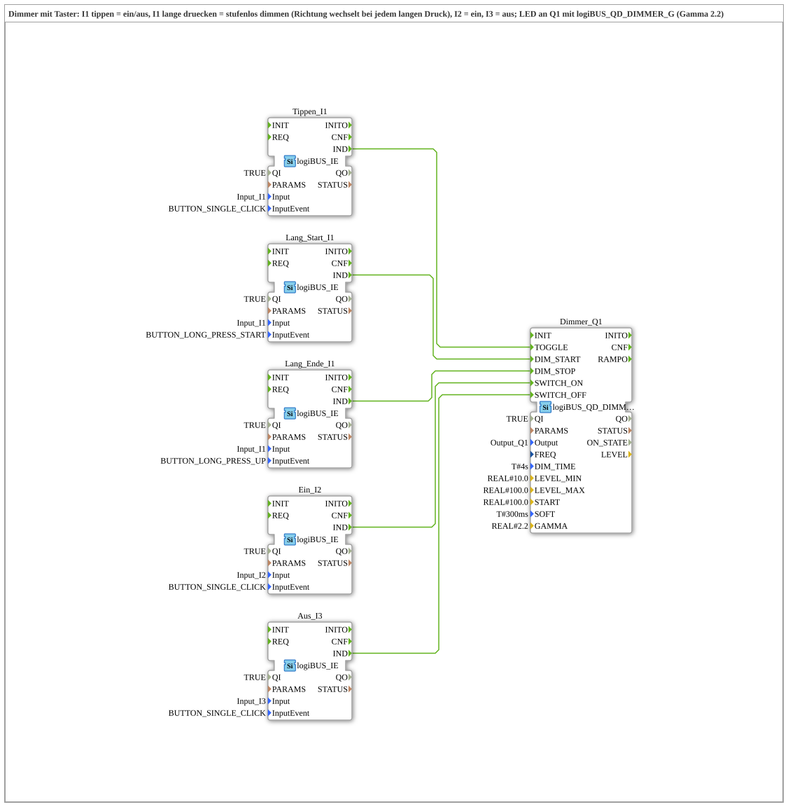

# Uebung_265_AX: Dimmer mit Taster: I1 tippen = ein/aus, I1 lange druecken = stufenlos dimmen …

This article describes the 4diac IDE sub-application Uebung_265_AX (Dimmer mit Taster: I1 tippen = ein/aus, I1 lange druecken = stufenlos dimmen (Richtung wechselt bei jedem langen Druck), I2 = ein, I3 = aus; LED an Q1 mit logiBUS_QD_DIMMER_G (Gamma 2.2)).

----

## Objective of the Exercise

The main objective of this exercise is to implement the following requirement: **Dimmer mit Taster: I1 tippen = ein/aus, I1 lange druecken = stufenlos dimmen (Richtung wechselt bei jedem langen Druck), I2 = ein, I3 = aus; LED an Q1 mit logiBUS_QD_DIMMER_G (Gamma 2.2)**

-----

## Description and Components

The exercise consists of the sub-application Uebung_265_AX.SUB, which uses the following function block structure:

### Instantiated Function Blocks (FBs)

- **Tippen_I1**: Instance of type logiBUS::io::DI::logiBUS_IE.
  - Parameter QI = TRUE
  - Parameter Input = Input_I1
  - Parameter InputEvent = BUTTON_SINGLE_CLICK
- **Lang_Start_I1**: Instance of type logiBUS::io::DI::logiBUS_IE.
  - Parameter QI = TRUE
  - Parameter Input = Input_I1
  - Parameter InputEvent = BUTTON_LONG_PRESS_START
- **Lang_Ende_I1**: Instance of type logiBUS::io::DI::logiBUS_IE.
  - Parameter QI = TRUE
  - Parameter Input = Input_I1
  - Parameter InputEvent = BUTTON_LONG_PRESS_UP
- **Ein_I2**: Instance of type logiBUS::io::DI::logiBUS_IE.
  - Parameter QI = TRUE
  - Parameter Input = Input_I2
  - Parameter InputEvent = BUTTON_SINGLE_CLICK
- **Aus_I3**: Instance of type logiBUS::io::DI::logiBUS_IE.
  - Parameter QI = TRUE
  - Parameter Input = Input_I3
  - Parameter InputEvent = BUTTON_SINGLE_CLICK
- **Dimmer_Q1**: Instance of type logiBUS::io::DQ::logiBUS_QD_DIMMER_G.
  - Parameter QI = TRUE
  - Parameter Output = Output_Q1
  - Parameter DIM_TIME = T#4s
  - Parameter LEVEL_MIN = 10.0
  - Parameter LEVEL_MAX = 100.0
  - Parameter START = 100.0
  - Parameter SOFT = T#300ms
  - Parameter GAMMA = 2.2

-----

## Summary

Exercise Uebung_265_AX demonstrates the modular IEC 61499 architecture in 4diac IDE.
