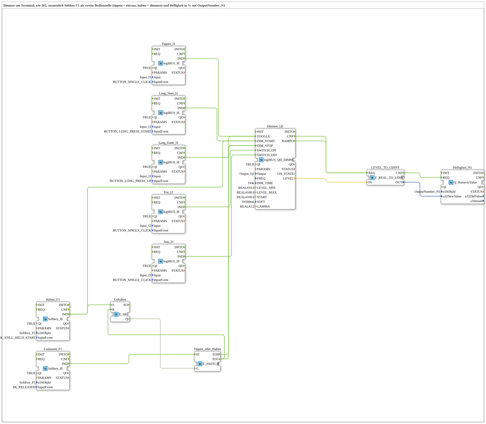

# Uebung_266_AX: Dimmer am Terminal: wie 265, zusaetzlich Softkey F1 als zweite Bedienstelle …

This article describes the 4diac IDE sub-application Uebung_266_AX (Dimmer am Terminal: wie 265, zusaetzlich Softkey F1 als zweite Bedienstelle (tippen = ein/aus, halten = dimmen) und Helligkeit in % auf OutputNumber_N1).

----

## Objective of the Exercise

The main objective of this exercise is to implement the following requirement: **Dimmer am Terminal: wie 265, zusaetzlich Softkey F1 als zweite Bedienstelle (tippen = ein/aus, halten = dimmen) und Helligkeit in % auf OutputNumber_N1**

-----

## Description and Components

The exercise consists of the sub-application Uebung_266_AX.SUB, which uses the following function block structure:

### Instantiated Function Blocks (FBs)

- **Tippen_I1**: Instance of type logiBUS::io::DI::logiBUS_IE.
  - Parameter QI = TRUE
  - Parameter Input = Input_I1
  - Parameter InputEvent = BUTTON_SINGLE_CLICK
- **Lang_Start_I1**: Instance of type logiBUS::io::DI::logiBUS_IE.
  - Parameter QI = TRUE
  - Parameter Input = Input_I1
  - Parameter InputEvent = BUTTON_LONG_PRESS_START
- **Lang_Ende_I1**: Instance of type logiBUS::io::DI::logiBUS_IE.
  - Parameter QI = TRUE
  - Parameter Input = Input_I1
  - Parameter InputEvent = BUTTON_LONG_PRESS_UP
- **Ein_I2**: Instance of type logiBUS::io::DI::logiBUS_IE.
  - Parameter QI = TRUE
  - Parameter Input = Input_I2
  - Parameter InputEvent = BUTTON_SINGLE_CLICK
- **Aus_I3**: Instance of type logiBUS::io::DI::logiBUS_IE.
  - Parameter QI = TRUE
  - Parameter Input = Input_I3
  - Parameter InputEvent = BUTTON_SINGLE_CLICK
- **Halten_F1**: Instance of type isobus::UT::io::Softkey::Softkey_IE.
  - Parameter QI = TRUE
  - Parameter u16ObjId = SoftKey_F1
  - Parameter InputEvent = SK_STILL_HELD_START
- **Loslassen_F1**: Instance of type isobus::UT::io::Softkey::Softkey_IE.
  - Parameter QI = TRUE
  - Parameter u16ObjId = SoftKey_F1
  - Parameter InputEvent = SK_RELEASED
- **Gehalten**: Instance of type iec61499::events::E_SR.
- **Tippen_oder_Halten**: Instance of type iec61499::events::E_SWITCH.
- **Dimmer_Q1**: Instance of type logiBUS::io::DQ::logiBUS_QD_DIMMER_G.
  - Parameter QI = TRUE
  - Parameter Output = Output_Q1
  - Parameter DIM_TIME = T#4s
  - Parameter LEVEL_MIN = 10.0
  - Parameter LEVEL_MAX = 100.0
  - Parameter START = 100.0
  - Parameter SOFT = T#300ms
  - Parameter GAMMA = 2.2
- **LEVEL_TO_UDINT**: Instance of type iec61131::conversion::F_REAL_TO_UDINT.
- **Helligkeit_N1**: Instance of type isobus::UT::Q::Q_NumericValue.
  - Parameter u16ObjId = OutputNumber_N1

-----

## Summary

Exercise Uebung_266_AX demonstrates the modular IEC 61499 architecture in 4diac IDE.
