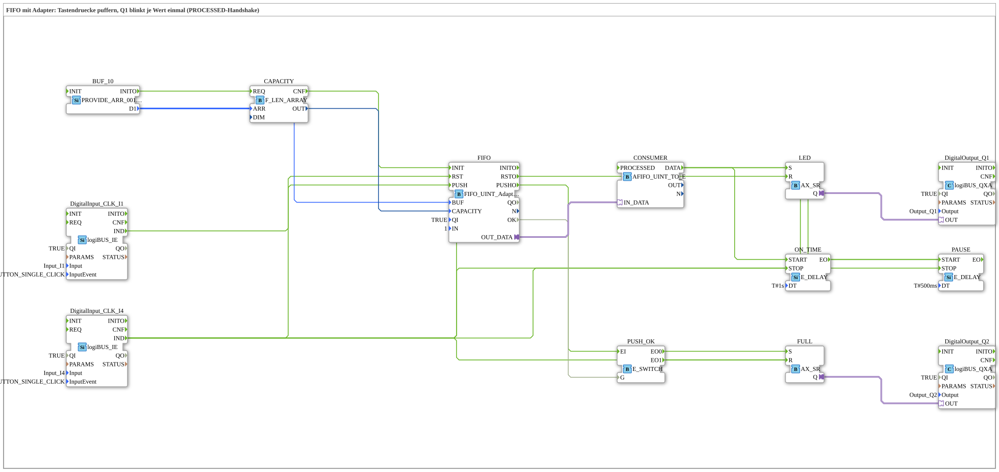

# Uebung_267_AX: FIFO mit Adapter: Tastendruecke puffern, Q1 blinkt je Wert einmal …

This article describes the 4diac IDE sub-application Uebung_267_AX (FIFO mit Adapter: Tastendruecke puffern, Q1 blinkt je Wert einmal (PROCESSED-Handshake)).

----

## Objective of the Exercise

The main objective of this exercise is to implement the following requirement: **FIFO mit Adapter: Tastendruecke puffern, Q1 blinkt je Wert einmal (PROCESSED-Handshake)**

-----

## Description and Components

The exercise consists of the sub-application Uebung_267_AX.SUB, which uses the following function block structure:

### Instantiated Function Blocks (FBs)

- **BUF_10**: Instance of type eclipse4diac::convert::providers::PROVIDE_ARR_0010_UINT.
- **CAPACITY**: Instance of type eclipse4diac::utils::arrays::F_LEN_ARRAY.
- **FIFO**: Instance of type FIFO_adapter::FIFO_UINT_Adapter.
  - Parameter QI = TRUE
  - Parameter IN = 1
- **CONSUMER**: Instance of type FIFO_adapter::AFIFO_UINT_TO_E.
- **DigitalInput_CLK_I1**: Instance of type logiBUS::io::DI::logiBUS_IE.
  - Parameter QI = TRUE
  - Parameter Input = Input_I1
  - Parameter InputEvent = BUTTON_SINGLE_CLICK
- **DigitalInput_CLK_I4**: Instance of type logiBUS::io::DI::logiBUS_IE.
  - Parameter QI = TRUE
  - Parameter Input = Input_I4
  - Parameter InputEvent = BUTTON_SINGLE_CLICK
- **LED**: Instance of type adapter::events::unidirectional::AX_SR.
- **ON_TIME**: Instance of type iec61499::events::E_DELAY.
  - Parameter DT = T#1s
- **PAUSE**: Instance of type iec61499::events::E_DELAY.
  - Parameter DT = T#500ms
- **DigitalOutput_Q1**: Instance of type logiBUS::io::DQ::logiBUS_QXA.
  - Parameter QI = TRUE
  - Parameter Output = Output_Q1
- **PUSH_OK**: Instance of type iec61499::events::E_SWITCH.
- **FULL**: Instance of type adapter::events::unidirectional::AX_SR.
- **DigitalOutput_Q2**: Instance of type logiBUS::io::DQ::logiBUS_QXA.
  - Parameter QI = TRUE
  - Parameter Output = Output_Q2

-----

## Summary

Exercise Uebung_267_AX demonstrates the modular IEC 61499 architecture in 4diac IDE.
