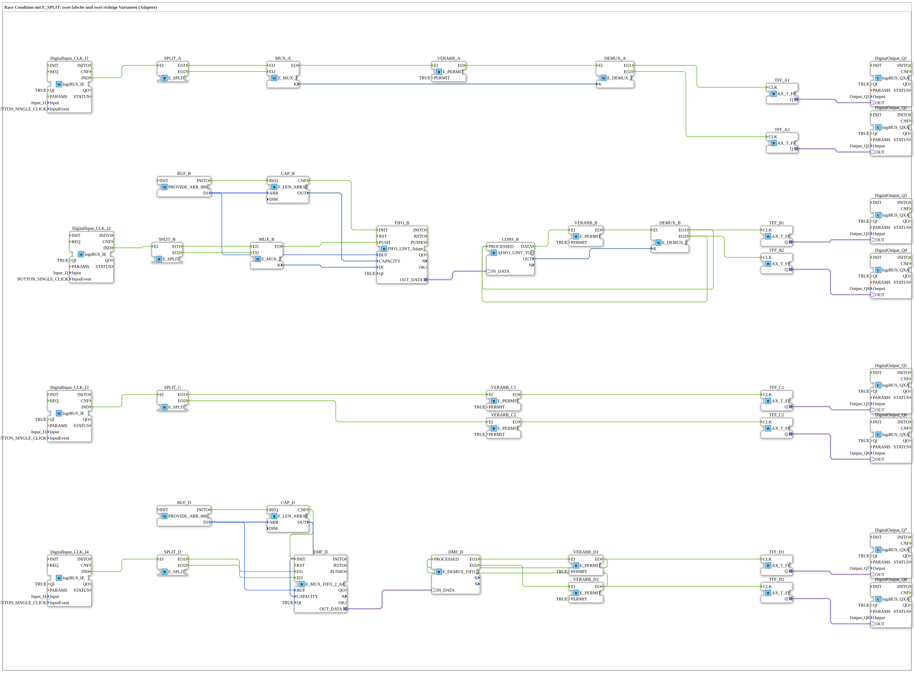

# Uebung_268_AX: Race Condition mit E_SPLIT: zwei falsche und zwei richtige Varianten (Adapter)

This article describes the 4diac IDE sub-application Uebung_268_AX (Race Condition mit E_SPLIT: zwei falsche und zwei richtige Varianten (Adapter)).

----

## Objective of the Exercise

The main objective of this exercise is to implement the following requirement: **Race Condition mit E_SPLIT: zwei falsche und zwei richtige Varianten (Adapter)**

-----

## Description and Components

The exercise consists of the sub-application Uebung_268_AX.SUB, which uses the following function block structure:

### Instantiated Function Blocks (FBs)

- **DigitalInput_CLK_I1**: Instance of type logiBUS::io::DI::logiBUS_IE.
  - Parameter QI = TRUE
  - Parameter Input = Input_I1
  - Parameter InputEvent = BUTTON_SINGLE_CLICK
- **SPLIT_A**: Instance of type iec61499::events::E_SPLIT.
- **MUX_A**: Instance of type iec61499::events::E_MUX_2.
- **VERARB_A**: Instance of type iec61499::events::E_PERMIT.
  - Parameter PERMIT = TRUE
- **DEMUX_A**: Instance of type iec61499::events::E_DEMUX_2.
- **TFF_A1**: Instance of type adapter::events::unidirectional::AX_T_FF.
- **DigitalOutput_Q1**: Instance of type logiBUS::io::DQ::logiBUS_QXA.
  - Parameter QI = TRUE
  - Parameter Output = Output_Q1
- **TFF_A2**: Instance of type adapter::events::unidirectional::AX_T_FF.
- **DigitalOutput_Q2**: Instance of type logiBUS::io::DQ::logiBUS_QXA.
  - Parameter QI = TRUE
  - Parameter Output = Output_Q2
- **DigitalInput_CLK_I2**: Instance of type logiBUS::io::DI::logiBUS_IE.
  - Parameter QI = TRUE
  - Parameter Input = Input_I2
  - Parameter InputEvent = BUTTON_SINGLE_CLICK
- **SPLIT_B**: Instance of type iec61499::events::E_SPLIT.
- **BUF_B**: Instance of type eclipse4diac::convert::providers::PROVIDE_ARR_0004_UINT.
- **CAP_B**: Instance of type eclipse4diac::utils::arrays::F_LEN_ARRAY.
- **MUX_B**: Instance of type iec61499::events::E_MUX_2.
- **FIFO_B**: Instance of type FIFO_adapter::FIFO_UINT_Adapter.
  - Parameter QI = TRUE
- **CONS_B**: Instance of type FIFO_adapter::AFIFO_UINT_TO_E.
- **VERARB_B**: Instance of type iec61499::events::E_PERMIT.
  - Parameter PERMIT = TRUE
- **DEMUX_B**: Instance of type iec61499::events::E_DEMUX_2.
- **TFF_B1**: Instance of type adapter::events::unidirectional::AX_T_FF.
- **DigitalOutput_Q3**: Instance of type logiBUS::io::DQ::logiBUS_QXA.
  - Parameter QI = TRUE
  - Parameter Output = Output_Q3
- **TFF_B2**: Instance of type adapter::events::unidirectional::AX_T_FF.
- **DigitalOutput_Q4**: Instance of type logiBUS::io::DQ::logiBUS_QXA.
  - Parameter QI = TRUE
  - Parameter Output = Output_Q4
- **DigitalInput_CLK_I3**: Instance of type logiBUS::io::DI::logiBUS_IE.
  - Parameter QI = TRUE
  - Parameter Input = Input_I3
  - Parameter InputEvent = BUTTON_SINGLE_CLICK
- **SPLIT_C**: Instance of type iec61499::events::E_SPLIT.
- **VERARB_C1**: Instance of type iec61499::events::E_PERMIT.
  - Parameter PERMIT = TRUE
- **VERARB_C2**: Instance of type iec61499::events::E_PERMIT.
  - Parameter PERMIT = TRUE
- **TFF_C1**: Instance of type adapter::events::unidirectional::AX_T_FF.
- **DigitalOutput_Q5**: Instance of type logiBUS::io::DQ::logiBUS_QXA.
  - Parameter QI = TRUE
  - Parameter Output = Output_Q5
- **TFF_C2**: Instance of type adapter::events::unidirectional::AX_T_FF.
- **DigitalOutput_Q6**: Instance of type logiBUS::io::DQ::logiBUS_QXA.
  - Parameter QI = TRUE
  - Parameter Output = Output_Q6
- **DigitalInput_CLK_I4**: Instance of type logiBUS::io::DI::logiBUS_IE.
  - Parameter QI = TRUE
  - Parameter Input = Input_I4
  - Parameter InputEvent = BUTTON_SINGLE_CLICK
- **SPLIT_D**: Instance of type iec61499::events::E_SPLIT.
- **BUF_D**: Instance of type eclipse4diac::convert::providers::PROVIDE_ARR_0004_UINT.
- **CAP_D**: Instance of type eclipse4diac::utils::arrays::F_LEN_ARRAY.
- **EMF_D**: Instance of type FIFO_adapter::E_MUX_FIFO_2_Adapter.
  - Parameter QI = TRUE
- **DMF_D**: Instance of type FIFO_adapter::E_DEMUX_FIFO_2.
- **VERARB_D1**: Instance of type iec61499::events::E_PERMIT.
  - Parameter PERMIT = TRUE
- **VERARB_D2**: Instance of type iec61499::events::E_PERMIT.
  - Parameter PERMIT = TRUE
- **TFF_D1**: Instance of type adapter::events::unidirectional::AX_T_FF.
- **DigitalOutput_Q7**: Instance of type logiBUS::io::DQ::logiBUS_QXA.
  - Parameter QI = TRUE
  - Parameter Output = Output_Q7
- **TFF_D2**: Instance of type adapter::events::unidirectional::AX_T_FF.
- **DigitalOutput_Q8**: Instance of type logiBUS::io::DQ::logiBUS_QXA.
  - Parameter QI = TRUE
  - Parameter Output = Output_Q8

-----

## Summary

Exercise Uebung_268_AX demonstrates the modular IEC 61499 architecture in 4diac IDE.
