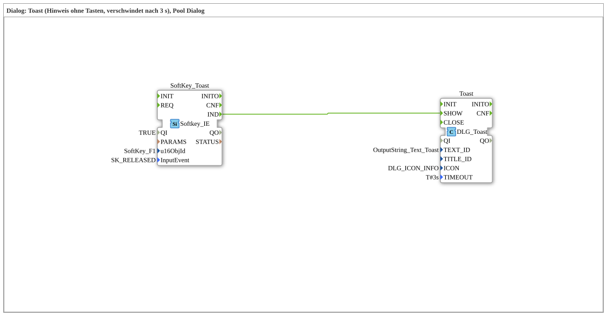

# Uebung_269_AX: Dialog: Toast (Hinweis ohne Tasten, verschwindet nach 3 s), Pool Dialog

This article describes the 4diac IDE sub-application Uebung_269_AX (Dialog: Toast (Hinweis ohne Tasten, verschwindet nach 3 s), Pool Dialog).

----

## Objective of the Exercise

The main objective of this exercise is to implement the following requirement: **Dialog: Toast (Hinweis ohne Tasten, verschwindet nach 3 s), Pool Dialog**

-----

## Description and Components

The exercise consists of the sub-application Uebung_269_AX.SUB, which uses the following function block structure:

### Instantiated Function Blocks (FBs)

- **SoftKey_Toast**: Instance of type isobus::UT::io::Softkey::Softkey_IE.
  - Parameter QI = TRUE
  - Parameter u16ObjId = SoftKey_F1
  - Parameter InputEvent = SK_RELEASED
- **Toast**: Instance of type isobus::UT::dialog::DLG_Toast.
  - Parameter TEXT_ID = OutputString_Text_Toast
  - Parameter ICON = DLG_ICON_INFO
  - Parameter TIMEOUT = T#3s

-----

## Summary

Exercise Uebung_269_AX demonstrates the modular IEC 61499 architecture in 4diac IDE.
