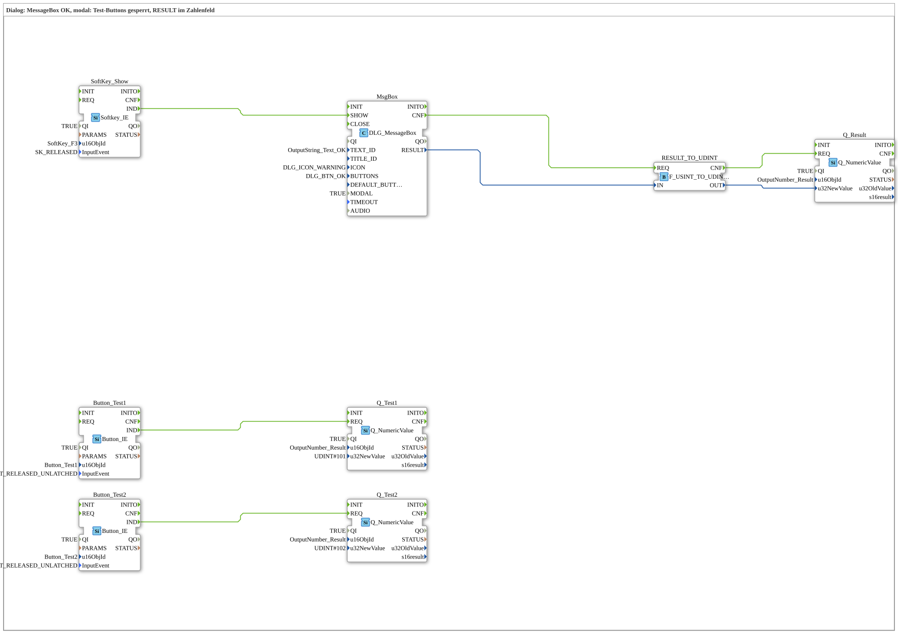

# Uebung_271_AX: Dialog: MessageBox OK, modal: Test-Buttons gesperrt, RESULT im Zahlenfeld

This article describes the 4diac IDE sub-application Uebung_271_AX (Dialog: MessageBox OK, modal: Test-Buttons gesperrt, RESULT im Zahlenfeld).

----

## Objective of the Exercise

The main objective of this exercise is to implement the following requirement: **Dialog: MessageBox OK, modal: Test-Buttons gesperrt, RESULT im Zahlenfeld**

-----

## Description and Components

The exercise consists of the sub-application Uebung_271_AX.SUB, which uses the following function block structure:

### Instantiated Function Blocks (FBs)

- **SoftKey_Show**: Instance of type isobus::UT::io::Softkey::Softkey_IE.
  - Parameter QI = TRUE
  - Parameter u16ObjId = SoftKey_F3
  - Parameter InputEvent = SK_RELEASED
- **MsgBox**: Instance of type isobus::UT::dialog::DLG_MessageBox.
  - Parameter TEXT_ID = OutputString_Text_OK
  - Parameter ICON = DLG_ICON_WARNING
  - Parameter BUTTONS = DLG_BTN_OK
  - Parameter MODAL = TRUE
- **RESULT_TO_UDINT**: Instance of type iec61131::conversion::F_USINT_TO_UDINT.
- **Q_Result**: Instance of type isobus::UT::Q::Q_NumericValue.
  - Parameter QI = TRUE
  - Parameter u16ObjId = OutputNumber_Result
- **Button_Test1**: Instance of type isobus::UT::io::Button::Button_IE.
  - Parameter QI = TRUE
  - Parameter u16ObjId = Button_Test1
  - Parameter InputEvent = BT_RELEASED_UNLATCHED
- **Q_Test1**: Instance of type isobus::UT::Q::Q_NumericValue.
  - Parameter QI = TRUE
  - Parameter u16ObjId = OutputNumber_Result
  - Parameter u32NewValue = UDINT#101
- **Button_Test2**: Instance of type isobus::UT::io::Button::Button_IE.
  - Parameter QI = TRUE
  - Parameter u16ObjId = Button_Test2
  - Parameter InputEvent = BT_RELEASED_UNLATCHED
- **Q_Test2**: Instance of type isobus::UT::Q::Q_NumericValue.
  - Parameter QI = TRUE
  - Parameter u16ObjId = OutputNumber_Result
  - Parameter u32NewValue = UDINT#102

-----

## Summary

Exercise Uebung_271_AX demonstrates the modular IEC 61499 architecture in 4diac IDE.
