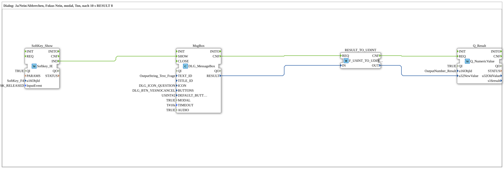

# Uebung_272_AX: Dialog: Ja/Nein/Abbrechen, Fokus Nein, modal, Ton, nach 10 s RESULT 8

This article describes the 4diac IDE sub-application Uebung_272_AX (Dialog: Ja/Nein/Abbrechen, Fokus Nein, modal, Ton, nach 10 s RESULT 8).

----

## Objective of the Exercise

The main objective of this exercise is to implement the following requirement: **Dialog: Ja/Nein/Abbrechen, Fokus Nein, modal, Ton, nach 10 s RESULT 8**

-----

## Description and Components

The exercise consists of the sub-application Uebung_272_AX.SUB, which uses the following function block structure:

### Instantiated Function Blocks (FBs)

- **SoftKey_Show**: Instance of type isobus::UT::io::Softkey::Softkey_IE.
  - Parameter QI = TRUE
  - Parameter u16ObjId = SoftKey_F4
  - Parameter InputEvent = SK_RELEASED
- **MsgBox**: Instance of type isobus::UT::dialog::DLG_MessageBox.
  - Parameter TEXT_ID = OutputString_Text_Frage
  - Parameter ICON = DLG_ICON_QUESTION
  - Parameter BUTTONS = DLG_BTN_YESNOCANCEL
  - Parameter DEFAULT_BUTTON = USINT#2
  - Parameter MODAL = TRUE
  - Parameter TIMEOUT = T#10s
  - Parameter AUDIO = TRUE
- **RESULT_TO_UDINT**: Instance of type iec61131::conversion::F_USINT_TO_UDINT.
- **Q_Result**: Instance of type isobus::UT::Q::Q_NumericValue.
  - Parameter QI = TRUE
  - Parameter u16ObjId = OutputNumber_Result

-----

## Summary

Exercise Uebung_272_AX demonstrates the modular IEC 61499 architecture in 4diac IDE.
