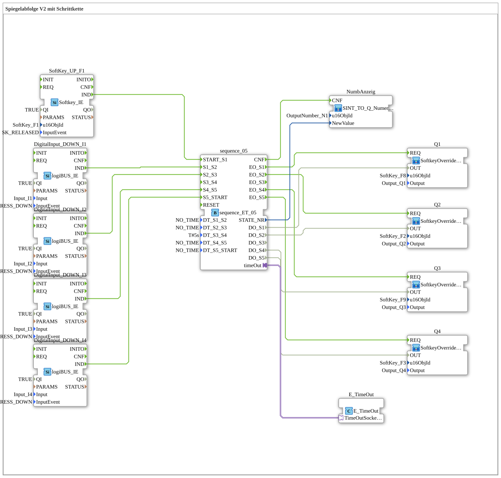

# Exercise_039: Mirror Sequence V2 with Step Chain

* * * * * * * * * *

## Introduction

This article describes the logiBUS® exercise `Uebung_039`. This exercise is specifically designed for controlling hydraulic or pneumatic directional control valves.

The goal is a complex mirror sequence. Unlike simple cylinders, directional control valves often need to maintain states (center position locked), which requires precise timing and event-based control of the coils.

The subapplication `Uebung_039.SUB` uses a 5-step sequencer (`sequence_ET_05`). The hardware is controlled via four instances of the reusable SubApp `MyLib::sys::SoftkeyOverride_TO_QX_BG`, which also give visual feedback on the respective valve state on the ISOBUS terminal by changing the background color of the corresponding softkey.

## Function Blocks (FBs) Used

- **SoftKey_UP_F1**: VT softkey as start button
    - **Type**: `isobus::UT::io::Softkey::Softkey_IE`
    - **Parameters**: `QI = TRUE`, `u16ObjId = SoftKey_F1`, `InputEvent = SK_RELEASED`
    - **Explanation**: Reports the release of `SoftKey_F1` as event `IND`.
- **DigitalInput_DOWN_I1** to **DigitalInput_DOWN_I4**: logiBUS inputs with button-press detection
    - **Type**: `logiBUS::io::DI::logiBUS_IE`
    - **Parameters**: `QI = TRUE`, `Input = Input_I1` / `Input_I2` / `Input_I3` / `Input_I4`, `InputEvent = BUTTON_PRESS_DOWN`
    - **Explanation**: Each input reports pressing down its button as event `IND`.
- **sequence_05**: 5-step sequencer (advance by event or time)
    - **Type**: `logiBUS::utils::sequence::combi::sequence_ET_05`
    - **Parameters**: `DT_S1_S2 = NO_TIME`, `DT_S2_S3 = NO_TIME`, `DT_S3_S4 = T#5s`, `DT_S4_S5 = NO_TIME`, `DT_S5_START = NO_TIME`
    - **Explanation**: Step chain with the states `START` (0) and `State_01` to `State_05`. Each transition happens via its event (`START_S1`, `S1_S2`, ...) or - if a time other than `NO_TIME` is set - automatically after the time has elapsed. Outputs: `STATE_NR` (with `CNF`) and, per step, `DO_Sx` with `EO_Sx`. Only `DT_S3_S4` is set (5 s); all other transitions wait for their event.
- **E_TimeOut**: Timer for the sequencer
    - **Type**: `iec61499::events::E_TimeOut`
    - **Parameters**: none
    - **Explanation**: Provides the timeout function for `sequence_05.timeOut` via the adapter `TimeOutSocket`.
- **NumbAnzeig**: Display of the step number (SubApp instance)
    - **Type**: `MyLib::sys::SINT_TO_Q_NumericValue`
    - **Parameters**: `u16ObjId = OutputNumber_N1`
    - **Explanation**: Converts the SINT value `NewValue` (here `STATE_NR`) to UINT and writes it via `Q_NumericValue` into the VT number field `OutputNumber_N1`.
- **Q1**, **Q2**, **Q3**, **Q4**: Output with manual override and feedback (SubApp instances)
    - **Type**: `MyLib::sys::SoftkeyOverride_TO_QX_BG`
    - **Parameters**: `Q1`: `u16ObjId = SoftKey_F8`, `Output = Output_Q1`; `Q2`: `u16ObjId = SoftKey_F2`, `Output = Output_Q2`; `Q3`: `u16ObjId = SoftKey_F9`, `Output = Output_Q3`; `Q4`: `u16ObjId = SoftKey_F3`, `Output = Output_Q4`
    - **Explanation**: The program signal `OUT` is internally OR-ed via `OR_2` with the pressed softkey (`Softkey_IX`) and placed on the digital output (`logiBUS_QX`); the same state colors the softkey background via `GreenWhiteBackground1`.

## Program Flow and Connections

1. `SoftKey_UP_F1.IND` → `sequence_05.START_S1`: releasing `SoftKey_F1` starts the chain (step 1).
2. `DigitalInput_DOWN_I1.IND` → `sequence_05.S1_S2`: `I1` advances from step 1 to step 2.
3. `DigitalInput_DOWN_I2.IND` → `sequence_05.S2_S3`: `I2` advances from step 2 to step 3.
4. Step 3 → step 4: no button, but automatic after `DT_S3_S4 = T#5s` (`sequence_05.timeOut` ↔ `E_TimeOut.TimeOutSocket`). The input `S3_S4` is not wired.
5. `DigitalInput_DOWN_I3.IND` → `sequence_05.S4_S5`: `I3` advances from step 4 to step 5.
6. `DigitalInput_DOWN_I4.IND` → `sequence_05.S5_START`: `I4` ends the chain (back to `START`).
7. Outputs: `EO_S1`/`DO_S1` → `Q1.REQ`/`Q1.OUT`, `EO_S2`/`DO_S2` → `Q2`, `EO_S4`/`DO_S4` → `Q3`, `EO_S5`/`DO_S5` → `Q4`. Step 3 has no output.
8. `sequence_05.STATE_NR` → `NumbAnzeig.NewValue` and `sequence_05.CNF` → `NumbAnzeig.CNF`: the current step number is shown on the VT.

**Behavior**: The chain is advanced manually by the physical buttons (`I1` to `I4`), with the central time step (5 s at `DT_S3_S4`) inserting an automatic safety or waiting phase. In each step only the respective output is active (`Q1` in step 1, `Q2` in step 2, none in step 3, `Q3` in step 4, `Q4` in step 5).

## Summary

The exercise shows the combination of free operation (event-driven transitions via buttons) and enforced process times (timed transition from step 3 to 4) in a step chain for directional control valves. The outputs are driven via the generic SubApp `SoftkeyOverride_TO_QX_BG`, so each coil can additionally be actuated manually by softkey and its state is visible on the terminal.

---

### 🌐 Related topic subpages on ms-muc-docs.de

- [🌐 Eclipse 4diac IDE & Color Reference on ms-muc-docs.de](https://www.ms-muc-docs.de/iec-61499/eclipse-4diac/)
