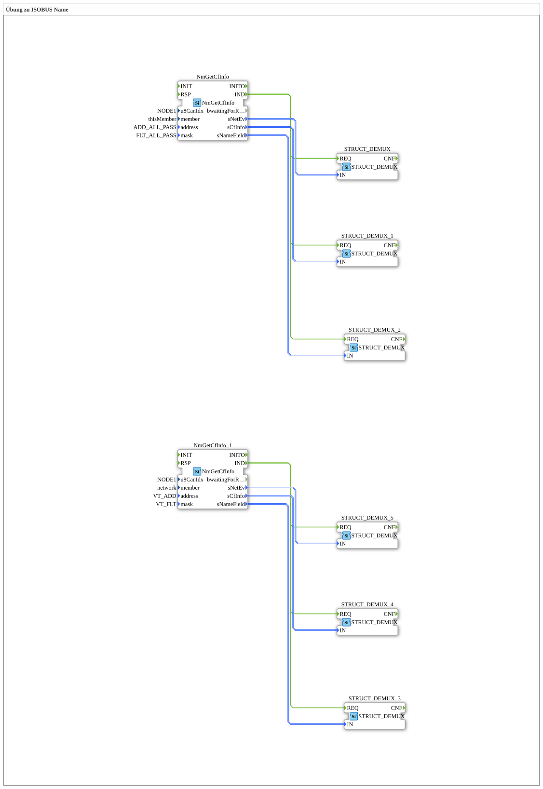

# Exercise_123: ISOBUS Name Exercise

This article describes the logiBUS® exercise `Uebung_123`

----

## Overview

This section shows how to restrict the network scan to specific device types.

By specifying a target address (`VT_ADD`) and a mask (`VT_FLT`) in the function block `NmGetCfInfo_1`, the program is configured to respond only to devices that match the profile of a "Virtual Terminal" (VT). All other bus participants (e.g., joysticks or task controllers) are ignored by this function block. This allows for a clean separation of communication logic according to functional groups.

## Pattern with `NmGetCfInfo` (IND/RSP)

`NmGetCfInfo` reports a network event with `IND` and then waits for `RSP` (`bwaitingForRSP = TRUE`). Only after `RSP` does the block deliver the next event from its internal queue. This exercise is therefore built as follows:

- `NmGetCfInfo.sNetEv` goes to `STRUCT_DEMUX`, whose `CNF` goes to `NmGetCfInfo.RSP` (display only, the connection is hidden in the IDE).

State of the conversion: 2026-11-17, not yet tested on hardware.
