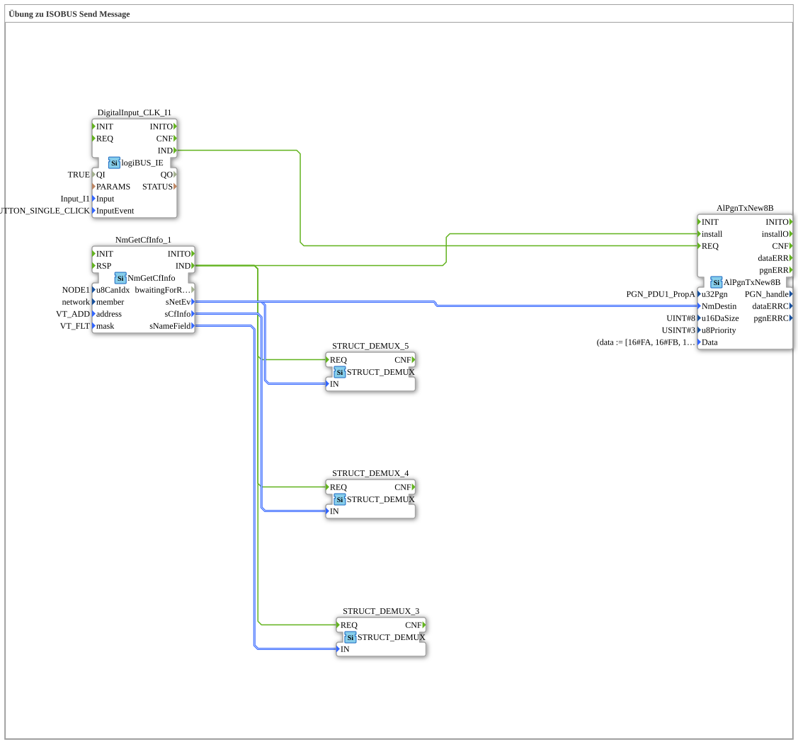

# Exercise_124: ISOBUS Send Message Exercise

This article describes the logiBUS® exercise `Uebung_124`. Here, we move beyond standard messages and send custom data packets (PGNs) to a specific partner in the network

----

## Objective of the Exercise

Using the function block `AlPgnTxNew8B`. It demonstrates how to define a proprietary message (Proprietary PGN) and send it to a specific ECU.

-----

## Description and Components

The subapplication `Uebung_124.SUB` combines participant search with a send function block.

### Function Blocks (FBs)

- **`NmGetCfInfo_1`**: Searches for the target partner (here, a virtual terminal).
- **`AlPgnTxNew8B`**: The send block for 8-byte messages.
- **Parameters**:
- `u32Pgn`: The message number (here, `61184` = Proprietary A).
- `Data`: The message content (8 bytes of hexadecimal data).

-----

## Functionality

1. First, `NmGetCfInfo` identifies the partner and returns its network identity (`NmDestin`).
2. The `IND` event registers the transmit module once in the system (`install`).
3. Each click of the physical button **I1** now triggers the `REQ` input.
4. The controller then sends the predefined data packet directly to the selected partner.

This forms the basis for manufacturer-specific communication between the tractor and implement.

## Pattern with `NmGetCfInfo` (IND/RSP)

`NmGetCfInfo` reports a network event with `IND` and then waits for `RSP` (`bwaitingForRSP = TRUE`). Only after `RSP` does the block deliver the next event from its internal queue. This exercise is therefore built as follows:

- `IND` triggers `STRUCT_DEMUX` (`sNetEv`). Its `CNF` goes to `NetEv_Install.REQ`, `eNetEvent` to `NetEv_Install.eNetEvent`.
- The sub-application `NetEv_Install` (`MyLib::sys::NetEv_Install_Filter`) filters by event: for `Active` and `NewAddress` it outputs `INSTALL` (only the first time, afterwards `RSP`), all other events go directly to `RSP`. Event numbers from 7 on also end up at `RSP`.
- `installO` goes to `NetEv_Install.SET` and to `RSP`, `pgnERR` also goes to `RSP`.
- `INIT` stays unconnected (`EInit`), so the replay of all known events is triggered at start.
- All connections to `RSP` are hidden in the IDE.

State of the conversion: 2026-11-17, not yet tested on hardware. Open is whether the PGN still arrives after the partner logs off and on again, because it is installed only once per deploy.
