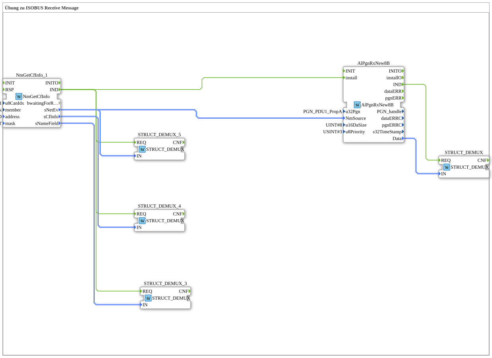

# Exercise_130: ISOBUS Receive Message Exercise

This article describes the logiBUS® exercise `Uebung_130`. It demonstrates the counterpart to sending: the targeted reception of manufacturer-specific messages

----

## Objective of the Exercise

Using the function block `AlPgnRxNew8B`. It demonstrates how to listen for a specific message (PGN) from a particular partner and evaluate its content for your own program.

-----

## Description and Components

In `Uebung_130.SUB`, a receive filter for a manufacturer-specific PGN is configured.

### Function Blocks (FBs)

- **`NmGetCfInfo_1`**: Identifies the message sender (source).
- **`AlPgnRxNew8B`**: The receive block. It filters all CAN messages and only allows the matching PGN to pass through.
- **`STRUCT_DEMUX`**: Splits the received 8-byte message back into individual signals.

-----

## Functionality

1. The block is registered in the system via `install` and linked to the desired sender (`NmSource`).
2. As soon as the partner sends the matching message (PGN `61184`), the block recognizes this.
3. It fires the event `IND` (Indication) and makes the data packet available on port `Data`.
4. The demultiplexer allows the program to now respond to the message content.

This enables private communication between two specific devices on the bus without interfering with other participants.

## Pattern with `NmGetCfInfo` (IND/RSP)

`NmGetCfInfo` reports a network event with `IND` and then waits for `RSP` (`bwaitingForRSP = TRUE`). Only after `RSP` does the block deliver the next event from its internal queue. This exercise is therefore built as follows:

- `IND` triggers `STRUCT_DEMUX` (`sNetEv`). Its `CNF` goes to `NetEv_Install.REQ`, `eNetEvent` to `NetEv_Install.eNetEvent`.
- The sub-application `NetEv_Install` (`MyLib::sys::NetEv_Install_Filter`) filters by event: for `Active` and `NewAddress` it outputs `INSTALL` (only the first time, afterwards `RSP`), all other events go directly to `RSP`. Event numbers from 7 on also end up at `RSP`.
- `installO` goes to `NetEv_Install.SET` and to `RSP`, `pgnERR` also goes to `RSP`.
- `INIT` stays unconnected (`EInit`), so the replay of all known events is triggered at start.
- All connections to `RSP` are hidden in the IDE.

State of the conversion: 2026-11-17, not yet tested on hardware. Open is whether the PGN still arrives after the partner logs off and on again, because it is installed only once per deploy.
