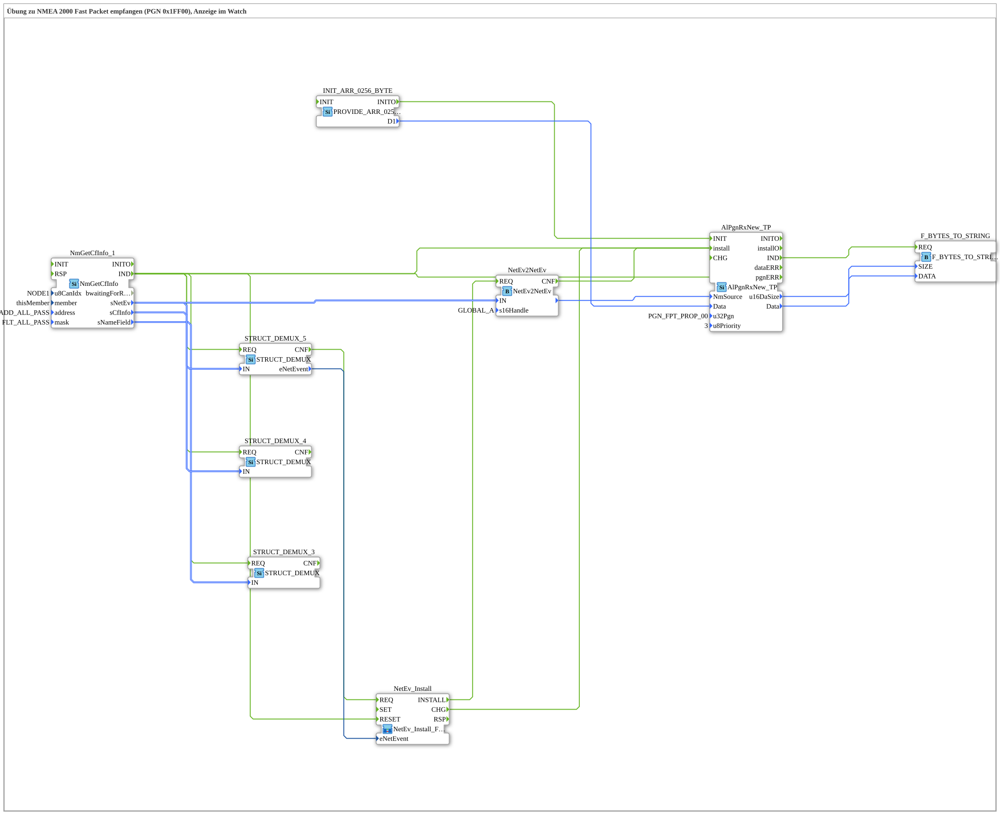

# Uebung_143: Exercise on receiving NMEA 2000 Fast Packet (PGN 0x1FF00)

This article describes the logiBUS® exercise `Uebung_143`.

----

## Objective of the Exercise

A Fast Packet message of PGN `0x1FF00` is received. The stack reassembles the frames, the application sees one message.

-----

## Description and Components

### Function Blocks (FBs)

- `AlPgnRxNew_TP`: `isobus::pgn::rx::AlPgnRxNew_TP` with `u32Pgn = PGN_FPT_PROP_00` (0x1FF00) and `u8Priority = 3`. `INIT_ARR_0256_BYTE` provides the receive buffer.
- `F_BYTES_TO_STRING`: `logiBUS::utils::dyn_arr::F_BYTES_TO_STRING`, turns the bytes into a text for the watch window.
- `NmGetCfInfo_1`, `STRUCT_DEMUX_*`, `NetEv_Install`, `NetEv2NetEv` (`GLOBAL_A`): pattern with `thisMember`.

The exercise uses the common pattern with `NmGetCfInfo` (IND/RSP): `IND` triggers `STRUCT_DEMUX`, `NetEv_Install` (`MyLib::sys::NetEv_Install_Filter`) handles the event and always acknowledges with `RSP` (the RSP connections are hidden in the IDE). `INIT` is left unconnected as `EInit`.

-----

## Sequence and Operation

1. When all frames have arrived, `AlPgnRxNew_TP` reports the message with `IND`.
2. In the watch, `u16DaSize = 32` is expected and the text `ABCDEFGHIJKLMNOPQRSTUVWXYZ01234` at the output of `F_BYTES_TO_STRING`.
3. If a frame is missing, there is no `IND`.
4. The counterpart is exercise 142. More on the protocol: [NMEA 2000 Fast Packet](https://meisterschulen-am-ostbahnhof-munchen-docs.readthedocs.io/projects/isobus-other-docs/en/latest/NMEA2000-Fast-Packet/).

-----

## Expected Behavior

- Sending is done with exercise 142 from a second device (expected: display as above).

No hardware results are documented: the exercise has not been tested on hardware yet. Statements about the behavior come from the comment in the exercise network and are to be read as expected.

-----

## Application Example

Reception of manufacturer-specific multi-frame messages without connection setup, where the stack does the reassembly.

