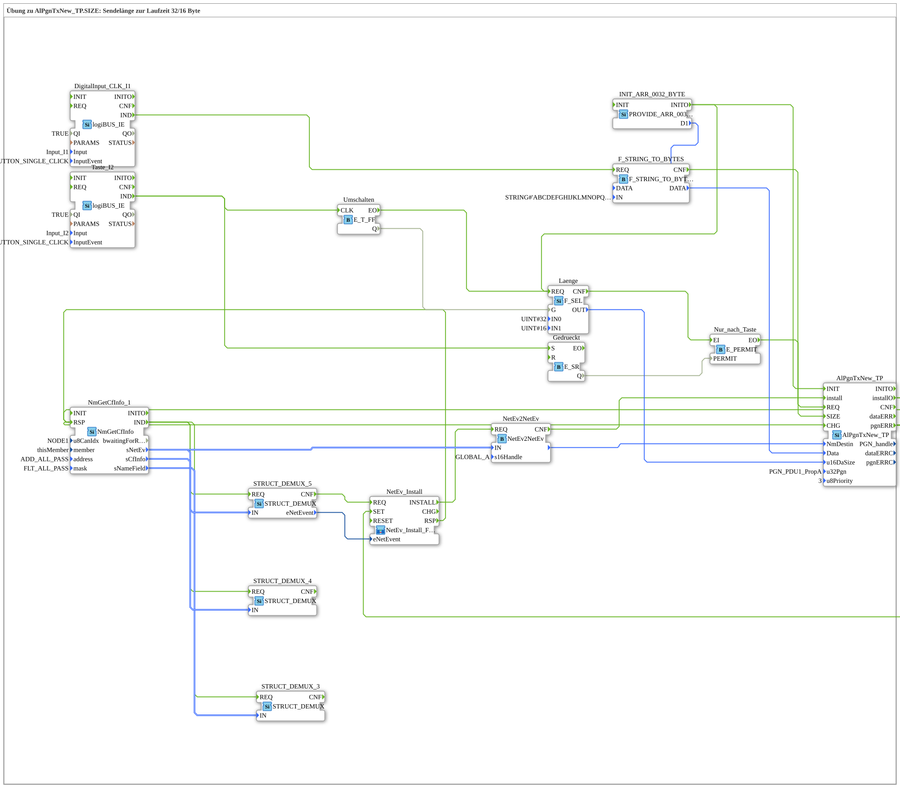

# Uebung_144: Exercise on AlPgnTxNew_TP.SIZE (send length at runtime)

This article describes the logiBUS® exercise `Uebung_144`.

----

## Objective of the Exercise

The send length of a PGN is switched between 32 and 16 bytes at runtime without reinstalling.

-----

## Description and Components

### Function Blocks (FBs)

- `AlPgnTxNew_TP`: `isobus::pgn::tx::AlPgnTxNew_TP` with `u32Pgn = PGN_PDU1_PropA` (Proprietary A) and `u8Priority = 3`. The input `SIZE` sets the send length.
- `DigitalInput_CLK_I1`: a click on `I1` sends. `Taste_I2`: a click on `I2` toggles.
- `Umschalten` (`E_T_FF`) and `Laenge` (`F_SEL`): `IN0 = UINT#32`, `IN1 = UINT#16`. With `Q = FALSE` 32 bytes apply, with `Q = TRUE` 16 bytes.
- `Gedrueckt` (`E_SR`) and `Nur_nach_Taste` (`E_PERMIT`): `SIZE` is only set after the first click on `I2`.
- `F_STRING_TO_BYTES_TERM` and `INIT_ARR_0032_BYTE`: text `ABCDEFGHIJKLMNOPQRSTUVWXYZ01234` in the 32-byte buffer.

The exercise uses the common pattern with `NmGetCfInfo` (IND/RSP): `IND` triggers `STRUCT_DEMUX`, `NetEv_Install` (`MyLib::sys::NetEv_Install_Filter`) handles the event and always acknowledges with `RSP` (the RSP connections are hidden in the IDE). `INIT` is left unconnected as `EInit`.

-----

## Sequence and Operation

1. At `install` the length is 32 bytes (`Laenge` at start). This is also the upper limit.
2. A click on `I2` switches to 16 bytes, the next one back to 32 bytes. The result goes to `AlPgnTxNew_TP.SIZE`.
3. `SIZE` must never be larger than at `install`, otherwise `pgnERR` reports the error `E_OVERFLOW`.
4. A click on `I1` sends.

-----

## Expected Behavior

- Exercise 139 serves as receiver. In the watch, `u16DaSize` is expected to alternate between 16 and 32.

No hardware results are documented: the exercise has not been tested on hardware yet. Statements about the behavior come from the comment in the exercise network and are to be read as expected.

-----

## Application Example

Messages with changing payload, for example a short variant in normal operation and a long one on demand.

