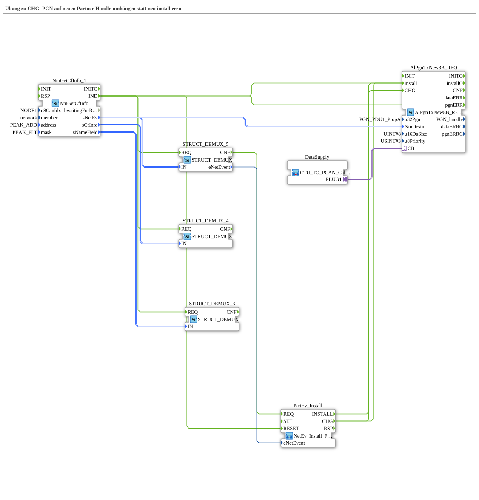

# Uebung_145: Exercise on CHG (re-attach a PGN to a new partner handle)

This article describes the logiBUS® exercise `Uebung_145`.

----

## Objective of the Exercise

If the partner logs on again after a dropout with a different handle, the existing transmit PGN is re-attached instead of reinstalled.

-----

## Description and Components

### Function Blocks (FBs)

- `NmGetCfInfo_1`: `member = network`, `address = PEAK_ADD`, `mask = PEAK_FLT`, observes the partner (PEAK).
- `AlPgnTxNew8B_REQ`: `isobus::pgn::tx::AlPgnTxNew8B_REQ` with `u32Pgn = PGN_PDU1_PropA`, `u16DaSize = 8`, `u8Priority = 3`. The new input `CHG` re-attaches the PGN.
- `DataSupply`: `MyLib::sys::CTU_TO_PCAN_Callback`, supplies the data.
- `NetEv_Install` (`NetEv_Install_Filter`): has the new output `CHG`, which fires before `RSP`.

The exercise uses the common pattern with `NmGetCfInfo` (IND/RSP): `IND` triggers `STRUCT_DEMUX`, `NetEv_Install` (`MyLib::sys::NetEv_Install_Filter`) handles the event and always acknowledges with `RSP` (the RSP connections are hidden in the IDE). `INIT` is left unconnected as `EInit`.

-----

## Sequence and Operation

1. The first `Active` triggers `install`.
2. If the partner logs off (`Inactive`) and on again (`Active`, possibly with a different handle), `NetEv_Install.CHG` triggers the input `AlPgnTxNew8B_REQ.CHG` with the new `NmDestin`. Then `RSP` follows.

-----

## Expected Behavior

- Unplug and replug PEAK: the PGN must arrive again afterwards (expected).

No hardware results are documented: the exercise has not been tested on hardware yet. Statements about the behavior come from the comment in the exercise network and are to be read as expected.

-----

## Application Example

Communication with a partner that restarts during operation or changes its address.

