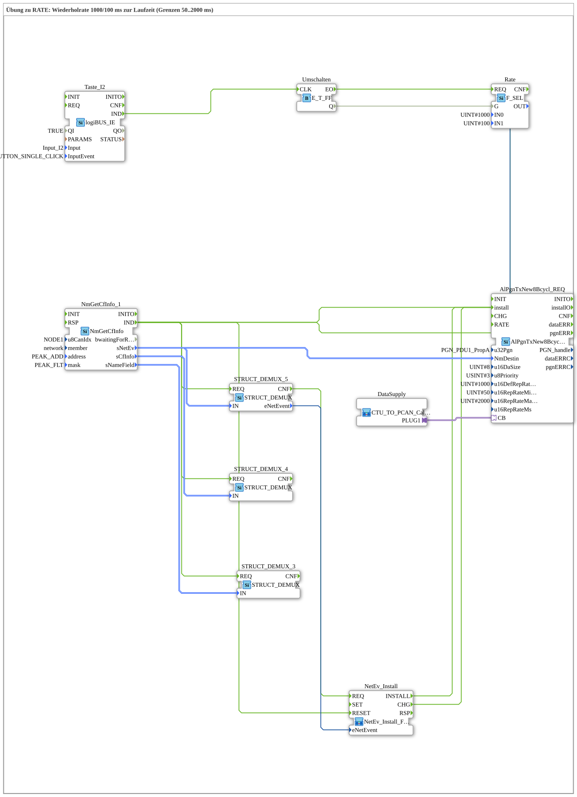

# Uebung_146: Exercise on RATE (repetition rate at runtime)

This article describes the logiBUS® exercise `Uebung_146`.

----

## Objective of the Exercise

The repetition rate of a cyclically sent PGN is switched between 1000 and 100 ms at runtime. The limits are set at `install`.

-----

## Description and Components

### Function Blocks (FBs)

- `AlPgnTxNew8Bcycl_REQ`: `isobus::pgn::tx::AlPgnTxNew8Bcycl_REQ` with `u32Pgn = PGN_PDU1_PropA`, `u16DaSize = 8`, `u16DefRepRate = 1000`, `u16RepRateMin = 50` and `u16RepRateMax = 2000`.
- `Taste_I2`, `Umschalten` (`E_T_FF`), `Rate` (`F_SEL`): `IN0 = UINT#1000`, `IN1 = UINT#100`. The result goes to `RATE` (`u16RepRateMs`).
- `DataSupply` (`CTU_TO_PCAN_Callback`), `NmGetCfInfo_1` (`network`, `PEAK_ADD`/`PEAK_FLT`), `NetEv_Install`: as in exercise 145.

The exercise uses the common pattern with `NmGetCfInfo` (IND/RSP): `IND` triggers `STRUCT_DEMUX`, `NetEv_Install` (`MyLib::sys::NetEv_Install_Filter`) handles the event and always acknowledges with `RSP` (the RSP connections are hidden in the IDE). `INIT` is left unconnected as `EInit`.

-----

## Sequence and Operation

1. The new inputs `u16RepRateMin` and `u16RepRateMax` (default 0 = off) limit the rate. For `RATE` both must be non-zero at `install`, otherwise `pgnERR` reports the error `E_CONFIG`.
2. Start with 1000 ms. A click on `I2` switches to 100 ms, the next one back to 1000 ms.
3. A value outside 50 to 2000 ms results in `pgnERR` with `E_VALUE_WRONG`.

-----

## Expected Behavior

- After the click a bus trace shows the changed spacing of the messages (expected).

No hardware results are documented: the exercise has not been tested on hardware yet. Statements about the behavior come from the comment in the exercise network and are to be read as expected.

-----

## Application Example

A message that is sent slowly in normal operation and faster on demand, without the bus load being able to rise without limit.

