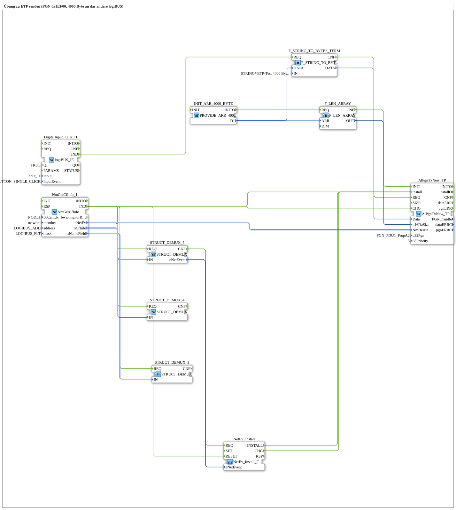

# Uebung_149: Übung zu ETP senden (PGN 0x1EF00, 4000 Byte an das andere logiBUS)

This article describes the 4diac IDE sub-application Uebung_149 (Übung zu ETP senden (PGN 0x1EF00, 4000 Byte an das andere logiBUS)).

----

## Objective of the Exercise

The main objective of this exercise is to implement the following requirement: **Übung zu ETP senden (PGN 0x1EF00, 4000 Byte an das andere logiBUS)**

-----

## Description and Components

The exercise consists of the sub-application Uebung_149.SUB, which uses the following function block structure:

### Instantiated Function Blocks (FBs)

- **STRUCT_DEMUX_3**: Instance of type eclipse4diac::convert::STRUCT_DEMUX.
- **NmGetCfInfo_1**: Instance of type isobus::pgn::NmGetCfInfo.
  - Parameter u8CanIdx = NODE1
  - Parameter member = network
  - Parameter address = LOGIBUS_ADD
  - Parameter mask = LOGIBUS_FLT
- **STRUCT_DEMUX_4**: Instance of type eclipse4diac::convert::STRUCT_DEMUX.
- **STRUCT_DEMUX_5**: Instance of type eclipse4diac::convert::STRUCT_DEMUX.
- **INIT_ARR_4000_BYTE**: Instance of type eclipse4diac::convert::providers::PROVIDE_ARR_4000_BYTE.
- **F_LEN_ARRAY**: Instance of type eclipse4diac::utils::arrays::F_LEN_ARRAY.
- **F_STRING_TO_BYTES_TERM**: Instance of type logiBUS::utils::dyn_arr::F_STRING_TO_BYTES_TERM.
  - Parameter IN = STRING#'ETP-Test 4000 Byte'
- **AlPgnTxNew_TP**: Instance of type isobus::pgn::tx::AlPgnTxNew_TP.
  - Parameter u32Pgn = PGN_PDU1_PropA2
  - Parameter u8Priority = 3
- **DigitalInput_CLK_I1**: Instance of type logiBUS::io::DI::logiBUS_IE.
  - Parameter QI = TRUE
  - Parameter Input = Input_I1
  - Parameter InputEvent = BUTTON_SINGLE_CLICK
- **NetEv_Install**: Nested sub-application (SubApp) MyLib::sys::NetEv_Install_Filter.

The exercise uses the common pattern with `NmGetCfInfo` (IND/RSP): `IND` triggers `STRUCT_DEMUX`, `NetEv_Install` handles the event and acknowledges with `RSP`.

-----

## Sequence and expected behavior (from the comment in the network)

- ETP senden: PGN PropA2 0x1EF00, 4000 Byte an das andere logiBUS
- Mehr als 1785 Byte gehen per ETP (Extended Transport Protocol). Das geht nur an EINEN Empfänger, nicht global.
- Partner: NmGetCfInfo mit network + Filter LOGIBUS_ADD/LOGIBUS_FLT (Hersteller 1116, Funktion 128).
- I1 Klick sendet: Text ETP-Test 4000 Byte, dann 16#00, Rest 16#FF. Den Stack wählt TP oder ETP selbst.
- Gegenstück: Übung 149b (oder 149c mit zu kleinem Puffer). Nicht 0x1F000-0x1FFFF: das ist Fast Packet.
- Firmware ab LOGIBUS 24534469 auf BEIDEN Geräten.

Note: The exercise has not been tested on hardware yet. The description comes from the sub-application and its comment, the behavior is to be read as expected.

-----

## Summary

Exercise Uebung_149 demonstrates the modular IEC 61499 architecture in 4diac IDE.
