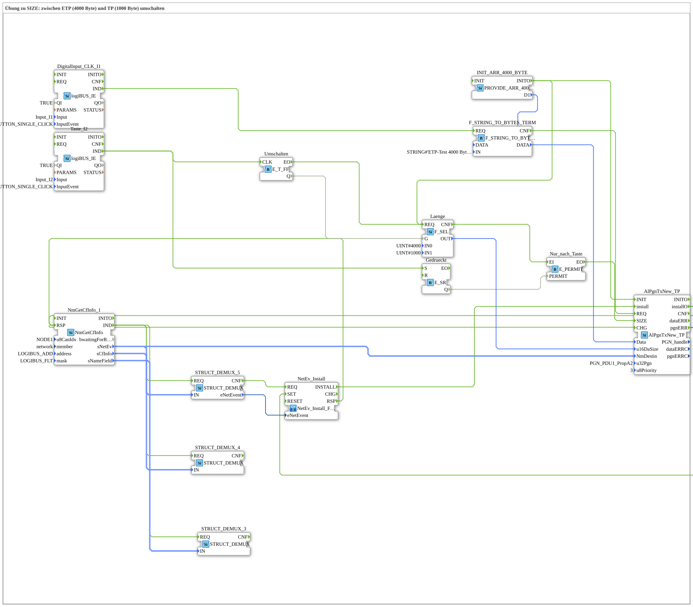

# Uebung_149d: Übung zu SIZE: zwischen ETP (4000 Byte) und TP (1000 Byte) umschalten

This article describes the 4diac IDE sub-application Uebung_149d (Übung zu SIZE: zwischen ETP (4000 Byte) und TP (1000 Byte) umschalten).

----

## Objective of the Exercise

The main objective of this exercise is to implement the following requirement: **Übung zu SIZE: zwischen ETP (4000 Byte) und TP (1000 Byte) umschalten**

-----

## Description and Components

The exercise consists of the sub-application Uebung_149d.SUB, which uses the following function block structure:

### Instantiated Function Blocks (FBs)

- **STRUCT_DEMUX_3**: Instance of type eclipse4diac::convert::STRUCT_DEMUX.
- **NmGetCfInfo_1**: Instance of type isobus::pgn::NmGetCfInfo.
  - Parameter u8CanIdx = NODE1
  - Parameter member = network
  - Parameter address = LOGIBUS_ADD
  - Parameter mask = LOGIBUS_FLT
- **STRUCT_DEMUX_4**: Instance of type eclipse4diac::convert::STRUCT_DEMUX.
- **STRUCT_DEMUX_5**: Instance of type eclipse4diac::convert::STRUCT_DEMUX.
- **INIT_ARR_4000_BYTE**: Instance of type eclipse4diac::convert::providers::PROVIDE_ARR_4000_BYTE.
- **F_STRING_TO_BYTES_TERM**: Instance of type logiBUS::utils::dyn_arr::F_STRING_TO_BYTES_TERM.
  - Parameter IN = STRING#'ETP-Test 4000 Byte'
- **AlPgnTxNew_TP**: Instance of type isobus::pgn::tx::AlPgnTxNew_TP.
  - Parameter u32Pgn = PGN_PDU1_PropA2
  - Parameter u8Priority = 3
- **DigitalInput_CLK_I1**: Instance of type logiBUS::io::DI::logiBUS_IE.
  - Parameter QI = TRUE
  - Parameter Input = Input_I1
  - Parameter InputEvent = BUTTON_SINGLE_CLICK
- **Taste_I2**: Instance of type logiBUS::io::DI::logiBUS_IE.
  - Parameter QI = TRUE
  - Parameter Input = Input_I2
  - Parameter InputEvent = BUTTON_SINGLE_CLICK
- **Umschalten**: Instance of type iec61499::events::E_T_FF.
- **Laenge**: Instance of type iec61131::selection::F_SEL.
  - Parameter IN0 = UINT#4000
  - Parameter IN1 = UINT#1000
- **Gedrueckt**: Instance of type iec61499::events::E_SR.
- **Nur_nach_Taste**: Instance of type iec61499::events::E_PERMIT.
- **NetEv_Install**: Nested sub-application (SubApp) MyLib::sys::NetEv_Install_Filter.

The exercise uses the common pattern with `NmGetCfInfo` (IND/RSP): `IND` triggers `STRUCT_DEMUX`, `NetEv_Install` handles the event and acknowledges with `RSP`.

-----

## Sequence and expected behavior (from the comment in the network)

- SIZE: zwischen ETP (4000 Byte) und TP (1000 Byte) umschalten, PGN PropA2 0x1EF00
- install mit 4000 Byte. I2 Klick schaltet um: 1000 Byte (TP), dann wieder 4000 Byte (ETP).
- I1 Klick sendet. Der Stack wählt TP oder ETP selbst nach der Länge.
- Partner wie Übung 149 (Filter LOGIBUS_ADD/LOGIBUS_FLT). Empfänger: Übung 149b, Watch u16DaSize (1000 bzw. 4000).
- Firmware ab LOGIBUS 24534469 auf BEIDEN Geräten.

Note: The exercise has not been tested on hardware yet. The description comes from the sub-application and its comment, the behavior is to be read as expected.

-----

## Summary

Exercise Uebung_149d demonstrates the modular IEC 61499 architecture in 4diac IDE.
