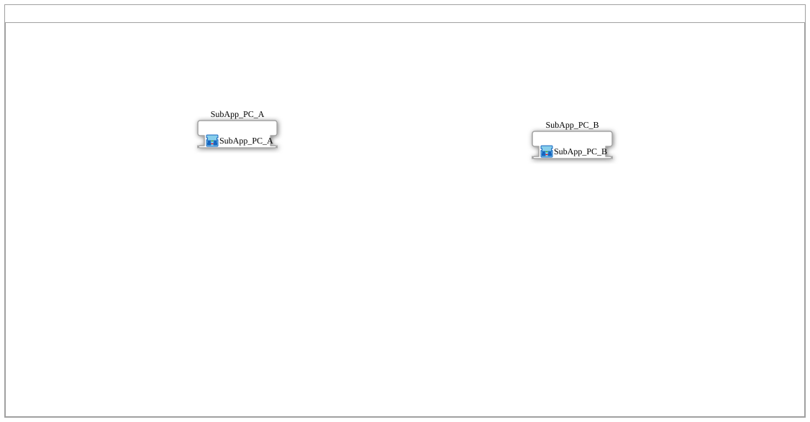

# Training_16_OPC_UA_RES: Reading and Writing Variables via CLIENT — Two Devices

* * * * * * * * * *

## Introduction

`Training_16_OPC_UA_RES` implements the "variables via CLIENT" example from `opcua.adoc` on two devices: when `Input_I1` is pressed, device A writes the value 42 with [`CLIENT_1_0`](https://meisterschulen-am-ostbahnhof-munchen-docs.readthedocs.io/projects/4diac-library-reference-docs/en/latest/Bibliotheken/StandardLibraries/net/CLIENT_1_0/) to the node `Increment` on device B and then reads the node `Incremented` of device B with [`CLIENT_0_1`](https://meisterschulen-am-ostbahnhof-munchen-docs.readthedocs.io/projects/4diac-library-reference-docs/en/latest/Bibliotheken/StandardLibraries/net/CLIENT_0_1/) (43 according to the SubApp comment). Device B subscribes to `Increment` locally, adds 1 with [`F_ADD`](https://meisterschulen-am-ostbahnhof-munchen-docs.readthedocs.io/projects/4diac-library-reference-docs/en/latest/Bibliotheken/StandardLibraries/iec61131-3/arithmetic/F_ADD/) and publishes the result locally to `Incremented`.

The training is the two-device counterpart of `L16` in `test_AX/Meins/OPC_UA_Lokal`.

## System Structure

Device A (`FORTE_PC_A`, `MGR_ID` = `PC_A`, station 11, `192.168.1.11`) with `EMB_RES_A`, device B (`FORTE_PC_B`, `MGR_ID` = `PC_B`, station 12, `192.168.1.12`) with `EMB_RES_B`, connected via the `Ethernet` segment. Each resource contains only `E_TRIG` (`EVENTTYPE` = `'EInit'`) triggered by `START.COLD`; all logic lives in the SubApps.

## SubApps Used

| SubApp | Device | Content |
|---|---|---|
| [`SubApp_PC_A`](./SubApp_PC_A_Training_16_network.svg) | A (`192.168.1.11`) | `TASTER_I1` ([`logiBUS_IE`](https://meisterschulen-am-ostbahnhof-munchen-docs.readthedocs.io/projects/4diac-library-reference-docs/en/latest/Bibliotheken/ExternalLibraries/logiBUS/io/DI/logiBUS_IE/): `QI` = `TRUE`, `Input` = `Input_I1`, `InputEvent` = `BUTTON_PRESS_DOWN`), `WRITE_INC` ([`CLIENT_1_0`](https://meisterschulen-am-ostbahnhof-munchen-docs.readthedocs.io/projects/4diac-library-reference-docs/en/latest/Bibliotheken/StandardLibraries/net/CLIENT_1_0/): `QI` = `TRUE`, `ID` = `T16_INC_CLIENT_WRITE`, `SD_1` = `INT#42`), `READ_INCD` ([`CLIENT_0_1`](https://meisterschulen-am-ostbahnhof-munchen-docs.readthedocs.io/projects/4diac-library-reference-docs/en/latest/Bibliotheken/StandardLibraries/net/CLIENT_0_1/): `QI` = `TRUE`, `ID` = `T16_INCD_CLIENT_READ`), `RESULT_TO_DINT` ([`F_INT_TO_DINT`](https://meisterschulen-am-ostbahnhof-munchen-docs.readthedocs.io/projects/4diac-library-reference-docs/en/latest/Bibliotheken/StandardLibraries/iec61131-3/conversion/INT/F_INT_TO_DINT/)) |
| [`SubApp_PC_B`](./SubApp_PC_B_Training_16_network.svg) | B (`192.168.1.12`) | `INCREMENT` ([`SUBSCRIBE_1`](https://meisterschulen-am-ostbahnhof-munchen-docs.readthedocs.io/projects/4diac-library-reference-docs/en/latest/Bibliotheken/StandardLibraries/net/SUBSCRIBE_1/): `QI` = `TRUE`, `ID` = `T16_INC_READ`), `TO_DINT` ([`F_INT_TO_DINT`](https://meisterschulen-am-ostbahnhof-munchen-docs.readthedocs.io/projects/4diac-library-reference-docs/en/latest/Bibliotheken/StandardLibraries/iec61131-3/conversion/INT/F_INT_TO_DINT/)), `F_ADD` ([`F_ADD`](https://meisterschulen-am-ostbahnhof-munchen-docs.readthedocs.io/projects/4diac-library-reference-docs/en/latest/Bibliotheken/StandardLibraries/iec61131-3/arithmetic/F_ADD/): `IN2` = `DINT#1`), `TO_INT` ([`F_DINT_TO_INT`](https://meisterschulen-am-ostbahnhof-munchen-docs.readthedocs.io/projects/4diac-library-reference-docs/en/latest/Bibliotheken/StandardLibraries/iec61131-3/conversion/DINT/F_DINT_TO_INT/)), `INCREMENTED` ([`PUBLISH_1`](https://meisterschulen-am-ostbahnhof-munchen-docs.readthedocs.io/projects/4diac-library-reference-docs/en/latest/Bibliotheken/StandardLibraries/net/PUBLISH_1/): `QI` = `TRUE`, `ID` = `T16_INCD_WRITE`) |

## OPC-UA Address Space

The IDs come from `myOpcUaAddresses.gcf`; the stations `PC_A`/`PC_B` are defined only there, the OPC-UA IDs are computed with the functions of the `MyLib_OPC` library. Structure and computation: [OPC-UA addresses](../OPC_UA_Adressen.md).

| Constants | Node | Meaning |
|---|---|---|
| `T16_INC_CLIENT_WRITE / T16_INC_READ` | `/Objects/T16/Increment,1:s=T16_Increment` | Node on B; A writes via `CLIENT` (`WRITE` with B's endpoint), B reads locally (`READ`) |
| `T16_INCD_WRITE / T16_INCD_CLIENT_READ` | `/Objects/T16/Incremented,1:s=T16_Incremented` | Node on B; B writes locally (`WRITE`), A reads via `CLIENT` (`READ` with B's endpoint) |

## Program Flow and Connections

1. **`SubApp_PC_A`** (device A), event connections:

    1. `TASTER_I1.IND` → `WRITE_INC.REQ`
    2. `WRITE_INC.CNF` → `READ_INCD.REQ`
    3. `TASTER_I1.INITO` → `WRITE_INC.INIT`
    4. `WRITE_INC.INITO` → `READ_INCD.INIT`
    5. `READ_INCD.CNF` → `RESULT_TO_DINT.REQ`

2. **`SubApp_PC_A`** (device A), data connections:

    1. `READ_INCD.RD_1` → `RESULT_TO_DINT.IN`

3. **`SubApp_PC_B`** (device B), event connections:

    1. `INCREMENT.IND` → `TO_DINT.REQ`
    2. `TO_DINT.CNF` → `F_ADD.REQ`
    3. `F_ADD.CNF` → `TO_INT.REQ`
    4. `TO_INT.CNF` → `INCREMENTED.REQ`
    5. `INCREMENT.INITO` → `INCREMENTED.INIT`

4. **`SubApp_PC_B`** (device B), data connections:

    1. `INCREMENT.RD_1` → `TO_DINT.IN`
    2. `TO_DINT.OUT` → `F_ADD.IN1`
    3. `F_ADD.OUT` → `TO_INT.IN`
    4. `TO_INT.OUT` → `INCREMENTED.SD_1`

## Technical Notes

- **Write, then read**: `WRITE_INC.CNF` triggers `READ_INCD.REQ`; reading `Incremented` starts only after the write has been confirmed. **Limitation:** This only confirms the write to B, not that B has already incremented and published `Incremented`. The first read may therefore still return the old value; a read only after an acknowledgement from B would be cleaner.
- **INIT chain on A**: `TASTER_I1.INITO` → `WRITE_INC.INIT` → `READ_INCD.INIT`.
- **Type conversion**: on B, `INT` is converted to `DINT` with `F_INT_TO_DINT`, 1 is added (`IN2` = `DINT#1`) and the result is converted back with `F_DINT_TO_INT`; on A the value read is converted to `DINT` with `F_INT_TO_DINT`.

## Note

- **Not tested on the device.** `Training_13_OPC_UA_RES` through `Training_18_OPC_UA_RES` have not yet been run on a device. This page describes only what is contained in `test_Training_16_OPC_UA.sys`, `SubApp_PC_A.SUB`, `SubApp_PC_B.SUB` and `myOpcUaAddresses.gcf`; whether the examples run as described has not been verified.
- Initialization comes from the resources: in `EMB_RES_A` and `EMB_RES_B`, `START.COLD` feeds `E_TRIG` (`EVENTTYPE = 'EInit'`), which triggers the initialization (`EInit`) of the application. That is why the first block of each chain has no connection of its own to its `INIT` input in the SubApp.

## Learning Objectives

- Writing a node of another device with `CLIENT_1_0` and reading it with `CLIENT_0_1`.
- Executing write and read access one after the other via `CNF`.

## Summary

`Training_16_OPC_UA_RES` is the "variables via CLIENT" example from `opcua.adoc` on two devices: A writes 42 to `Increment` and reads `Incremented` from B, B adds 1.

---

### 🌐 Related Topic Subpages on ms-muc-docs.de

- [🌐 Eclipse 4diac IDE & Color Reference on ms-muc-docs.de](https://www.ms-muc-docs.de/iec-61499/eclipse-4diac/)
